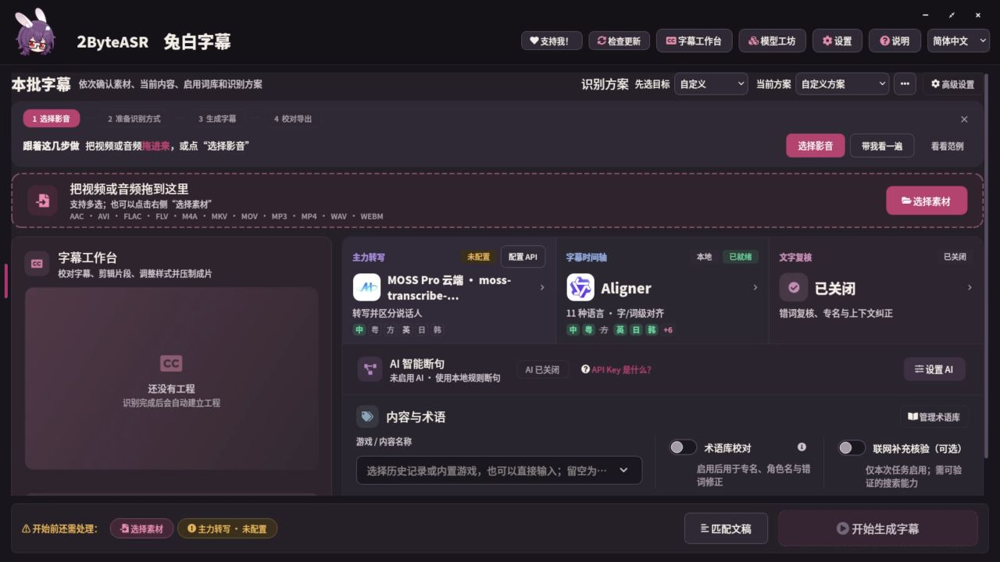

# 兔白字幕 0.8.1 Docker 版

> 2026-10-25：`main` 已是 0.8.5（Windows / Mac），Docker 版仍是 0.8.1。请按下方步骤从 `v0.8.1-docker.1` 标签构建或下载镜像。


基于公开 `v0.8.1`（`83f928c1`），通过浏览器操作原有界面，声音由 Selkies 传输。镜像标签为 `2byteasr:0.8.1-docker.1`，平台为 `linux/amd64`。

默认推荐 **MOSS Pro 云端转写 + Qwen3 本地字级对齐**。填写自己的 MOSI API Key 后，云端生成文字与说话人，本机 CPU 补充逐字时间；AI 校对和 AI 断句默认关闭，可另行配置。首次引导默认选中「云端识别 + 字级对齐」，确认后保留对齐模型；首次打开模型工坊进入「在线 API」，Qwen3 是字幕时间轴的推荐项。已有数据卷中的设置不会被改写。

本地字级时间戳可选 Qwen3-ForcedAligner、Whisper large-v3-turbo、Paraformer，另有日语 CTC 句首校正。离线转写保留 SenseVoice、Paraformer 和 Fun-ASR Nano。FireRed、其他 NVIDIA 专属引擎及 Apple MLX 不在这份 CPU 镜像里；0.8.1 之后新增的 MFA 等日常功能未混入。



## 启动

需要 Docker Engine 或已切到 Linux containers 的 Docker Desktop，以及 Docker Compose。平台为 **linux/amd64 / CPU**；建议给 Docker 至少 8 GB 内存，准备至少 20 GB 磁盘空间。模型按需下载，Qwen3 约 1.8 GB、日语 CTC 约 1.3 GB，不含在镜像内。

### 从源码构建

复制下面命令，构建固定发布标签：

```sh
git clone --depth 1 --branch v0.8.1-docker.1 https://github.com/NOTBAD314/2ByteASR.git 2ByteASR-docker
cd 2ByteASR-docker
docker compose up -d --build
```

需要记录精确构建提交时，先运行 `docker compose build --build-arg VCS_REF=$(git rev-parse HEAD)`，再运行 `docker compose up -d --no-build`。

### 下载预构建镜像

从 [Docker Release](https://github.com/NOTBAD314/2ByteASR/releases/tag/v0.8.1-docker.1) 下载启动包、两个镜像分片和校验文件：

- `2byteasr-0.8.1-docker-start.zip`
- `2byteasr-0.8.1-docker.1.tar.part01`
- `2byteasr-0.8.1-docker.1.tar.part02`
- `SHA256SUMS.txt`

解压启动包，把两个分片放到与 `compose.yaml` 相同的目录。GitHub 附件限制为每个小于 2 GiB，所以镜像分成两段；导入脚本先核对两段和重组文件的 SHA-256，再交给 Docker，不会下载或覆盖已有配置。

Linux（也可在支持 amd64 容器的 macOS 上构建，但本轮未验证 Apple 芯片的模拟运行）：

```sh
sh load-image.sh
docker compose up -d --no-build
```

Windows PowerShell：

```powershell
powershell -NoProfile -File .\load-image.ps1
docker compose up -d --no-build
```

若系统策略不允许运行脚本，可手动合并后核对 SHA-256，再导入：

```powershell
cmd /c copy /b 2byteasr-0.8.1-docker.1.tar.part01+2byteasr-0.8.1-docker.1.tar.part02 2byteasr-0.8.1-docker.1.tar
Get-FileHash .\2byteasr-0.8.1-docker.1.tar -Algorithm SHA256
docker load -i 2byteasr-0.8.1-docker.1.tar
docker compose up -d --no-build
```

完整镜像 SHA-256：`1c2dcb24f5d74f6dd7cd6d469c78209165b10bb754f13895c58abd81256561c5`。已持有完整 `.tar` 时直接 `docker load -i 2byteasr-0.8.1-docker.1.tar` 即可。

打开 [http://localhost:3000](http://localhost:3000)。初始化完毕后会出现兔白界面。关闭浏览器不会停止任务；关闭兔白窗口后，可用 `docker compose restart` 重新打开。

## 识别一个视频

1. 将视频放入启动目录的 `media/input`；也可用浏览器桌面的文件上传功能。
2. 在「模型工坊 → 在线 API」配置 MOSS Pro 的 API Key；在「字幕时间轴」下载 Qwen3-ForcedAligner，下载来源可以选 ModelScope。
3. 回到首页，从容器路径 `/media/input` 选择素材，确认主力转写为云端 API、字级时间戳为 Qwen3，阅读上传提示后开始。
4. 在字幕工作台编辑、保存并导出。导出目录选 `/media/output`，文件会出现在宿主机的 `media/output`。

需要离线转写时，下载 SenseVoice（约 0.9 GB），将主力改为 SenseVoice；字级时间戳继续使用 Qwen3。没有配置 Key 时不会自动调用云端。

输入路径、输出路径均使用容器路径：例如宿主机 `D:\videos` 挂载到 `/media` 后，在软件里应选 `/media`，不能填 `D:\videos`。已有 Windows 工程里的绝对素材路径需要在工作台重新关联。

## 保存在哪里

| 容器路径 | 保存内容 | 默认宿主位置 |
| --- | --- | --- |
| `/config` | 设置、API Key、工程库、日志、缓存 | Compose 的 `config` 命名卷 |
| `/models` | 模型权重 | Compose 的 `models` 命名卷 |
| `/media` | 输入视频与导出文件 | 当前目录的 `media` |

`docker compose down` 保留两个命名卷；`down -v` 会删除它们。换镜像时继续使用同一 Compose 项目名，设置、工程和模型便会保留。备份配置时复制整个 `/config`：密文 `secrets.dat` 与 `container-secrets.key` 必须一起保留。它们的保护边界是宿主机和数据卷访问权限；不要把 Windows 的 DPAPI 文件直接覆盖进容器。

## 改路径、端口和远程访问

复制 `packaging/docker/.env.example` 为启动目录的 `.env`，按需修改：

```dotenv
MEDIA_DIR=D:/videos
WEB_PORT=3000
PUID=1000
PGID=1000
```

Linux 的 PUID/PGID 填 `id -u` / `id -g` 的结果。挂载目录需允许该用户写入；启动只调整顶层模型目录和新建的 input/output 目录，不递归修改你的媒体权限。

默认只监听本机。远程机器可用 SSH 转发 `ssh -L 3000:127.0.0.1:3000 user@server`。需要开放局域网时设置 `BIND_ADDRESS=0.0.0.0` 和 `WEB_PASSWORD`；公网使用 HTTPS 反向代理和访问认证。

## 常用命令

```sh
docker compose logs -f --tail=100
docker compose restart
docker compose stop
docker compose exec -u abc twobyteasr /opt/venv/bin/python -m twobyteasr.container.models --keys qwen_aligner,ja_ctc_aligner --source MODELSCOPE
```

最后一条与模型工坊使用相同的固定版本下载及哈希校验。断网时只可使用已经准备好的模型；权重没有烘焙进镜像。

## 验证和边界

已完成：SenseVoice 真实中文识别、Qwen3 CPU 字级对齐、日语 CTC 推理冒烟、云端上传/轮询协议回环、X11 视频画面与播放、PulseAudio 实际声音、中文编辑/剪切/撤销、保存重开、四种字幕格式与 MP4 导出。云端协议验收使用本机模拟服务，未调用真实付费 API；CTC 冒烟不评价日语准确率，Whisper/Paraformer/Fun-ASR Nano 尚未逐模型跑真实样本。

完整执行记录见 [本轮计划](docs/exec-plans/completed/2026-10-19-docker-081.md)。构建成功、界面可见、模型下载、实际识别与导出分别验收；未实际跑过的模型和硬件不算已验证。CPU 的长视频识别速度取决于主机；浏览器视频是远程桌面画面，不代表导出画质。

源码沿用 GPL-3.0-only；第三方组件保留各自许可。Selkies 基础镜像的 [官方使用说明](https://docs.linuxserver.io/selkies/developer-guide/building-images/) 说明了应用启动、声音与持久化机制。
