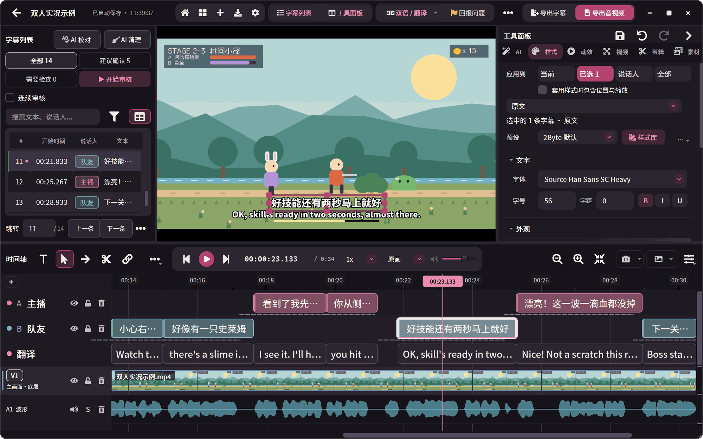
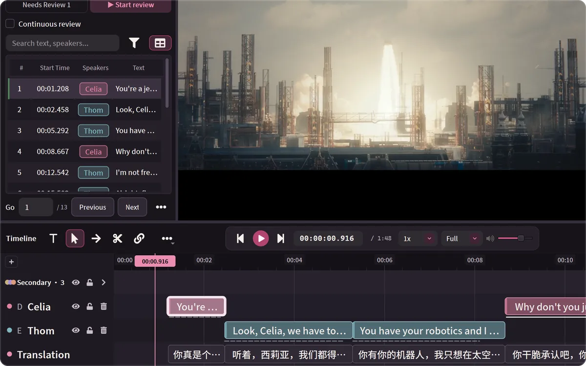
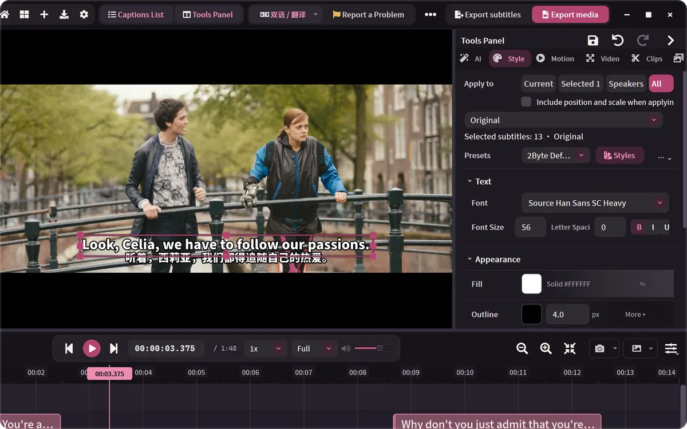
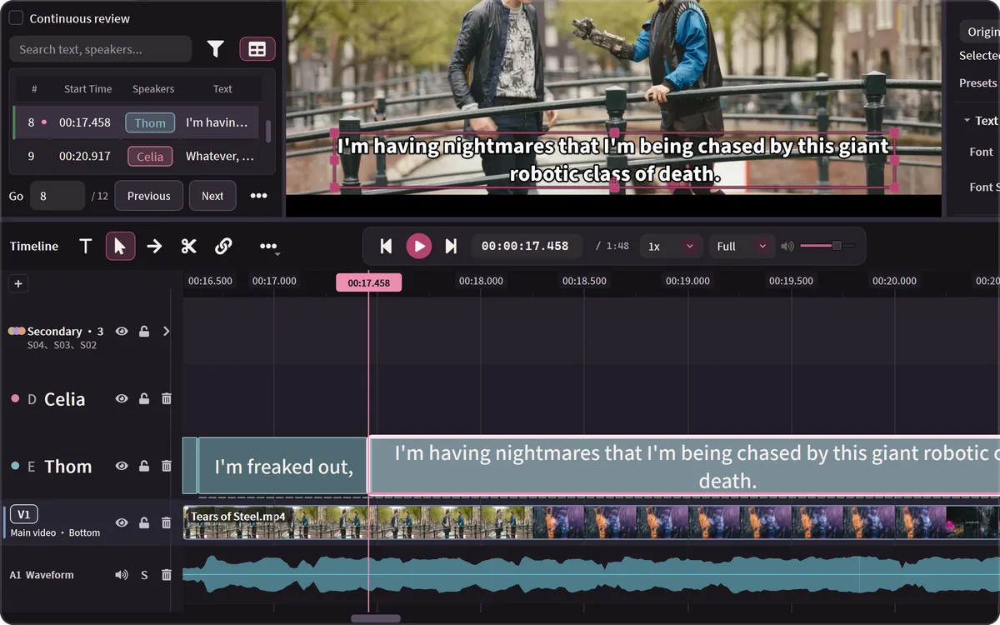
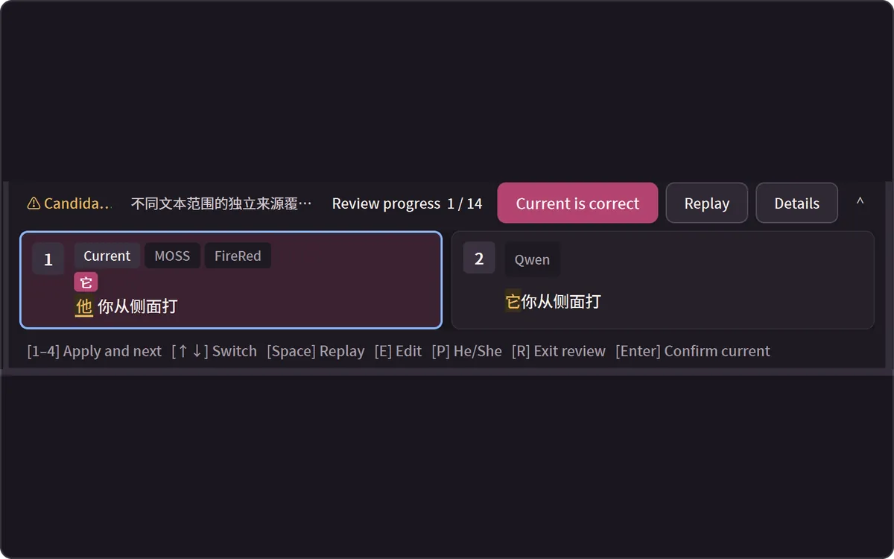
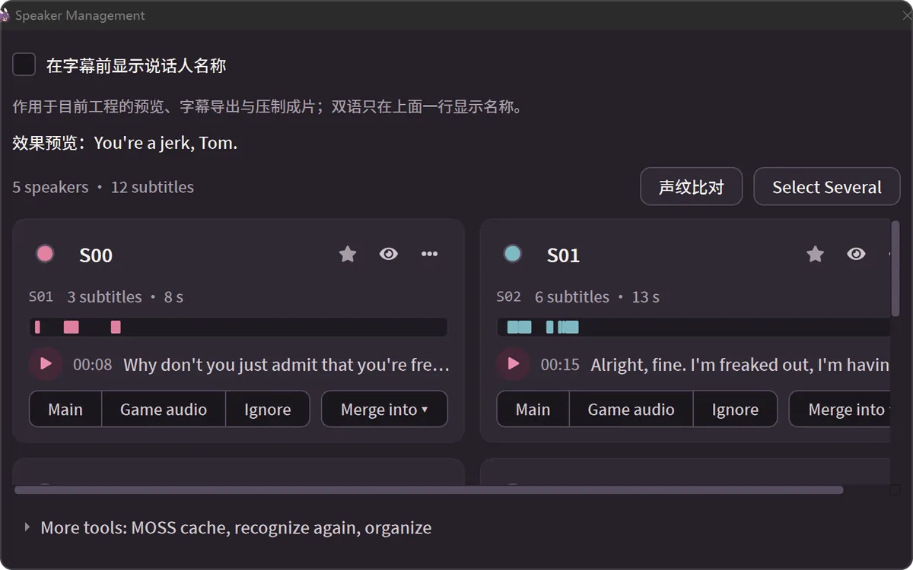
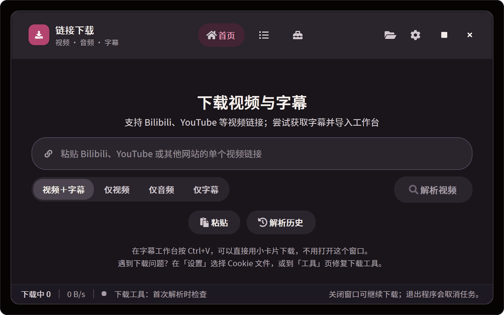
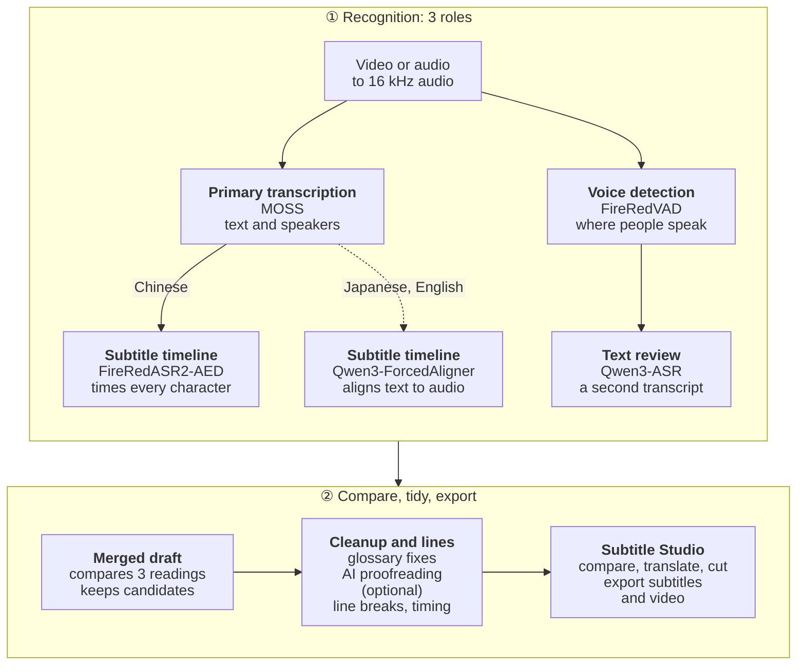

# 2ByteASR · 兔白字幕

### Subtitle editing &amp; translation workbench

Transcribe, proofread, translate, cut and render, all in one window. 
Free. Run everything on your own computer, or connect your own cloud service.

**English** · [中文](README_ZH.md) · [日本語](README_JA.md) · [한국어](README_KO.md)

Real 0.8.7 screenshot. Sample: [Tears of Steel](https://mango.blender.org/) (© Blender Foundation, [CC BY 3.0](https://creativecommons.org/licenses/by/3.0/)), transcribed locally with MOSS + Qwen3-ForcedAligner + Qwen3-ASR on an NVIDIA GPU. Speaker names were typed in Speaker Management; the Chinese translation was entered with the Studio's manual translation, without AI.

| Transcribe | Proofread | Translate | Cut | Export |
| --- | --- | --- | --- | --- |
| Locally or in the cloud, with speakers told apart | Compare models, glossary, AI proofreading | Original and translation as two layers; double-click to fill gaps | Split on word boundaries, remove pauses in one step | Subtitle files, or video with subtitles burned in |

## Download

Current release: **0.8.8** (2026-10-29).

| Your computer | Download |
| --- | --- |
| Windows 10 1809 or later, 64-bit | [2ByteASR-Setup-0.8.8.exe](https://github.com/NOTBAD314/2ByteASR/releases/download/v0.8.8/2ByteASR-Setup-0.8.8.exe), about 1.1 GB |
| Apple silicon Mac (M1 or later), macOS 14 or later | [2ByteASR-0.8.8-macos-arm64-Setup.dmg](https://github.com/NOTBAD314/2ByteASR/releases/download/v0.8.8/2ByteASR-0.8.8-macos-arm64-Setup.dmg), about 578 MB; **experimental**, no Intel build |

Save your work and close the app before installing over the current version. On Windows, in-app updating is also available from 0.6.5 onwards. See the [release notes and checksums](https://github.com/NOTBAD314/2ByteASR/releases/tag/v0.8.8), [Windows guide](docs/product-guide.en.md#installing-on-windows) and [Mac guide](docs/product-guide.en.md#installing-on-mac-experimental). The installer is not Authenticode-signed and the Mac app is not Apple-notarized. Source, licence, component and signature files are for source delivery, verification and in-app updates.

Linux: the [Docker 0.8.1 release](https://github.com/NOTBAD314/2ByteASR/releases/tag/v0.8.1-docker.1) remains available; see [Build and run](README.docker.md).

## What are you working on?

<table>
<tr>
<td width="50%" valign="top">

**Game streams and stream replays** 
One subtitle track per speaker; a glossary that remembers character names and skills; highlight candidates from Bilibili danmaku XML. 
→ [Tell speakers apart](#what-it-does) · [Glossary](docs/product-guide.en.md#everyday-studio-actions)

</td>
<td width="50%" valign="top">

**Subtitling foreign-language videos** 
Paste a YouTube, Bilibili or other link to download the video and its subtitles into a project; transcribe Japanese or English, translate with your own text AI, and export bilingual subtitles. 
→ [Link download](#what-it-does) · [Translation](#what-it-does)

</td>
</tr>
<tr>
<td width="50%" valign="top">

**Interviews, podcasts and lectures** 
Already have a script? Time each line without rewriting it. Remove speech pauses in one step; find and replace in bulk; convert between Simplified and Traditional Chinese. 
→ [Everyday Studio actions](docs/product-guide.en.md#everyday-studio-actions)

</td>
<td width="50%" valign="top">

**You already have subtitles** 
Import SRT / ASS, proofread, translate, restyle and render the video again. No speech model needed. 
→ [Input and output](docs/product-guide.en.md#input-and-output)

</td>
</tr>
</table>

## What it does

<table>
<tr>
<td width="50%" valign="top">

**Translation and bilingual subtitles** 
Translate into Simplified or Traditional Chinese, English, Japanese, Korean and more with your own text AI; double-click the translation track to fill any gap. Original and translation keep their own styles; export either or both.
</td>
<td width="50%" valign="top">

**Styles, animation and rendering** 
Fonts, outlines, positions and entrance/exit animations come as presets that need no AI. Render MP4 / MKV / MOV, the whole timeline or just the in-to-out range.
</td>
</tr>
<tr>
<td width="50%" valign="top">

**Split on word boundaries, and cut the video** 
Every word has its own timing, so the razor stops between words. On the video track, split, ripple-delete, or detect speech pauses and remove them in one go.
</td>
<td width="50%" valign="top">

**Compare what each model heard** 
Local multi-model routes let several models transcribe the same line; differing characters are highlighted with their source, and a click (or 1–4) applies one. Shown with the Chinese sample: this release lists candidates for Chinese lines.
</td>
</tr>
<tr>
<td width="50%" valign="top">

**Tell speakers apart** 
Routes that separate speakers give each person their own subtitle track. Names, colours and default styles live in one place; merge speakers that were split by mistake; everything can be undone.
</td>
<td width="50%" valign="top">

**Paste a link, get the video and its subtitles** 
YouTube, Bilibili and other single videos the downloader (yt-dlp) supports. In the Studio, press Ctrl+V to download straight to the playhead.
</td>
</tr>
</table>

Also: glossary and AI proofreading, script matching, per-speaker export, a beginner tutorial with a sample project (no models needed), 11 interface languages and 15 themes. See the [user guide](docs/product-guide.en.md).

## Before you start

- **The app is free.** Official builds cost nothing: no paid features, sign-up or subscription. To support development, see [Afdian](#support-the-author).
- **Local recognition downloads models first.** The installer contains no speech models. The first time you transcribe locally, the Model workshop downloads the models and runtime for the route you picked (the NVIDIA high-quality route is about 11 GB of models plus its runtime). After that it works offline and your media never leaves your computer.
- **Cloud recognition and AI features use your own accounts.** Cloud transcription needs an account and API key with the provider, is billed by them, and uploads your audio to them. AI segmentation, AI proofreading, translation and AI glossary building need your own text-AI service (only subtitle text is sent). You can transcribe, edit and export without any of these.
- **Not every computer runs every model.** Start here:

| Your computer | Recommended route | What you get |
| --- | --- | --- |
| Windows with an NVIDIA GPU | **Local**: MOSS + FireRedASR2-AED + Qwen3-ASR | Free and private; speakers, character timing, three models to compare |
| Windows without an NVIDIA GPU | **Cloud** (your API key), or **Light local** (SenseVoice on the CPU) | Cloud is pay-as-you-go and uploads audio; light local is free but slower, with one speaker |
| Mac with Apple silicon (experimental) | **Mac local** (MLX), **MOSS + FireRed** on the Apple GPU, or cloud | 16 GB of memory or more recommended; slower than an NVIDIA GPU |

Among cloud services, MOSS Pro cloud and Qwen-Audio 3.1 (Bailian / Qwen Cloud) separate speakers; both cloud and light local can add the local Qwen3 aligner (CPU capable) for character timing. See [Choosing a recognition route](docs/product-guide.en.md#choosing-a-recognition-route) for details.

## Quick start

1. **Install and launch** with the installer above.
2. **Choose how to transcribe.** On first launch pick "On this computer", "Cloud recognition" or "Light, on this computer"; the app downloads what that route needs, or opens "Apply for and set up an API" for your key.
3. **Add media.** Drop video or audio on the home screen, or click "Link download" and paste a video link; pick a glossary if you have one and click "Start subtitles". Videos that come with subtitles can go straight to the Studio.
4. **Edit, translate and export in Subtitle Studio.** Proofread, split and merge, translate, adjust styles, then export subtitles or render the video.

To learn the interface first, open Help → Beginner tutorial and follow the sample project. Installation, costs, updates and common questions are in the [user guide](docs/product-guide.en.md).

## Going further

<b>How a recognition plan is put together (three roles and the model list)</b>

 

A run uses up to three roles, combined to suit your media and hardware:

| Role | What it does | Typical choices |
| --- | --- | --- |
| Primary transcription | Writes the text; MOSS also separates speakers | MOSS, SenseVoice, Whisper, Qwen3-ASR, cloud services |
| Subtitle timeline | Gives every character a start and end time, so segmentation and cuts follow character boundaries | FireRedASR2-AED, Qwen3-ForcedAligner (CPU capable), Paraformer |
| Text review | Listens again with another model and lists the differences | Qwen3-ASR and other local or online options |

- **Local models:** MOSS-Transcribe-Diarize, FireRedASR2-AED, Qwen3-ASR 1.7B, SenseVoice Small, Paraformer Large, Whisper large-v3-turbo, Fun-ASR Nano, FireRedASR2-LLM, GLM-ASR-Nano, Canary-Qwen-2.5B (English), Qwen3-ForcedAligner 0.6B, and MLX Qwen3-ASR on Macs. On Windows, MOSS, FireRedASR2-AED, Qwen3-ASR 1.7B and FireRedASR2-LLM need an NVIDIA GPU.
- **Cloud transcription (your own account):** MOSS Pro cloud (MOSI), Alibaba Cloud Bailian / Qwen Cloud file transcription, iFlytek Spark-ASR 2.0, Groq Whisper, OpenAI, plus OpenRouter, Azure and custom compatible endpoints (advanced, not tested with real keys). Services that return sentence times only produce timing marked as estimated.
- Models are not bundled. The Model workshop downloads them on demand, checks every file against its SHA-256, and each model keeps its own licence ([model licence table](licenses/MODELS.md)).

<b>How a recording becomes subtitles (recognition flow)</b>

 

The chart follows the default local route on Windows with an NVIDIA GPU (MOSS + FireRedASR2-AED + Qwen3-ASR). Dashed lines apply only to Japanese and English media.

MOSS listens to the whole file, writes the text and tells the speakers apart, while FireRedVAD finds where people actually speak. FireRedASR2-AED and Qwen3-ASR then each listen again: the first times every character, the second writes another transcript. Using MOSS's sentences and speakers as the backbone, the app compares the three readings. It replaces text automatically only when the other two models agree and the change passes a safety check; other differences are left for you in the Studio's review mode. Glossary fixes and optional AI proofreading follow; line breaking uses local rules or AI, but the AI only decides where to break and cannot change the text.

Other routes keep the same roles with different models: with cloud recognition the provider writes the text and the local Qwen3-ForcedAligner can add character timing; light local (SenseVoice) only transcribes; Macs use MLX Qwen3-ASR with an aligner, or MOSS + FireRed on the Apple GPU.

- [User guide](docs/product-guide.en.md): installation, first launch, choosing a route, costs and privacy, everyday Studio actions, updates, FAQ, running from source
- [Interface tour](docs/product-demo.en.md): progress, completion, Model workshop, export, themes and more (0.7.1 interface)
- [API setup guides](docs/api-setup/README.md) (Chinese): sign-up steps and pricing notes for each cloud and text-AI provider
- [Mac notes](docs/deployment/macos-experimental.zh-CN.md) (Chinese) · [Updating](UPDATING.md) (Chinese) · [0.8.7 release notes](docs/releases/0.8.7.md) (Chinese, English, Japanese, Korean) · [Changelog](CHANGELOG.md) · [Contributing](CONTRIBUTING.md)

## Support the author

If 2ByteASR helps you, you can support its development on Afdian (爱发电): **[afdian.com/a/2byteasr](https://afdian.com/a/2byteasr)**. Sponsoring is entirely optional; every feature works without it.

## Feedback, licences and third-party components

Please report problems in [Issues](https://github.com/NOTBAD314/2ByteASR/issues) with your version, recognition route, steps to reproduce and screenshots.

Project-owned code is licensed under **GPL-3.0-only** ([English license](LICENSE), [scope](PROJECT_LICENSE.md)). Official versions are free; GPL permits commercial use, modification and paid distribution subject to its source and other conditions. Private changes need not be published. Ordinary subtitle, video and image outputs do not become GPL merely through use of this software. Third-party components keep their own licenses: Remotion, used by the high-fidelity renderer, is free for individuals and for-profit organizations of up to 3 employees, while larger for-profit organizations need its Company License; GSAP uses its standard license. See the [third-party notices](THIRD_PARTY_NOTICES.md) and [model license table](licenses/MODELS.md); distribution materials for the full installer are still being completed ([status](licenses/DISTRIBUTION-STATUS.md)).

Source: the `main` branch holds the application source. The tag `v0.8.7` is the build source of the 0.8.7 installers, and the full build inputs are in the release's `2ByteASR-Source-0.8.7.zip` (see "Source and checksums" in the [0.8.7 release notes](docs/releases/0.8.7.md#source-and-checksums)). [SOURCE_DELIVERY.md](SOURCE_DELIVERY.md) was written for 0.5.0 and has not been updated for 0.8.7.
