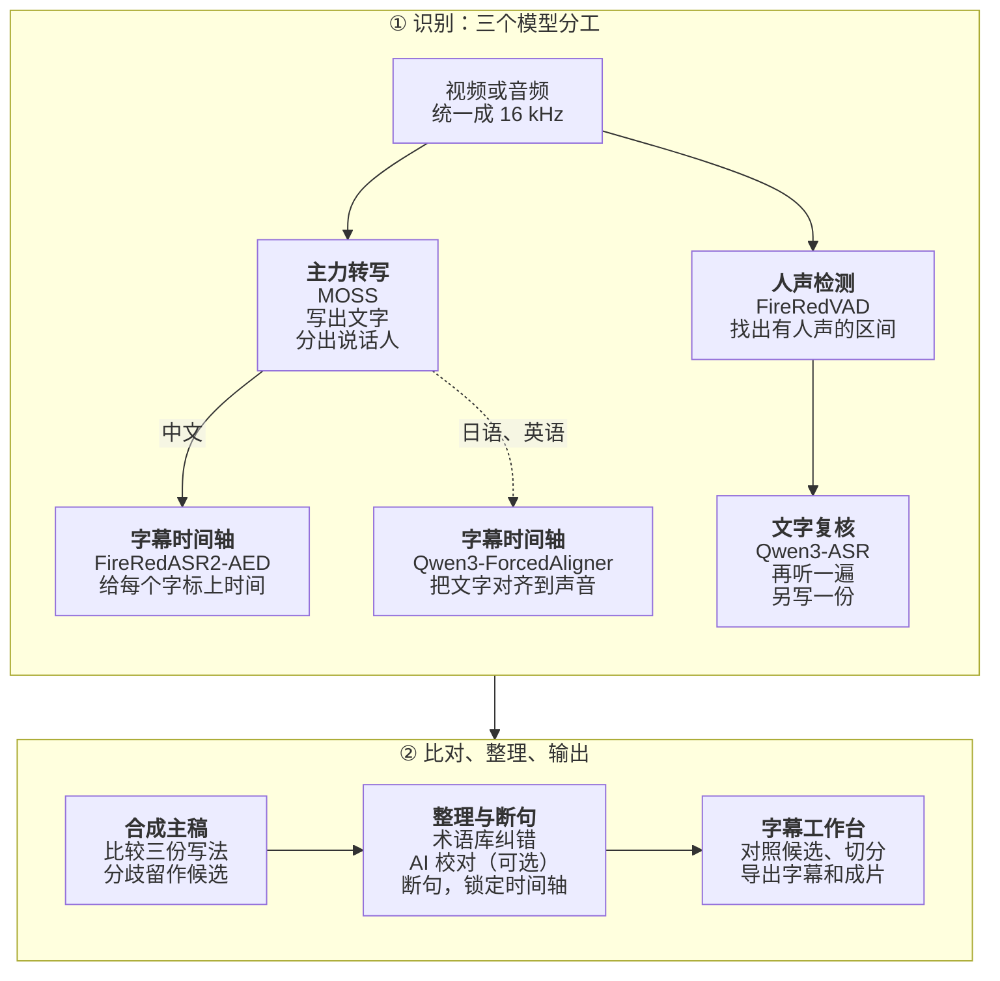

# 兔白字幕 · 2ByteASR

**不只自动出字幕：分清谁在说话、按字对准时间，在同一个窗口里改好、剪好、直接导出。**

免费的桌面字幕软件，为游戏实况、直播回放和多人对话视频而做。 
以中文为主，也支持日语和英语识别；可以全部在本机运行，也可以接入你自己的云端服务。

**中文** · [English](README_EN.md) · [日本語](README_JA.md) · [한국어](README_KO.md)

## 下载

当前版本 **0.8.1**（2026-10-18）。按你的电脑选一个安装程序：

| 你的电脑 | 下载 |
| --- | --- |
| **Windows 10 1809 或更新（64 位）** 正式版 | **[2ByteASR-Setup-0.8.1.exe](https://github.com/NOTBAD314/2ByteASR/releases/download/v0.8.1/2ByteASR-Setup-0.8.1.exe)**（约 1 GB） 安装程序没有代码签名，Windows 可能提示“未知发布者”，见 [Windows 安装](docs/product-guide.zh-CN.md#windows-安装)。 |
| **Mac：Apple 芯片（M1 及以后），macOS 15 或更新** **实验版** | **[2ByteASR-0.8.1-macos-arm64-Setup.dmg](https://github.com/NOTBAD314/2ByteASR/releases/download/v0.8.1/2ByteASR-0.8.1-macos-arm64-Setup.dmg)**（约 0.5 GB） 只在 GitHub 的虚拟 Mac 上验证过，**不支持 Intel Mac**；没有经过 Apple 公证，第一次打开见 [Mac 安装](docs/product-guide.zh-CN.md#mac-安装实验版)。 |

- **中国大陆下载慢或打不开：** 先从 GitCode 国内镜像下载 [Windows 安装程序](https://gitcode.com/Notbad314/2ByteASR/releases/download/v0.8.1/2ByteASR-Setup-0.8.1.exe) · [Mac 安装包](https://gitcode.com/Notbad314/2ByteASR/releases/download/v0.8.1/2ByteASR-0.8.1-macos-arm64-Setup.dmg)；还不行再用第三方加速站 gh-proxy：[Windows](https://gh-proxy.com/https://github.com/NOTBAD314/2ByteASR/releases/download/v0.8.1/2ByteASR-Setup-0.8.1.exe) · [Mac](https://gh-proxy.com/https://github.com/NOTBAD314/2ByteASR/releases/download/v0.8.1/2ByteASR-0.8.1-macos-arm64-Setup.dmg)。各来源的文件完全相同，可用 `SHA256SUMS.txt` 核对。
- **已经装了 0.6.5、0.7.x 或 0.8.0：** 在程序右上角“检查更新”，只下载有变化的部分。0.6.0 及更早版本：直接运行新的安装程序覆盖安装，不要先卸载。
- **其他附件不用下载。** [Releases 页面](https://github.com/NOTBAD314/2ByteASR/releases/latest)里的 `Source`、`ThirdParty`、`update`、`.sig` 等文件是给源码、许可材料和程序内更新用的。下载后可用 `SHA256SUMS.txt` 核对文件是否完整。

0.7.1 真实界面截图。示例素材是项目自制的测试卡画面和两段合成语音；字幕由本机 MOSS + FireRedASR2-AED + Qwen3-ASR 识别（NVIDIA 显卡），说话人名称“主播”“队友”是在说话人管理里改的。

## 开始前先了解

- **软件免费。** 官方版本免费提供，没有付费功能、注册或订阅。想支持开发，可以到[爱发电](#支持作者)赞助。
- **本机识别需要先下载模型。** 安装程序不包含识别模型。第一次本机识别时，程序会按你选的方案在“模型工坊”下载模型和运行环境（例如 NVIDIA 高质量方案的模型约 11 GB，另加运行环境），之后可以离线识别，影音不离开电脑。
- **云端识别和 AI 功能用你自己的账号。** 云端识别需要服务商账号和 API Key，按服务商的规则收费，音频会上传到你选的服务商。AI 断句、AI 校对、翻译和 AI 建词需要你自己的文字 AI 服务（只发送字幕文字）。不用这些，也能完成识别、编辑和导出。
- **不是每台电脑都能跑每个模型。** 先看下表：

| 你的电脑 | 推荐的识别方式 | 特点 |
| --- | --- | --- |
| Windows，有 NVIDIA 显卡 | **本机识别**：MOSS + FireRedASR2-AED + Qwen3-ASR | 免费、不上传；分说话人，有逐字时间，三个模型可对照 |
| Windows，没有 NVIDIA 显卡 | **云端识别**（自备 API Key），或 **轻量本机**（SenseVoice，用 CPU） | 云端按用量收费、要上传音频；轻量本机免费但较慢，不分说话人 |
| Mac，Apple 芯片（实验版） | **Mac 本机识别**（MLX）、**MOSS + FireRed**（Apple GPU），或云端 | 建议 16 GB 以上内存；比 NVIDIA 显卡慢 |

- 云端服务里，MOSS Pro 云端和百炼 / Qwen Cloud 的 Qwen-Audio 3.1 能分说话人。云端识别和轻量本机都能加装本机的 Qwen3 对齐模型（可用 CPU），补上逐字时间。
- Mac 的 MLX 方案是社区实现，还没在实体 Mac 上验收。
- 需要 NVIDIA 显卡的组合在开始前就会标出来，并提示可以换成哪一种方式。详细比较见[选择识别方式](docs/product-guide.zh-CN.md#选择识别方式)。

## 它能帮你做什么

- **[分清谁在说话](#分清谁在说话)。** 多人实况不用一句句标注说话人：支持说话人区分的方案会把每个人放进自己的字幕轨，改名、配色、默认样式都在一处管理，也能按说话人分开导出。
- **[按字切分字幕](#按字切分字幕也能剪视频)，不用反复对波形。** 每个字都有起止时间，切开一句时文字跟着字的边界走；时间轴上也能直接剪视频，导出的成片会照剪辑结果生成。
- **[同一句话，对照多个模型的写法](#同一句话对照多个模型的写法)。** 本机多模型方案会让几个模型各听一遍，写法不同的字会标出来，看清来源后点一下采用。
- **[术语库](#术语库整理一次下次直接用)：整理一次，下次直接用。** 角色名、招式和常见错字按游戏整理；识别时用来纠错，识别后还能拿来校对现有字幕。
- **[从直播回放里找切片候选](#从直播回放里找切片候选)。** 结合字幕和 B 站弹幕 XML，列出值得剪的片段、理由和时间范围，选好后生成剪辑。
- **[字幕、文稿、成片一起导出](#导出)。** SRT、ASS、TXT、JSON，按说话人分开的字幕，以及压好字幕的 MP4 / MKV / MOV。

## 实际操作

下面的动图和截图都录自 0.7.1 的真实窗口，没有重绘界面或识别结果。

### 分清谁在说话

- 时间轴上每位说话人一条字幕轨（见上方主图）。把字幕拖到另一条轨，就改成另一个人说的。
- 说话人管理里可以改名、设颜色和默认样式，合并被分错的说话人，把选中的字幕归给某人，或只保留某个人的字幕。所有操作都能撤销。
- **哪些方案能分说话人：** 本机 MOSS（NVIDIA 显卡或 Mac 的 Apple GPU）、MOSS Pro 云端（MOSI）、百炼 / Qwen Cloud 的 Qwen-Audio 3.1。其他方案只输出一位说话人，可以在工作台里手动分。

### 按字切分字幕，也能剪视频

- **切分字幕**（剃刀，快捷键 C）：移动时先看到切开后的前后两段，开启吸附时会停在字与字之间；切在某个字的发音中间，这个字会留在前一段。合并工具（B）能把两条字幕合成一句。都可以 Ctrl+Z 撤销。
- **没有逐字时间时**（例如只回传句段时间的云端服务），切分位置按字数比例估算，界面会标明“文字分界为估算”，提醒你试听核对。
- **剪视频**是另一件事：在视频轨上分割、删除片段或波纹删除空隙，也能自动检测口播停顿后一次删掉。字幕轨会跟着移动，导出的成片按剪辑后的时间轴生成，原始素材文件不会被改写。

### 同一句话，对照多个模型的写法

- 按 R 进入审核模式，每条字幕下列出各个模型的写法，和当前文字不同的字会标出来，并写明来自哪个模型。点一下（或按 1–4）采用，同样可以撤销。
- 只有识别时跑过多个模型才有候选：Windows 的 NVIDIA 本机方案有三份结果，Mac 的 MOSS + FireRed 有两份；只用云端或轻量本机识别时没有候选可比。

### 术语库：整理一次，下次直接用

这里有三件不同的事，可以只用其中一件：

1. **维护术语库**：按游戏或内容建词库，每条写明正确写法、别名和常见错字。内置部分游戏的参考词，只有你确认过的词条才会用来改字。也可以批量导入，或让你配置的 AI 帮忙建词（结果要你确认后才写入）。
2. **识别时套用**：确认过的词条会在识别后按规则把常见错字改成正确写法；本机 Qwen3-ASR（中文）、Qwen-Audio 3.1 和 MOSS Pro 云端还会在识别时参考这些词。
3. **用词库校对现有字幕**（“AI 词库校对”）：可以只按词库匹配（本机、免费），也可以交给你配置的文字 AI 校对。所有建议先列出来，确认后一次套用，可撤销。

这和上面的“多模型候选对照”是两回事：候选对照比较的是几个识别模型听到的内容，不需要词库。

### 从直播回放里找切片候选

在工作台的“剪辑助手”里，用已经识别好的字幕，加上（可选的）B 站格式弹幕 XML 文件，先在本机找出弹幕密集和字幕里有明显反应的段落；配置了文字 AI 时，再由 AI 排序并写出标题和理由。每个候选都有时间范围，可以预览、加入剪辑，再“生成剪辑”得到只保留这些片段的时间轴（可以随时恢复完整录播）。

它只读字幕和弹幕，不看画面，也不会自动下载弹幕；关键词和弹幕反应按中文调校。没有 AI 时会标明“本地分析 · 事件待核实”。

### 导出

- **字幕：** SRT、ASS、TXT、JSON；说话人可以合并、分别导出或两者都要。有翻译时可导出原文、译文或双语 SRT。SRT 也可以导入剪映等剪辑软件继续使用。
- **视频：** MP4、MKV、MOV，字幕直接压进画面；可以导出整段或入点到出点之间。字体、描边、位置和入场退场动效有现成预设，不需要 AI。
- **其他：** 当前画面截图（PNG / JPG）和封面编辑。

## 更多便利功能

- **新手引导：** 第一次启动先按你的电脑选择识别方式；31 步带动画的教学用范例工程演示，不需要模型、不上传、不花钱。
- **匹配文稿：** 已经有逐行写好的文稿时，用字级时间把每一行对上时间，不改写文字（首页这项目前只支持中文）。
- **标点：** 保留原文、添加标点或不加标点，只影响显示和导出，原文不变。
- **快捷键：** 所有快捷键都能在设置里修改，冲突时会说明是哪个功能。
- **界面：** 简体中文、繁體中文、English、日本語、한국어；15 套主题（浅色、深色、高对比），在外观页点卡片即时预览。
- **英语、日语与翻译：** 有“英语推荐”“日语推荐”识别方案；英文按单词断行。中文、日语、英语字幕可以用你的文字 AI 翻成简体中文、繁體中文、英语、日语或韩语，导出双语字幕。
- **外部 AI（MCP）：** 让 Claude Desktop 等 AI 客户端读取和搜索当前工程的字幕；改字要在兔白里点“批准”才生效。默认关闭，目前只在 Windows 上验证过。
- **程序内更新（Windows）：** 只下载变化的部分，校验后才替换，失败自动恢复原版本；设置、词库、工程和模型都保留。

## 快速开始

1. **安装并启动。** 下载上方对应的安装程序。
2. **选择识别方式。** 第一次启动时选“本机识别”“云端识别”或“轻量本机”，程序会带你下载需要的模型，或打开“申请与设置 API”填写 Key。
3. **导入素材，开始识别。** 把视频或音频拖进首页，选好要用的词库，点“开始生成字幕”。
4. **在字幕工作台里修改和导出。** 校对文字、切分合并、调整样式，再导出字幕或压制成片。

想先熟悉界面，可以点右上角“说明 → 新手教学”，跟着范例工程走一遍。安装、费用、更新和常见问题见[使用指南](docs/product-guide.zh-CN.md)。

## 进阶与文档

<b>识别方案是怎么组成的（三种分工与模型列表）</b>

 

一次识别最多有三种分工，按素材和设备组合：

| 分工 | 做什么 | 代表方案 |
| --- | --- | --- |
| 主力转写 | 写出文字；MOSS 还会区分说话人 | MOSS、SenseVoice、Whisper、Qwen3-ASR、云端服务 |
| 字幕时间轴 | 给每个字标上起止时间，断句和切分都沿着字的边界 | FireRedASR2-AED、Qwen3-ForcedAligner（可用 CPU）、Paraformer |
| 文字复核 | 用另一个模型再听一遍，列出写法不同的地方 | Qwen3-ASR 等本地或在线方案 |

- **本机模型：** MOSS-Transcribe-Diarize、FireRedASR2-AED、Qwen3-ASR 1.7B、SenseVoice Small、Paraformer Large、Whisper large-v3-turbo、Fun-ASR Nano、FireRedASR2-LLM、GLM-ASR-Nano、Canary-Qwen-2.5B（英语）、Qwen3-ForcedAligner 0.6B，以及 Mac 上的 MLX 版 Qwen3-ASR。在 Windows 上，MOSS、FireRedASR2-AED、Qwen3-ASR 1.7B 和 FireRedASR2-LLM 需要 NVIDIA 显卡。
- **云端识别（自备账号）：** MOSS Pro 云端（MOSI）、阿里云百炼 / Qwen Cloud 录音文件识别、讯飞 Spark-ASR 2.0、Groq Whisper、OpenAI，以及 OpenRouter、Azure 和自定义兼容接口（进阶，未用真实密钥实测）。只回传句段时间的服务，字幕时间会标为“估算”。
- 模型不随程序附带，在模型工坊按需下载，每个文件都核对 SHA-256，并遵守各自的许可（[模型许可表](licenses/MODELS.md)）。

- [使用指南](docs/product-guide.zh-CN.md)：安装、第一次启动、选择识别方式、费用与隐私、更新、常见问题、从源码运行
- [界面一览](docs/product-demo.zh-CN.md)：识别进度、完成页、模型工坊、导出、主题等更多截图（0.7.1 界面）
- [申请与设置 API](docs/api-setup/README.md)：各家云端识别和文字 AI 的申请步骤与费用说明
- [Mac 实验版说明](docs/deployment/macos-experimental.zh-CN.md) · [更新方式](UPDATING.md) · [0.8.1 发布说明](docs/releases/0.8.1.md) · [更新日志](CHANGELOG.md) · [参与贡献](CONTRIBUTING.md)

## 识别流程

想知道一段录音是怎么变成字幕的，可以看下面这张图。它画的是 Windows + NVIDIA 显卡的默认本机方案（MOSS + FireRedASR2-AED + Qwen3-ASR）；虚线是只有日语、英语素材才走的路线。

简单说：MOSS 先听完整段，写出文字并分出谁在说话；FireRedVAD 同时找出真正有人声的区间，没有人声的句子会被去掉。接着 FireRedASR2-AED 和 Qwen3-ASR 各自再听一遍，前者给每个字标上起止时间，后者写出另一份文字。软件以 MOSS 的句子和说话人为骨架比较三份写法：只有另外两个模型写法一致、改动又通过安全检查时才自动替换，其余不同的写法会标出来，留在工作台的审核模式里由你决定。之后中文素材按术语库纠错，再交给你配置的文字 AI 校对（可选，每处改动都要先通过本地安全检查）；断句可以用本地规则或 AI，但 AI 只决定在哪里断开、不能改字，最后还会核对字幕没有漏字或多字，并把时间对齐到视频帧、留够阅读时间。日语、英语素材不用中文时间轴模型，改由 Qwen3-ForcedAligner 对齐，断句后再按最终文字对齐一次（日语还可以用 CTC 对齐模型校正句首）。

换成其他方案时，分工不变，只是换成别的模型：云端识别由服务商写出文字（MOSS Pro 云端和 Qwen-Audio 3.1 也会分说话人），逐字时间可以用本机的 Qwen3-ForcedAligner 补上（可用 CPU），没有时用服务商给的句段时间并标为“估算”；轻量本机（SenseVoice）只做主力转写，不分说话人；Mac 用 MLX 版 Qwen3-ASR 加对齐模型，或在 Apple GPU 上跑 MOSS + FireRed。很长的录播一次放不进显存时，MOSS 会自动分成几段识别，再用声纹把各段的说话人对上。

## 支持作者

如果兔白字幕帮到了你，可以在爱发电支持作者继续开发：**[afdian.com/a/2byteasr](https://afdian.com/a/2byteasr)**。赞助完全自愿，不赞助也能使用全部功能。

## 反馈、许可与第三方组件

遇到问题请到 [Issues](https://github.com/NOTBAD314/2ByteASR/issues) 反馈，附上版本、所用的识别方案、复现步骤和截图。
Discord交流群：https://discord.gg/PSuTx9XfV
QQ交流群：1124254900

项目自有代码采用 **GPL-3.0-only**（[标准英文全文](LICENSE) / [适用范围](PROJECT_LICENSE.md)）。官方版本免费提供；允许依 GPL 商用、修改和收费分发，分发时须履行对应源码等条件。私人修改无需公开，普通字幕、视频和图片不会仅因使用本软件生成而自动适用 GPL。第三方组件保留各自许可：高保真渲染用到的 Remotion 对个人和员工不超过 3 人的营利组织免费，更大的营利组织需另购其 Company License；GSAP 采用其标准条款。详见[第三方说明](THIRD_PARTY_NOTICES.md)与[模型许可表](licenses/MODELS.md)，完整安装包的分发材料仍在整理中（[分发状态](licenses/DISTRIBUTION-STATUS.md)）。

源码：`main` 分支是程序源码；与 0.8.1 安装包对应的构建来源是 tag `v0.8.1`，完整构建输入在 Release 的 `2ByteASR-Source-0.8.1.zip`（说明见 [0.8.1 发布说明的“源码与校验”](docs/releases/0.8.1.md#源码与校验)）。[源码交付记录](SOURCE_DELIVERY.md)写于 0.5.0 阶段，尚未按 0.8.1 更新。
