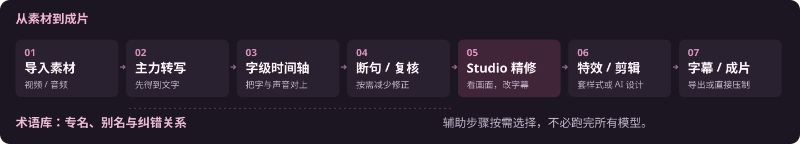
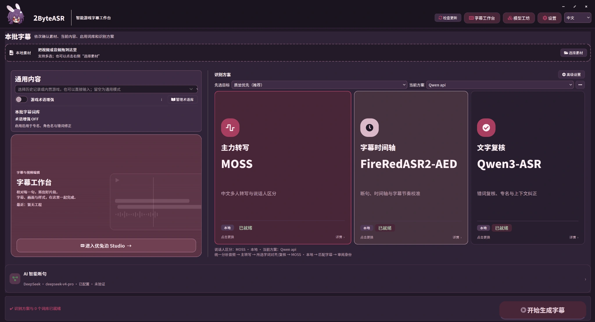
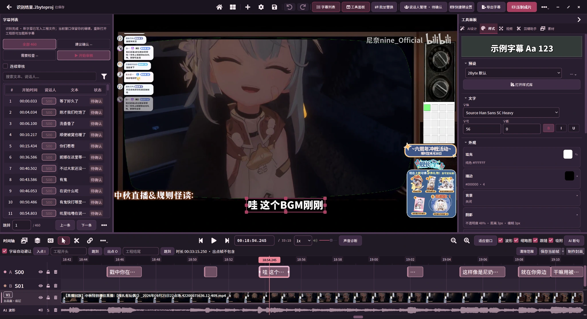

# 2ByteASR

**多模型字幕识别与视频编辑工具**

面向直播切片、游戏视频和口播内容，集成语音转写、字级时间轴、AI 断句与文字复核，并提供字幕编辑、特效设计和视频导出。

Windows x64 · 0.2.6-test.2 测试版 · 本地模型 / 在线 API

[查看下载与版本说明](https://github.com/NOTBAD314/2ByteASR/releases) · [功能特性](#功能特性) · [快速开始](#快速开始) · [反馈问题](https://github.com/NOTBAD314/2ByteASR/issues)

## 功能特性

2ByteASR 将内容识别、时间定位与人工精修衔接起来：模型按角色分工，识别保留的字级时间信息还能继续用于后期编辑；游戏词库和说话人字幕轨适合反复制作同一类内容。

| 功能 | 说明 |
| --- | --- |
| **多模型识别与字级对齐** | 分别选择主力转写、字幕时间轴和文字复核。转写确定文字内容，对齐补充每个字或词的时间位置，复核提供另一份文本依据。 |
| **AI 断句与文字复核** | 结合上下文整理错词和分句，再利用已有时间信息确定字幕边界。识别与分句结果仍可人工修改。 |
| **游戏术语库** | 手动录入或让 AI 搜索角色、技能和别名，保存词条与纠错关系供后续任务复用；已启用词库用于相关校对、匹配与纠错步骤。 |
| **说话人字幕轨** | 按方案区分说话人，人工命名、调整归属，在不同字幕轨上编辑，并合并或按说话人导出。短应答和重叠发言仍需检查。 |
| **Studio 字级字幕编辑** | 对照视频、波形和字幕修改文字与起止时间；有字级时间戳时，可按字拆分、裁剪与合并，减少手工寻找切点。 |
| **特效字幕与 AI 设计** | 直接套用已有样式，或描述字体、材质、框线和入退场动效，让 AI 生成字幕设计，预览后采用。 |
| **直播切片辅助** | 结合 B 站格式的弹幕 XML 与字幕分析片段，给出带时间范围的剪辑建议；可预览、调整后加入剪辑。建议不代替内容取舍。 |
| **多素材剪辑与输出** | 在多轨时间轴组织视频和音频，剪切、裁剪、调整片段；导出字幕文件，或把字幕及特效合成到视频。 |

## 识别工作流

<picture>
  <source media="(max-width: 760px)" srcset="docs/overview/assets/workflow-mobile.svg">
  
</picture>

模型和辅助步骤按方案选择，不要求安装全部模型。术语库提供相关校对与纠错参考，并非向所有 ASR 引擎统一注入热词；弹幕 XML 和字幕用于可选的片段分析。

图中 MOSS、FireRedASR2-AED、Qwen3-ASR 分别承担不同角色，是一种配置示例。

## Studio 字幕与视频编辑

识别后继续修改文字、调整切点、整理说话人，并编辑视频片段。字级时间信息保留在工程中，供后续拆分和裁剪使用；导入的普通 SRT／ASS 没有逐字时间时，需要手动调整或补充对齐。

AI 字幕设计可参考已接入的 HyperFrames 设计资料，生成适配 2ByteASR 的字幕作品，再由软件的预览和导出流程处理。

## 模型与运行方式

以下是已接入的代表选项，具体角色以应用中的方案选择为准。

| 选项 | 用途与条件 |
| --- | --- |
| **MOSS-Transcribe-Diarize** | 主力转写及说话人区分；本版使用 NVIDIA CUDA。 |
| **FireRedASR2-AED** | 字级时间轴，也可用于转写；本版使用 NVIDIA CUDA。 |
| **Qwen3-ASR 1.7B** | 本地转写或文字复核；本版使用 NVIDIA CUDA。 |
| **Qwen3-ForcedAligner 0.6B** | 根据已有文字补充字／词时间戳；本版使用 NVIDIA CUDA。 |
| **SenseVoice Small** | 本地转写或文字复核，可使用 CPU；不提供 MOSS 的多人身份区分。 |
| **在线识别** | 已接入阿里云 Qwen 音频、Groq Whisper、OpenAI 转写等渠道，需相应服务凭据；字级时间与说话人能力因接口而异。 |

本地识别与手动编辑不要求在线 API。**AI 断句、AI 文本校对、术语搜索、字幕设计和片段分析需配置相应 AI 服务**，可用已接入的 API 或 CLI 渠道；API 需密钥，CLI 需安装并登录。使用云端服务时，相关音频、文本或设计输入会发送给所选服务，并可能产生费用。

## 输入与输出

| 类型 | 主要格式 |
| --- | --- |
| 音视频输入 | MP4、MKV、MOV、WebM、FLV、AVI；WAV、MP3、M4A、FLAC、AAC。具体编码需能被解码。 |
| 字幕及辅助输入 | SRT、ASS；B 站格式弹幕 XML。普通字幕文件不自带逐字时间。 |
| 字幕输出 | SRT、ASS、TXT、JSON；可输出合并字幕、说话人分轨，或两者。 |
| 视频输出 | MP4、MKV、MOV；按容器选择 H.264、HEVC 或 AV1（MOV 不提供 AV1）。 |

视频编码提供软件编码与可用的 **NVIDIA NVENC、Intel QSV、AMD AMF**，实际选项取决于硬件、驱动和编码器探测结果。编码加速与 ASR 的 CUDA 需求不同；特效复杂度仍会影响整段视频的导出耗时。完整动效请以压制成片为准，SRT／ASS 等字幕文件不等同于完整 AI 特效作品。

## 安装条件

- **系统**：Windows 10 22H2（19045）或更新的 Windows x64。Setup 无需预先安装开发用 Python 或 Git。
- **模型与环境**：安装包不含模型权重；首次按需准备模型和独立运行库，需要网络与额外磁盘空间。显卡、显存和空间需求依所选模型确定，不必安装整套模型。
- **安装与工程**：安装器未签名，请核对来源及附件校验文件。测试版先备份重要工程，源媒体需另外保留。
- **已知问题**：当前安装附件在自定义用户数据目录时，部分入口的工程路径可能不一致；原工程未显示时先核对路径，不要用空工程覆盖。详见[本版说明](docs/releases/0.2.6-test.2.zh-CN.md)。

## 快速开始

1. 在 [Release](https://github.com/NOTBAD314/2ByteASR/releases) 附件中选择 `2ByteASR-Setup-0.2.6-test.2.exe`，不要把 `Source code` 压缩包当作安装程序。
2. 选择识别方案，准备所需本地模型与运行库，或填写在线服务凭据。
3. 导入一段音视频，生成字幕后进入 Studio 校对、剪辑并导出。

[安装与首次使用](docs/releases/0.2.6-test.2-start.zh-CN.md) · [图文介绍与离线 HTML](docs/overview/README.md) · [反馈问题](https://github.com/NOTBAD314/2ByteASR/issues)

反馈请附版本号、复现步骤和截图，移除密钥等隐私信息。项目源码采用 [Apache-2.0](LICENSE)；模型及第三方组件分别遵循各自许可，见[第三方声明](THIRD_PARTY_NOTICES.md)。
