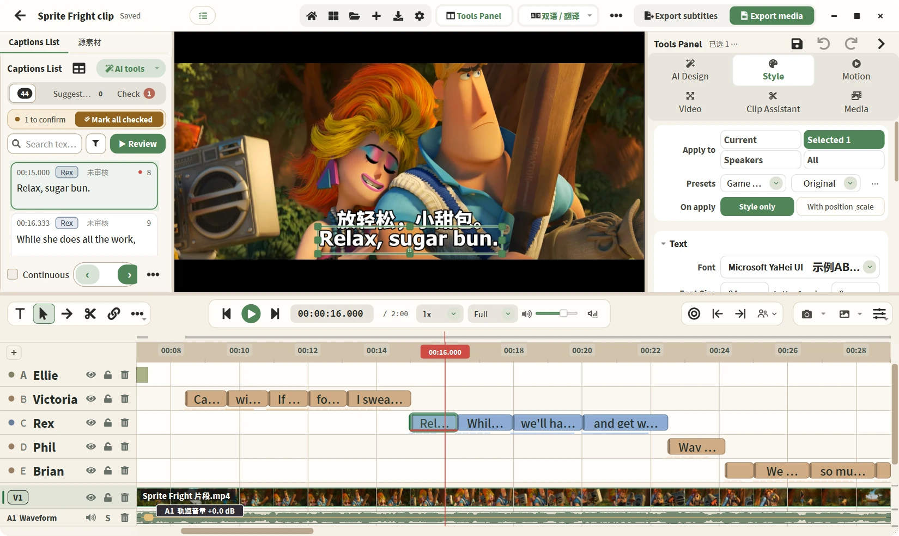
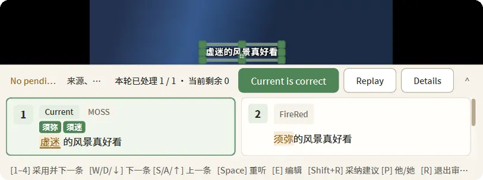
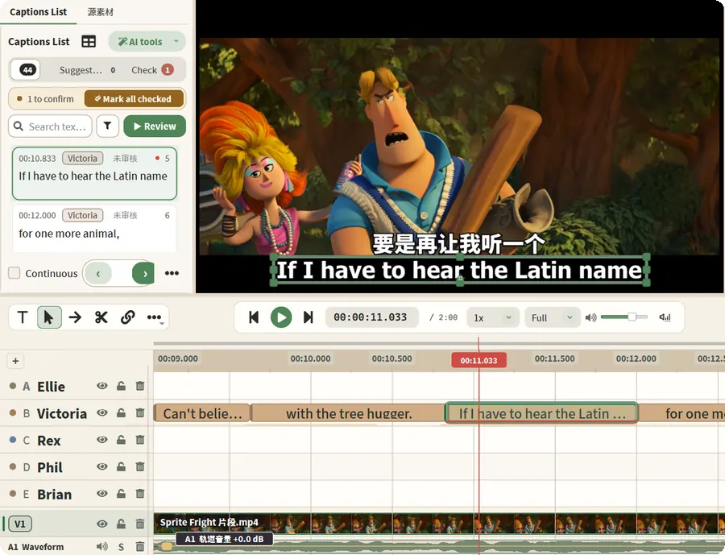
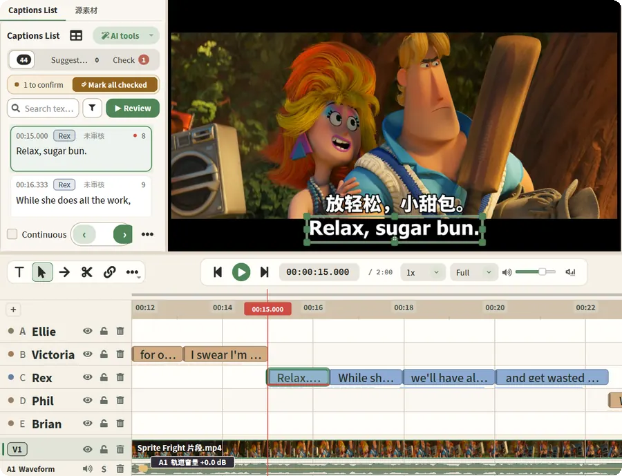
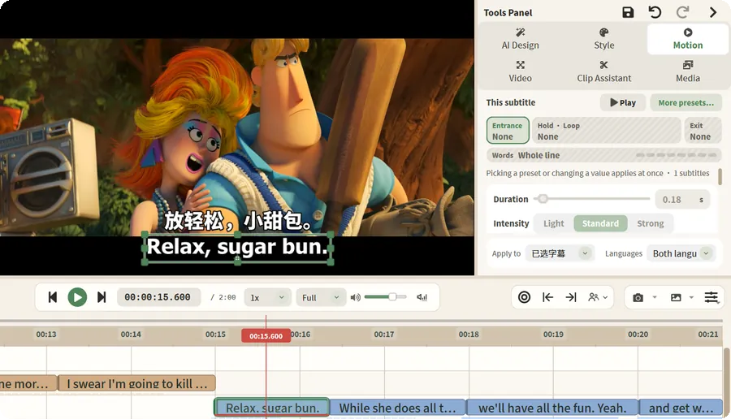
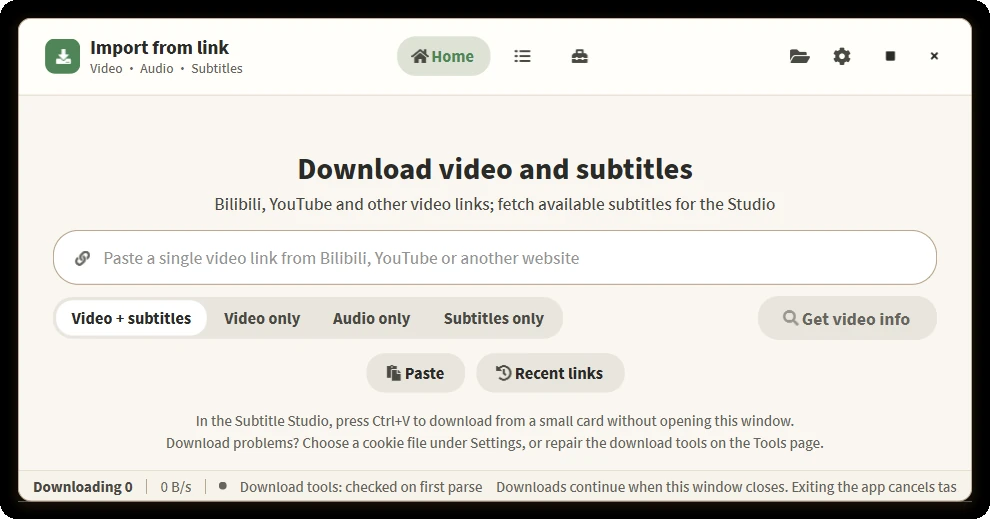
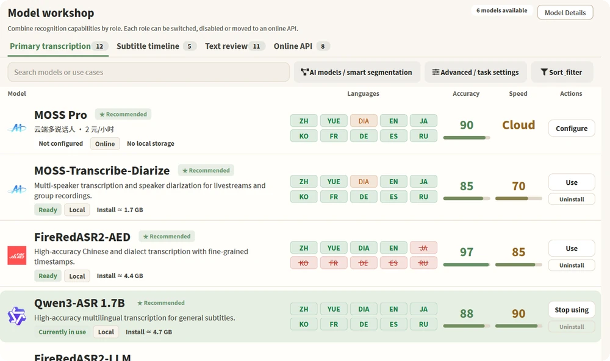
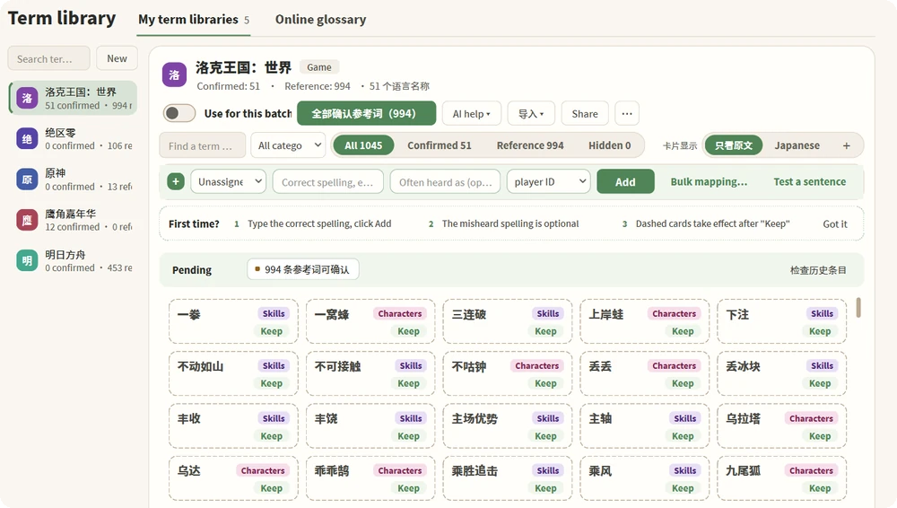
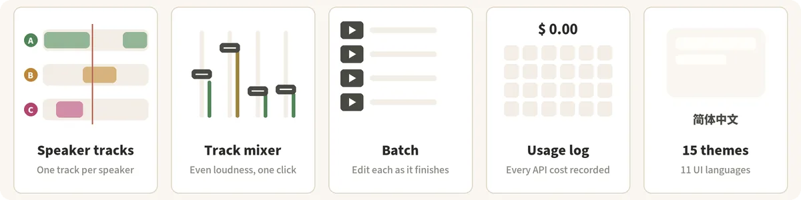
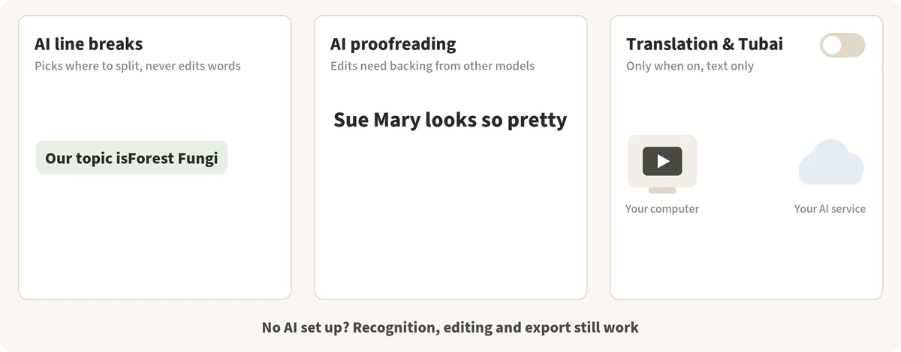

# 2ByteASR · 兔白字幕

### Free subtitle software: transcribe, proofread, translate, edit and export in one place

Runs on Windows and Mac. With an NVIDIA GPU, everything can stay offline.

[Download 1.2.0](#download) · [Features](#features) · [FAQ](#faq) · [User guide](docs/product-guide.en.md)

**English** · [中文](README_ZH.md) · [日本語](README_JA.md) · [한국어](README_KO.md)

Sample film: [Sprite Fright](https://studio.blender.org/films/sprite-fright/) © Blender Foundation · [CC BY 4.0](https://creativecommons.org/licenses/by/4.0/)

## Features

| Transcribe | Proofread | Translate | Edit | Export |
| :---: | :---: | :---: | :---: | :---: |
| Local or cloud | Compare models | Bilingual subtitles | Split by word | Subtitles or video |

<table>
<tr>
<td colspan="2" valign="top">

**Models wrote it differently? Click the right one** 
Differences are highlighted, and you can see which model wrote what.
</td>
</tr>
<tr>
<td width="50%" valign="top">

**The razor only cuts between words** 
No word gets cut in half, and the translation splits with it.
</td>
<td width="50%" valign="top">

**Bilingual subtitles in one click** 
Uses your own text AI. Double-click to fill in any line it missed.
</td>
</tr>
<tr>
<td width="50%" valign="top">

**Dozens of subtitle animations** 
Hover to preview, drag to change the duration.
</td>
<td width="50%" valign="top">

**Paste a link to download** 
Get YouTube and Bilibili videos together with their subtitles.
</td>
</tr>
<tr>
<td width="50%" valign="top">

**Model workshop: pick a model, install in one click** 
Compare languages, accuracy and speed side by side.
</td>
<td width="50%" valign="top">

**Term library: character names spelled right** 
Comes with term libraries for several games, and you can add your own.
</td>
</tr>
</table>

## Why the subtitles are accurate

## What AI does, and what it doesn't

## Ask Tubai

The bunny in the corner of the studio answers questions about the app. Ask “How do I translate subtitles?” and she shows you where it is and can take you there. With a text AI connected, she can also check your subtitles, fix a line, or replace a word across the whole project. She asks before changing anything, and every change can be undone.

## Who it's for

| You're working on | Try this |
| --- | --- |
| Game streams and VODs | One track per speaker, a term library for character names, danmaku to find highlights |
| Foreign-language videos | Paste a link, transcribe, translate, export bilingual subtitles |
| Interviews, podcasts, lectures | Time an existing script, remove pauses in one go |
| Videos that already have subtitles | Import SRT / ASS to fix, translate and restyle; no models needed |

## Download

Current releases are **Windows 1.2.0** (2026-11-28) and **Apple silicon Mac 1.1.2**.

| Your computer | Download |
| --- | --- |
| Windows 10 1809 or later, 64-bit | [2ByteASR-Setup-1.2.0.exe](https://github.com/NOTBAD314/2ByteASR/releases/download/v1.2.0/2ByteASR-Setup-1.2.0.exe), about 1178 MB |
| Apple silicon Mac (M1 or later), macOS 14 or later | [2ByteASR-1.1.2-macos-arm64-Setup.dmg](https://github.com/NOTBAD314/2ByteASR/releases/download/v1.1.2/2ByteASR-1.1.2-macos-arm64-Setup.dmg), about 592 MB; **experimental**, no Intel build |

Save your work and quit before installing over the current version. Windows 0.6.5 or later also supports in-app updates. On Mac, replace the app in Applications. [Release notes](https://github.com/NOTBAD314/2ByteASR/releases/tag/v1.2.0) · [GitCode mirror](https://gitcode.com/Notbad314/2ByteASR/releases/tag/v1.2.0) · [Windows guide](docs/product-guide.en.md#installing-on-windows) · [Mac guide](docs/product-guide.en.md#installing-on-mac-experimental). Windows is not Authenticode-signed; Mac is not Apple-notarized. Source, licence, component and signature files are for source delivery, verification and in-app updates.

Linux: the [Docker 0.8.1 release](https://github.com/NOTBAD314/2ByteASR/releases/tag/v0.8.1-docker.1) remains available; see [Build and run](README.docker.md).

## FAQ

<b>Is it free?</b>

Yes. No paid features, no sign-up. Only cloud transcription and AI features use your own account, billed by that provider.

<b>Is my video uploaded?</b>

Not with local transcription. With cloud transcription, the audio goes to the provider you chose. AI features only send subtitle text.

<b>Will it run on my computer?</b>

| Your computer | Recommended |
| --- | --- |
| Windows with an NVIDIA GPU | Local: speakers separated, three models compared |
| Windows without an NVIDIA GPU | Cloud, or the light local option on CPU |
| Apple silicon Mac | Local or cloud; 16 GB of memory or more recommended |

Models download the first time you transcribe; the NVIDIA high-quality set is about 11 GB. See [Choosing a recognition route](docs/product-guide.en.md#choosing-a-recognition-route).

<b>Windows says “Unknown publisher”?</b>

The installers aren't code-signed, so the system warns you. You can check the files against SHA256SUMS on the release page.

## Support and feedback

- Like it? You can support the author on [Afdian](https://afdian.com/a/2byteasr).
- Found a problem? Open an [issue](https://github.com/NOTBAD314/2ByteASR/issues) with your version and a screenshot.
- Chat: [Discord](https://discord.gg/PSuTx9XfV) · QQ group 1124254900
- The code is [GPL-3.0](LICENSE). Subtitles and videos you make with it are yours. Third-party components: [notices](THIRD_PARTY_NOTICES.md).
- More: [User guide](docs/product-guide.en.md) · [API setup](docs/api-setup/README.md) · [Changelog](CHANGELOG.md) · [Contributing](CONTRIBUTING.md)
