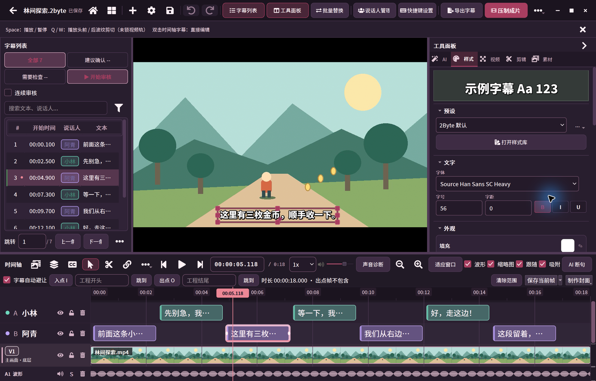
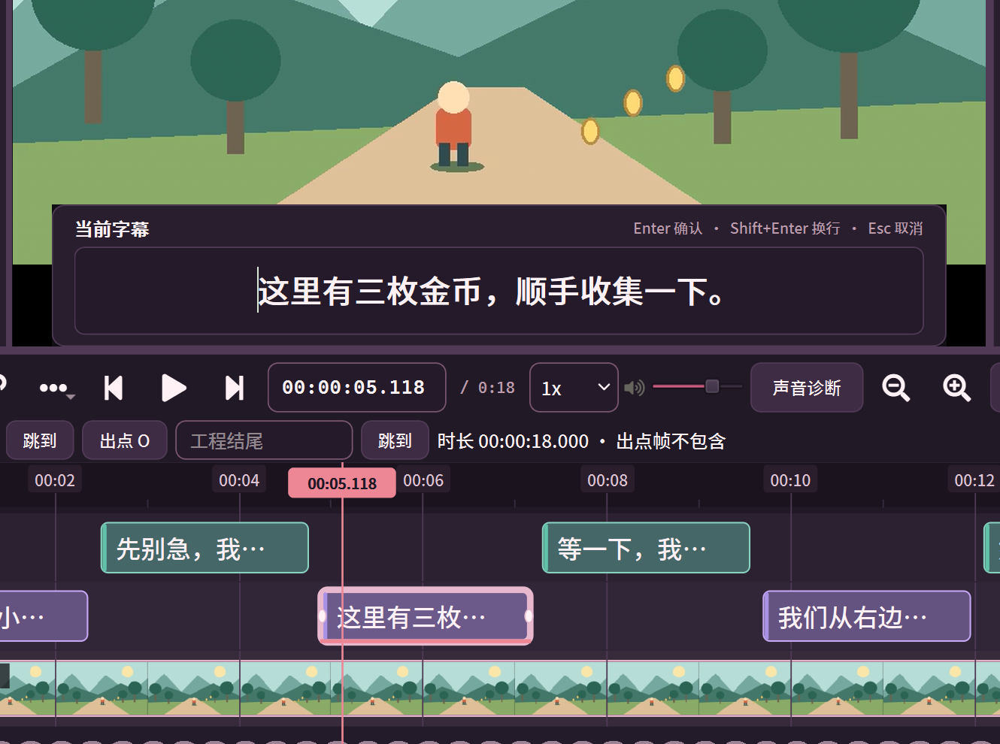
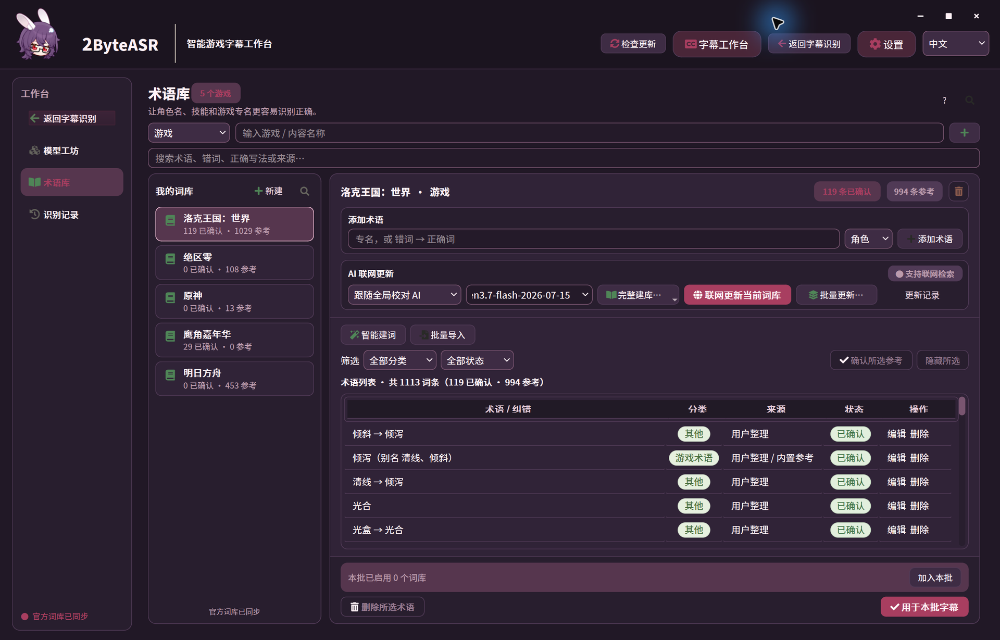
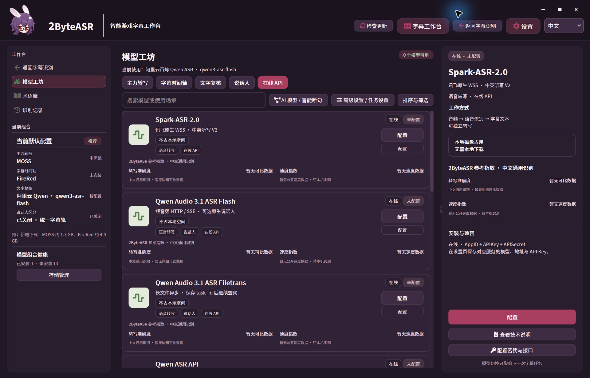

# 2ByteASR

### 从语音识别到字幕精修

面向视频创作者、直播切片与游戏内容制作的桌面字幕工作台。

**Windows x64 · 0.2.6-test.2 测试候选版**

[下载与快速开始](#下载与快速开始) · [本版说明](docs/releases/0.2.6-test.2.zh-CN.md) · [反馈问题](https://github.com/NOTBAD314/2ByteASR/issues)

看着画面改字幕，沿着波形调时间，把文字与剪辑放在同一处。

> 当前仅供私有审核：安装包保存在 Release 草稿中，尚未公开发布。页面截图均来自本次候选安装版；林间动画与手工字幕是自有编辑示例，不是自动识别效果评测。

## 字幕不止于识别出来

### 对着画面，把每一句改准确

听清一句话，往往还要检查它何时出现、在哪里断开。Studio 把视频、字幕列表、波形和时间轴放在一起，可定位当前字幕、直接改字，再保存或导出，减少在播放器与文本编辑器间往返。

### 多段素材，多条字幕轨，放在一起整理

需要保留不同说话人的字幕，或把多个片段串起来时，可以在时间轴组织视频、关联音频与字幕轨，进行切分、裁边和移动。支持说话人命名与分轨字幕输出；自动区分出的标签仍需要人工核对，不等同于真实身份。

### 让游戏名词有据可查

角色名、技能名、别名容易被听成日常用词。术语库把参考词、确认词与纠错关系集中管理，可选择用于本批字幕，方便积累自己的内容用语；参考词需要审核，不能保证每次识别都正确。

### 按自己的设备和需求准备识别方案

模型工坊区分转写、时间轴、文字复核和说话人角色，展示本地模型与在线 API 的准备状态。先看清需要下载什么、配置什么，再开始任务，不必默认装齐全部模型。

*图中为干净演示配置，模型未安装、API 未配置；仅展示方案选择，不表示所有后端均已验收。*

### 精修后，交给下一步制作

可以导出合并 SRT 或按说话人拆分字幕，继续交给剪辑软件；也可调整基础字幕样式并压制成片。本包已完成短片字幕成片验证，长片、复杂动效和不同硬件仍需更多测试。

## 一个简单的工作流

**导入视频／音频 → 准备识别方案 → 生成字幕 → 进入 Studio 校对与编辑 → 导出**

已有字幕时，也可以从字幕工作台开始导入素材和字幕，直接精修。识别、编辑与导出是可检查的步骤，输出前请回看错字、说话人归属和字幕时间。

## 下载与快速开始

**本次应下载：`2ByteASR-Setup-0.2.6-test.2.exe`**，约 **947.1 MiB**。不要下载旧版 Lite，也不要把 GitHub 的 **Source code** 压缩包当成 Windows 安装程序。

[打开本次审核草稿](https://github.com/NOTBAD314/2ByteASR/releases/tag/untagged-8ce24471ad555b803ab4)（需仓库权限，不能直接分享给无权限的 Discord 用户）。

1. 下载安装程序与同页 `SHA256SUMS.txt`，核对文件后运行安装。
2. 启动 2ByteASR，在模型工坊选择要使用的方案。安装包**不含模型权重**；本地识别需准备对应模型与运行库，首次准备需要联网和额外磁盘空间。
3. 使用在线识别、云端校对或 AI 断句时，配置对应服务的账户与 API Key，费用按服务商规则计算。不使用的云端角色应在识别方案中关闭。
4. 先用一段短素材试跑，再进入 Studio 核对文字、时间和说话人，最后导出。

本安装程序**未签名**，Windows 可能显示来源或信誉提示；请核对来源与校验和，不要关闭系统保护。普通快捷方式、首次向导和干净 Windows 环境的完整流程尚未验收，详见[首次使用与排错](docs/releases/0.2.6-test.2-start.zh-CN.md)。

## 使用条件

| 项目 | 本版说明 |
| --- | --- |
| 系统 | Windows x64；本包已在 Windows 10 22H2（19045）宿主隔离环境验证。安装器门槛为 19045；本包 Windows 11／干净 VM 未验。 |
| CPU 与 GPU | SenseVoice CPU 短样本、MOSS NVIDIA CUDA 短样本已验；不同方案需求不同，没有全软件统一的最低显存／内存承诺。 |
| 磁盘 | 安装程序约 947.1 MiB，安装展开、模型、运行库和工程缓存还需额外空间，按所选模型准备。 |
| 本地与云端 | 本地推理在本机执行，准备模型仍需下载。在线识别会发送音频，云端文字处理会发送对应文本；具体数据取决于启用的功能。 |

## 测试版边界与反馈

- 识别结果需要人工复核，重叠说话、复杂噪声和游戏专名不保证准确。
- 本包完成核心编辑／导出与两个本地识别方案的有限验证；其余模型、云端调用和 AI 字幕设计没有本轮完整验收。AI 设计请按实验性能力看待。
- 完整干净系统、只读安装目录下的模型准备及最低硬件要求尚未验证。
- 公开分发前仍需补齐第三方对应源码材料并核实 Remotion 再分发范围；当前草稿不代表公开发布就绪。

反馈请附 **版本号、Windows 版本、所选模型／方案、复现步骤、预期与实际结果**，必要时提供可公开的最短素材。截图与日志先移除 Key、账号和个人路径。[提交 Issue](https://github.com/NOTBAD314/2ByteASR/issues) 需要当前私有仓库的访问权限。

仓库源码许可证沿用 [Apache-2.0](LICENSE)；安装包第三方组件按各自许可证使用，见随包许可文件及[本版第三方说明](docs/releases/0.2.6-test.2-start.zh-CN.md#第三方组件)。本审核分支只更新展示材料，不包含候选包完整构建源码；既有外语文档尚未同步到本版。
