

# 2ByteASR · 兔白字幕

### 無料の字幕ソフト。文字起こし・校正・翻訳・編集・書き出しまでこれひとつで

Windows と Mac に対応。NVIDIA の GPU があれば、すべてオフラインで処理できます。

[ダウンロード 1.2.0](#ダウンロード) · [機能](#機能) · [よくある質問](#よくある質問) · [使い方ガイド](docs/product-guide.ja.md)

[English](README.md) · [中文](README_ZH.md) · **日本語** · [한국어](README_KO.md) · [Türkçe](README_TR.md)

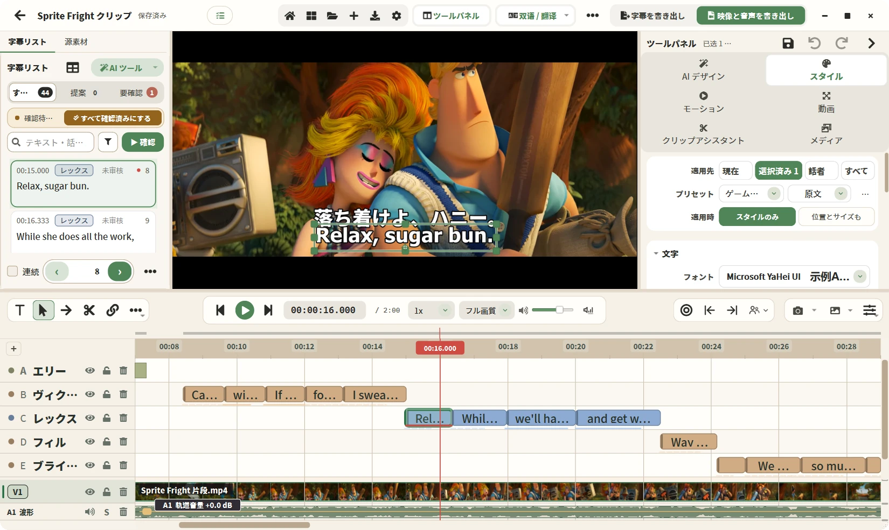

サンプル映像：[Sprite Fright](https://studio.blender.org/films/sprite-fright/) © Blender Foundation · [CC BY 4.0](https://creativecommons.org/licenses/by/4.0/)

## 機能

| 文字起こし | 校正 | 翻訳 | 編集 | 書き出し |
| :---: | :---: | :---: | :---: | :---: |
| ローカルでもクラウドでも | 複数モデルで照合 | 2か国語字幕 | 単語ごとに分割 | 字幕でも動画でも |

<table>
<tr>
<td colspan="2" valign="top">
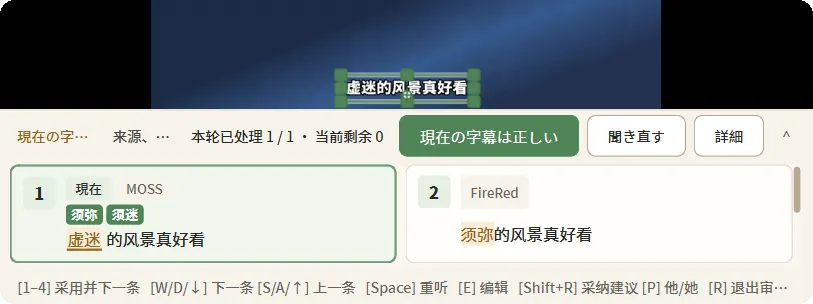

**モデルごとに書き方が違う？正しいほうをクリック** 
違う文字はハイライトされ、どのモデルの結果かも分かります。
</td>
</tr>
<tr>
<td width="50%" valign="top">
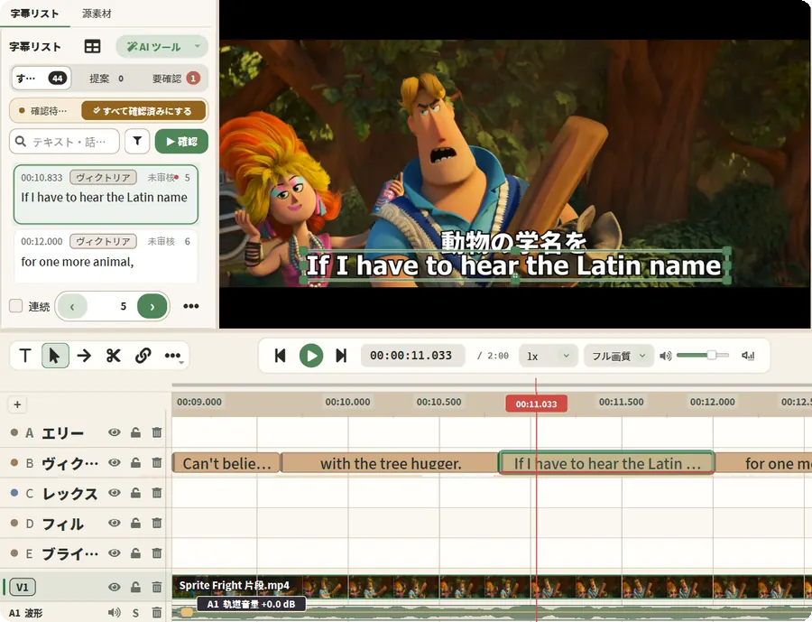

**レイザーは単語の切れ目でだけ切る** 
単語の途中では切れません。訳文も一緒に分かれます。
</td>
<td width="50%" valign="top">
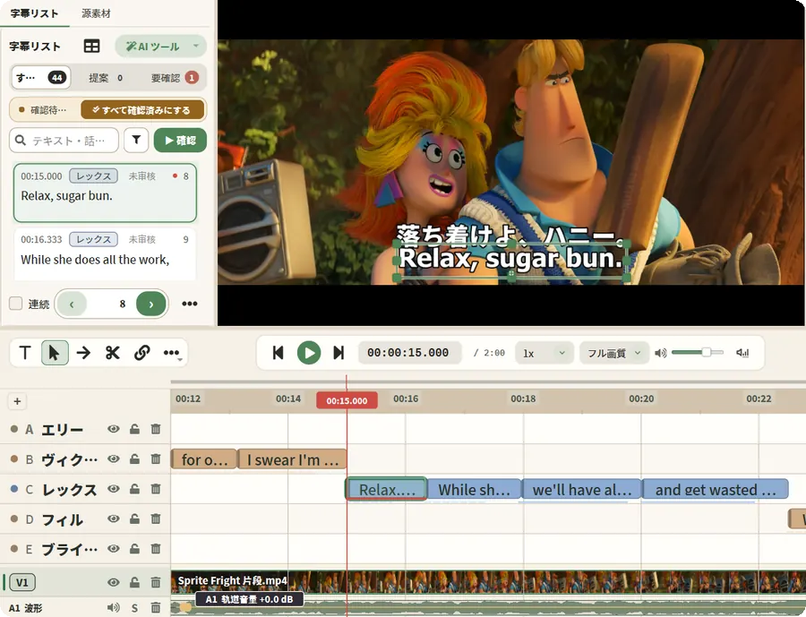

**ワンクリックで2か国語字幕** 
自分の文字 AI を使って翻訳。訳し漏れはダブルクリックで書き足せます。
</td>
</tr>
<tr>
<td width="50%" valign="top">
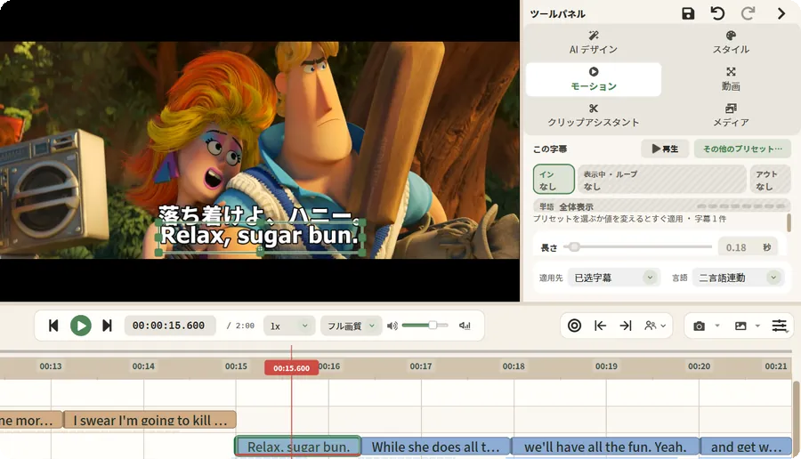

**数十種類の字幕アニメーション** 
マウスを乗せればプレビュー、長さはドラッグで変えられます。
</td>
<td width="50%" valign="top">
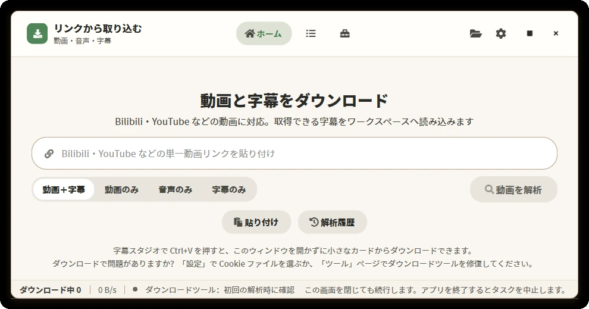

**リンクを貼ってダウンロード** 
YouTube やビリビリの動画を、字幕ごと取り込めます。
</td>
</tr>
<tr>
<td width="50%" valign="top">
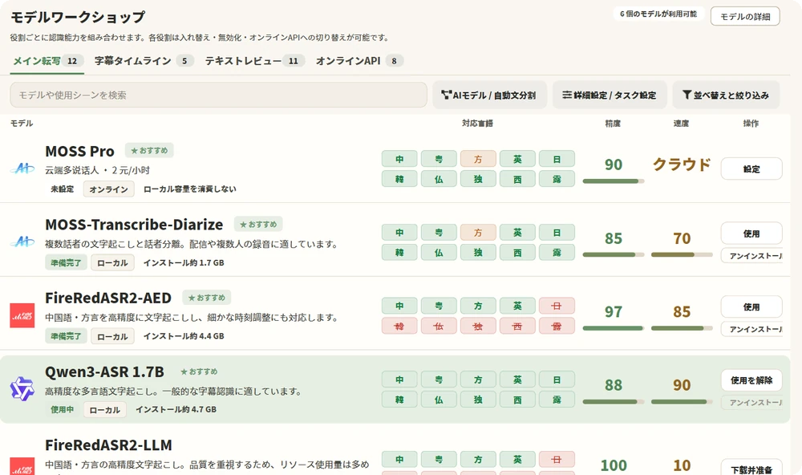

**モデルワークショップ：選んでワンクリックでインストール** 
対応言語・精度・速度をひと目で比べられます。
</td>
<td width="50%" valign="top">
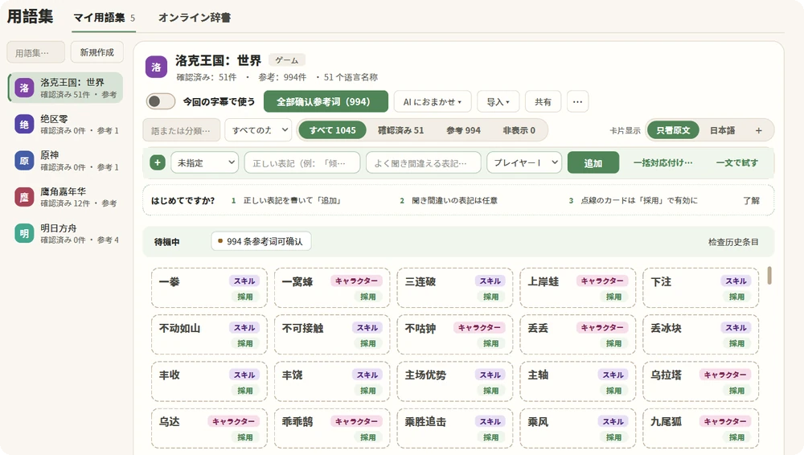

**用語集：キャラクター名を正しく** 
いくつかのゲームの用語集が最初から入っていて、自分でも追加できます。
</td>
</tr>
</table>

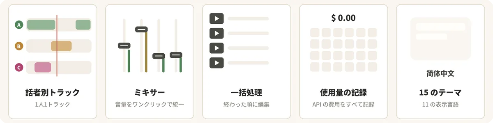

## 字幕が正確な理由

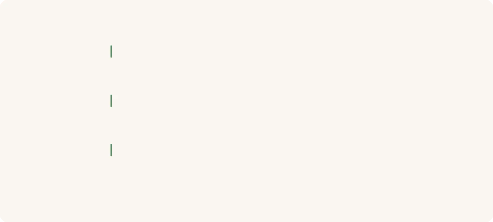

## AI がすること、しないこと

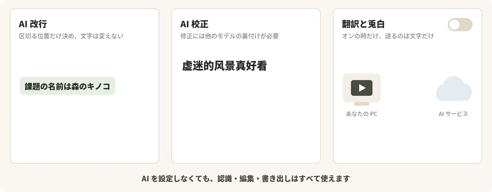

## 兎白に聞く

スタジオの隅にいるうさぎの兎白が、使い方の質問に答えます。「字幕を翻訳するには？」と聞けば、場所を教えてそこまで連れて行ってくれます。文字 AI をつなげば、字幕のチェック、1行の修正、全体の置き換えもできます。変更の前には必ず確認し、どの変更も元に戻せます。

## こんな作業に

| 作業 | 使い方 |
| --- | --- |
| ゲーム実況・配信アーカイブ | 話者ごとに1トラック、用語集でキャラクター名を管理、弾幕から見どころ探し |
| 外国語の動画に字幕 | リンクから取り込み、文字起こし、翻訳、2か国語字幕を書き出し |
| インタビュー・ポッドキャスト・講義 | 手元の台本にそのまま時間を合わせ、間をまとめて削除 |
| 字幕ファイルがすでにある | SRT / ASS を読み込んで修正・翻訳・スタイル変更。モデル不要 |

## ダウンロード

現行版は **Windows 1.2.0**（2026-11-28）と **Apple Silicon Mac 1.1.2** です。

| 環境 | ダウンロード |
| --- | --- |
| Windows 10 1809以降、64bit | [2ByteASR-Setup-1.2.0.exe](https://github.com/NOTBAD314/2ByteASR/releases/download/v1.2.0/2ByteASR-Setup-1.2.0.exe)、約1178MB |
| Apple Silicon Mac、macOS14以降 | [2ByteASR-1.1.2-macos-arm64-Setup.dmg](https://github.com/NOTBAD314/2ByteASR/releases/download/v1.1.2/2ByteASR-1.1.2-macos-arm64-Setup.dmg)、約592MB、**実験版**。Intel Mac非対応 |

保存して終了してから上書きインストールしてください。Windows 0.6.5以降はアプリ内更新も利用できます。MacはApplicationsのアプリを置き換えてください。[リリースノート](https://github.com/NOTBAD314/2ByteASR/releases/tag/v1.2.0) · [GitCodeミラー](https://gitcode.com/Notbad314/2ByteASR/releases/tag/v1.2.0) · [導入ガイド](docs/product-guide.ja.md)。WindowsのAuthenticode署名とApple公証はありません。Source、ライセンス、コンポーネント、署名の添付は検証・ソース提供・アプリ内更新用です。

Linux向け[Docker 0.8.1](https://github.com/NOTBAD314/2ByteASR/releases/tag/v0.8.1-docker.1)も利用できます。

## よくある質問

<b>無料ですか？</b>

はい。有料機能も登録もありません。クラウドでの文字起こしと AI 機能だけは、ご自身のアカウントを使い、各サービスの料金がかかります。

<b>動画はアップロードされますか？</b>

ローカルで文字起こしする場合はされません。クラウドを選んだ場合、音声はそのサービスに送られます。AI 機能が送るのは字幕の文字だけです。

<b>自分のパソコンで動きますか？</b>

| お使いのパソコン | おすすめ |
| --- | --- |
| NVIDIA GPU のある Windows | ローカル：話者を分け、3つのモデルで照合 |
| NVIDIA GPU のない Windows | クラウド、または CPU で動く軽量ローカル |
| Apple シリコン Mac | ローカルまたはクラウド。メモリ 16 GB 以上推奨 |

モデルは最初の文字起こしのときにダウンロードします（NVIDIA 向け高品質セットで約 11 GB）。詳しくは[認識方法の選び方](docs/product-guide.ja.md#認識方法の選び方)へ。

<b>「不明な発行元」と表示されます</b>

インストーラーにコード署名がないため、警告が出ます。リリースページの SHA256SUMS でファイルを確認できます。

## サポートとフィードバック

- 気に入ったら [愛発電（Afdian）](https://afdian.com/a/2byteasr) で作者を応援できます。
- 問題は [Issues](https://github.com/NOTBAD314/2ByteASR/issues) へ。バージョンとスクリーンショットを添えてください。
- 交流：[Discord](https://discord.gg/PSuTx9XfV) · QQ グループ 1124254900
- コードは [GPL-3.0](LICENSE)。このソフトで作った字幕や動画はあなたのものです。サードパーティ製コンポーネントは[こちら](THIRD_PARTY_NOTICES.md)。
- そのほか：[使い方ガイド](docs/product-guide.ja.md) · [API の設定](docs/api-setup/README.md) · [更新履歴](CHANGELOG.md) · [コントリビュート](CONTRIBUTING.md)
