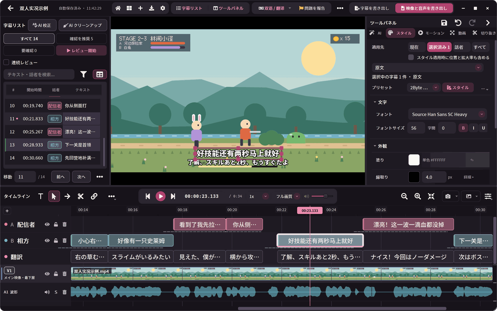
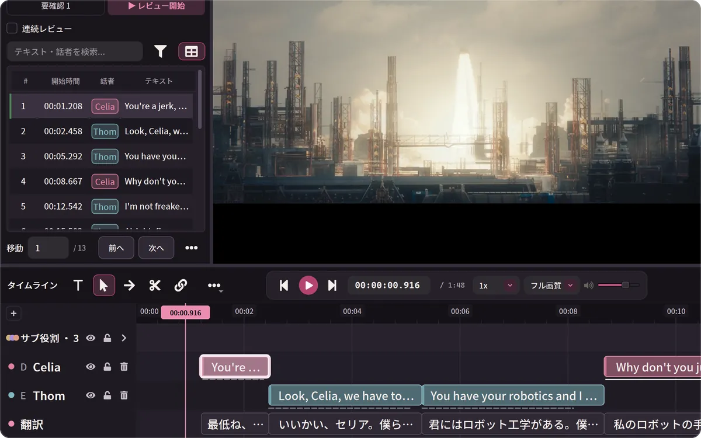
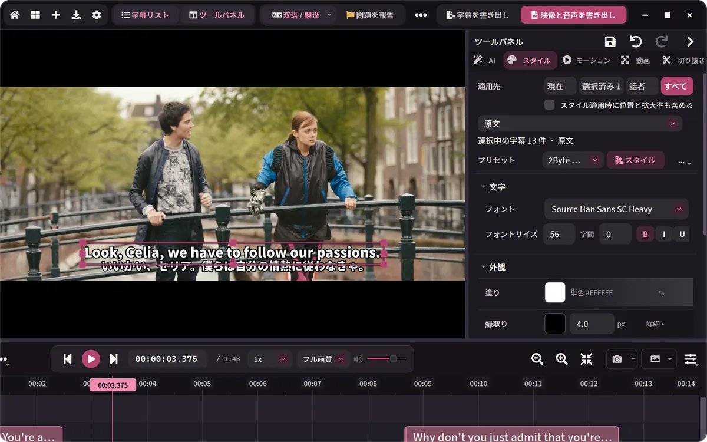
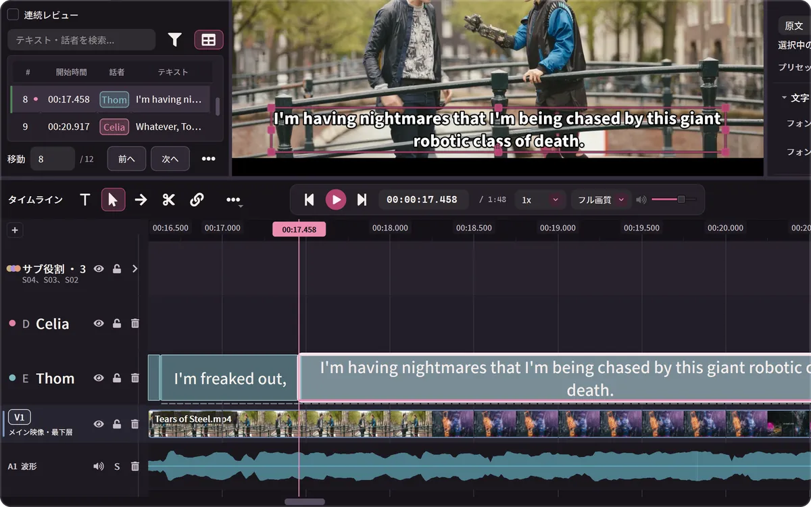
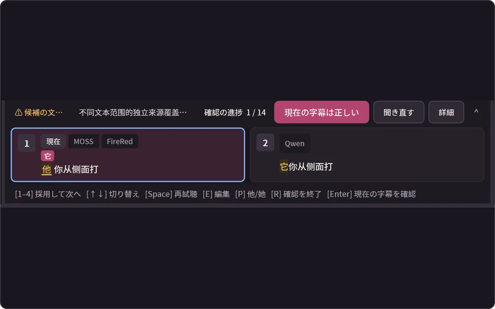
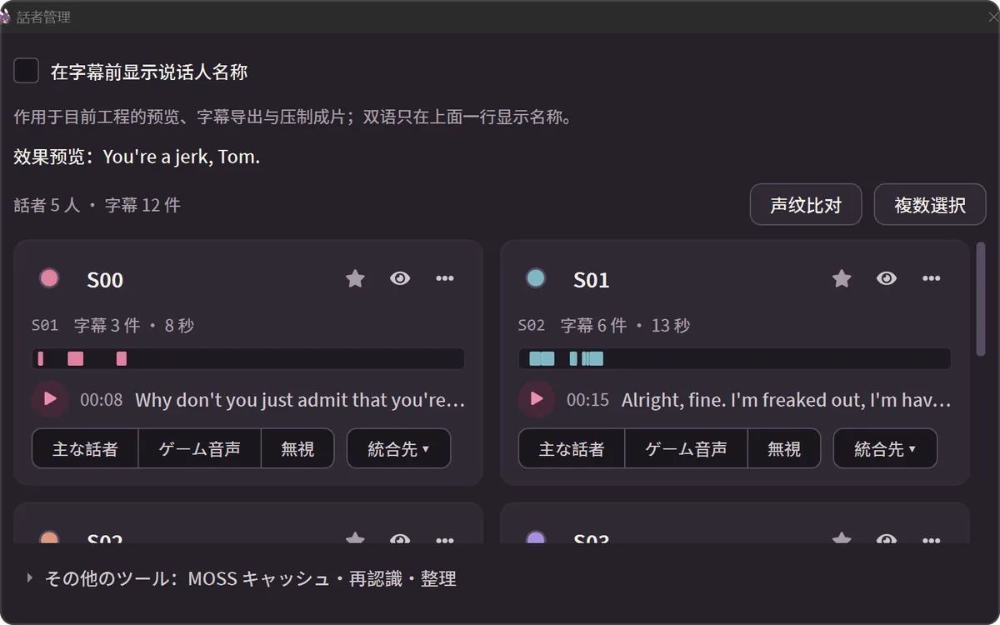
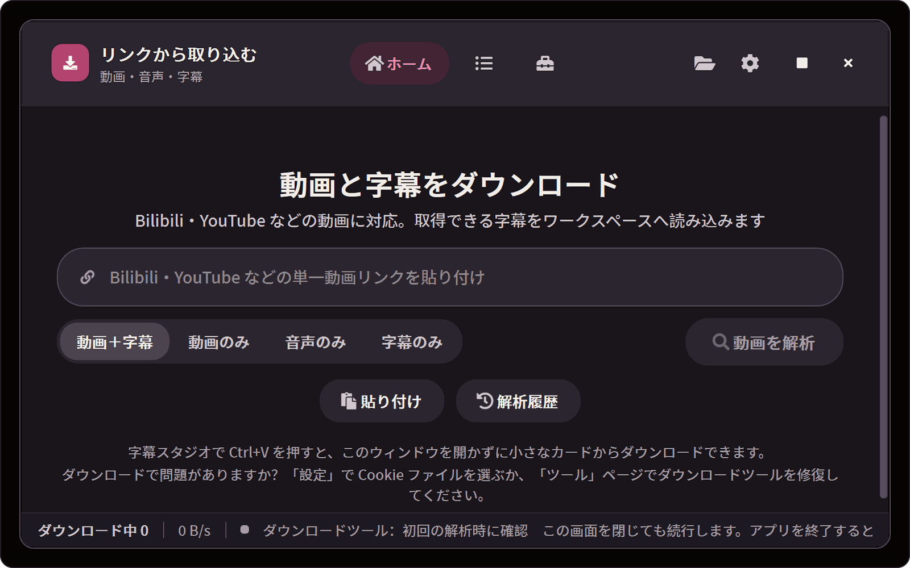
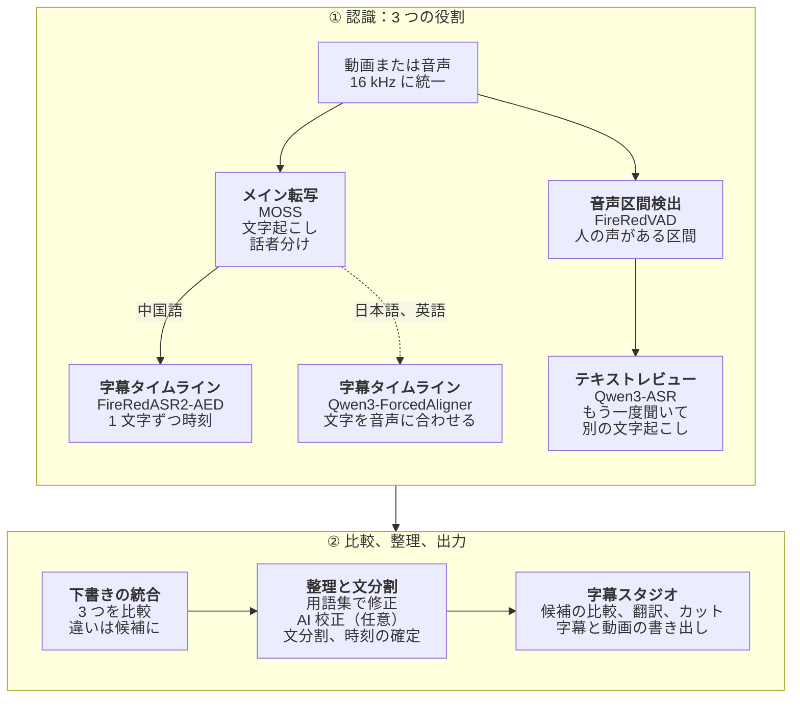

# 2ByteASR · 兔白字幕

### 字幕の編集・翻訳ワークベンチ

文字起こし、校正、翻訳、カット、書き出しを、ひとつのウィンドウで。 
無料。すべて自分の PC で動かすことも、自分のクラウドサービスにつなぐこともできます。

[English](README.md) · [中文](README_ZH.md) · **日本語** · [한국어](README_KO.md)

0.8.7 の実際の画面です。サンプル：[Tears of Steel](https://mango.blender.org/) (© Blender Foundation, [CC BY 3.0](https://creativecommons.org/licenses/by/3.0/))。NVIDIA GPU 上のローカル MOSS + Qwen3-ForcedAligner + Qwen3-ASR で認識しました。話者名は話者管理で入力し、日本語訳は字幕スタジオの手動翻訳で入力しています（AI は使っていません）。

| 文字起こし | 校正 | 翻訳 | カット | 書き出し |
| --- | --- | --- | --- | --- |
| ローカルでもクラウドでも、話者を分けて | モデル比較、用語集、AI 校正 | 原文と訳文の 2 層、抜けはダブルクリックで補う | 文字の境界で分割、話の間をまとめて削除 | 字幕ファイル、または字幕を焼き込んだ動画 |

## ダウンロード

現行版：**0.8.8**（2026-10-29）。

| 環境 | ダウンロード |
| --- | --- |
| Windows 10 1809以降、64bit | [2ByteASR-Setup-0.8.8.exe](https://github.com/NOTBAD314/2ByteASR/releases/download/v0.8.8/2ByteASR-Setup-0.8.8.exe)、約1.1GB |
| Apple Silicon Mac、macOS14以降 | [2ByteASR-0.8.8-macos-arm64-Setup.dmg](https://github.com/NOTBAD314/2ByteASR/releases/download/v0.8.8/2ByteASR-0.8.8-macos-arm64-Setup.dmg)、約578MB、**実験版**。Intel Mac非対応 |

保存してアプリを終了してから上書きインストールしてください。Windowsの0.6.5以降はアプリ内更新も利用できます。[リリースノート・チェックサム](https://github.com/NOTBAD314/2ByteASR/releases/tag/v0.8.8) · [導入ガイド](docs/product-guide.ja.md)。WindowsのAuthenticode署名とApple公証はありません。Source、ライセンス、コンポーネント、署名の添付は検証・ソース提供・アプリ内更新用です。

Linux向け[Docker 0.8.1](https://github.com/NOTBAD314/2ByteASR/releases/tag/v0.8.1-docker.1)も利用できます。

## 何をしますか？

<table>
<tr>
<td width="50%" valign="top">

**ゲーム実況、配信アーカイブ** 
話者ごとに字幕トラックを分け、用語集でキャラクター名や技名を覚えさせ、bilibili のコメント XML から切り抜き候補を探します。 
→ [話者を分ける](#できること) · [用語集](docs/product-guide.ja.md#字幕スタジオのよく使う操作)

</td>
<td width="50%" valign="top">

**外国語の動画に字幕を付ける** 
YouTube や bilibili などのリンクを貼ると、動画と元の字幕をまとめてプロジェクトに取り込めます。日本語や英語を認識し、ご自身のテキスト AI で翻訳して、2 言語字幕を書き出します。 
→ [リンクからダウンロード](#できること) · [翻訳と 2 言語字幕](#できること)

</td>
</tr>
<tr>
<td width="50%" valign="top">

**インタビュー、ポッドキャスト、講義** 
原稿があれば文章を書き換えずに時刻だけ合わせます。話の間はまとめて削除。一括置換や簡体字・繁体字の変換もできます。 
→ [字幕スタジオのよく使う操作](docs/product-guide.ja.md#字幕スタジオのよく使う操作)

</td>
<td width="50%" valign="top">

**字幕はもうある** 
SRT / ASS を読み込んで、校正、翻訳、スタイル変更をして、もう一度動画に焼き込めます。認識モデルは不要です。 
→ [入力と出力](docs/product-guide.ja.md#入力と出力)

</td>
</tr>
</table>

## できること

<table>
<tr>
<td width="50%" valign="top">

**翻訳と 2 言語字幕** 
ご自身のテキスト AI で簡体字・繁体字中国語、英語、日本語、韓国語などに翻訳できます。訳が抜けた所は訳文トラックをダブルクリックして補えます。原文と訳文は別々のスタイルを持ち、どちらか、または両方を書き出せます。
</td>
<td width="50%" valign="top">

**スタイル、アニメーション、書き出し** 
フォント、縁取り、位置、登場と退場のアニメーションはプリセットがあり、AI は不要です。MP4 / MKV / MOV で、全体でもイン点からアウト点まででも書き出せます。
</td>
</tr>
<tr>
<td width="50%" valign="top">

**文字・単語の境界で分割し、動画も切る** 
文字や単語ごとに時刻があるので、分割ツールはその境界で止まります。映像トラックでは分割、リップル削除、話の間を検出してまとめて削除できます。
</td>
<td width="50%" valign="top">

**モデルごとの聞き取りを比べる** 
ローカルの複数モデル方式では、同じ行を複数のモデルが聞き、違う文字と出どころを示します。クリック（または 1〜4 キー）で採用できます。ここは中国語サンプルです（このバージョンで候補が出るのは中国語の字幕です）。
</td>
</tr>
<tr>
<td width="50%" valign="top">

**話者を分ける** 
話者分離に対応した方法なら、ひとりずつ字幕トラックに分かれます。名前、色、標準スタイルをまとめて管理し、誤って分かれた話者は統合できます。どれも元に戻せます。
</td>
<td width="50%" valign="top">

**リンクを貼れば、動画と字幕が入る** 
YouTube、bilibili、ダウンローダー（yt-dlp）が対応するそのほかの単体動画。字幕スタジオで Ctrl+V を押すと、再生ヘッドの位置にそのままダウンロードできます。
</td>
</tr>
</table>

ほかにも：用語集と AI 校正、原稿合わせ、話者別の書き出し、サンプルプロジェクトで試せるチュートリアル（モデル不要）、11 の表示言語と 15 のテーマ。詳しくは[使い方ガイド](docs/product-guide.ja.md)へ。

## はじめる前に

- **アプリは無料です。** 公式版は無料で、有料機能、登録、サブスクリプションはありません。開発を支援したい方は[愛発電](#作者を支援する)へ。
- **ローカル認識には、まずモデルのダウンロードが必要です。** インストーラーに認識モデルは含まれていません。初めてローカルで認識するとき、選んだ方法に合わせてモデルワークショップがモデルと実行環境をダウンロードします（NVIDIA 高品質プランはモデルだけで約 11 GB、ほかに実行環境）。その後はオフラインで使え、映像や音声が PC の外に出ることはありません。
- **クラウド認識と AI 機能はご自身のアカウントで使います。** クラウド認識にはサービスのアカウントと API キーが必要で、料金はサービス側の規定に従い、音声はそのサービスにアップロードされます。AI による文分割、AI 校正、翻訳、AI 用語作成にはご自身のテキスト AI サービスが必要です（送るのは字幕の文字だけ）。これらを使わなくても、認識、編集、書き出しはできます。
- **すべての PC ですべてのモデルが動くわけではありません。** まず下の表をご覧ください。

| お使いのコンピューター | おすすめの認識方法 | 特長 |
| --- | --- | --- |
| Windows、NVIDIA GPU あり | **この PC で認識**：MOSS + FireRedASR2-AED + Qwen3-ASR | 無料でアップロードなし。話者分離、1 文字ずつの時刻、3 モデルの比較 |
| Windows、NVIDIA GPU なし | **クラウド認識**（API キーが必要）、または **軽量（この PC）**（SenseVoice、CPU） | クラウドは従量課金で音声をアップロード。軽量は無料だが遅く、話者は分けない |
| Apple シリコンの Mac（実験版） | **この Mac で認識**（MLX）、Apple GPU での **MOSS + FireRed**、またはクラウド | メモリ 16 GB 以上を推奨。NVIDIA GPU より遅い |

クラウドサービスのうち、MOSS Pro クラウドと百炼 / Qwen Cloud の Qwen-Audio 3.1 は話者を分けられます。クラウド認識と軽量方式は、どちらもローカルの Qwen3 アライナー（CPU 可）を加えると 1 文字ずつの時刻が付きます。詳しくは[認識方法の選び方](docs/product-guide.ja.md#認識方法の選び方)を参照してください。

## クイックスタート

1. **インストールして起動します。** 上の表から合うインストーラーをダウンロードしてください。
2. **認識方法を選びます。** 初回起動時に「この PC で認識」「クラウド認識」「軽量（この PC）」から選ぶと、必要なモデルをダウンロードするか、キーを入力する「API の申請と設定」を開きます。
3. **素材を入れます。** 動画や音声をホーム画面にドロップするか、「リンクダウンロード」で動画リンクを貼ります。用語集を選んで「字幕生成を開始」を押します。字幕付きの動画はそのまま字幕スタジオへ進めます。
4. **字幕スタジオで直して、訳して、書き出します。** 文字の確認、分割と結合、翻訳、スタイルの調整のあと、字幕を書き出すか、動画をエンコードします。

まず画面に慣れたい場合は、右上の「ヘルプ → はじめてのチュートリアル」でサンプルプロジェクトを試せます。インストール、費用、更新、よくある質問は[使い方ガイド](docs/product-guide.ja.md)にあります。

## さらに詳しく

<b>認識プランの組み立て（3 つの役割とモデル一覧）</b>

 

1 回の認識では、素材と機器に合わせて最大 3 つの役割を組み合わせます。

| 役割 | 内容 | 主な選択肢 |
| --- | --- | --- |
| メイン転写 | 文字に起こします。MOSS は話者も分けます | MOSS、SenseVoice、Whisper、Qwen3-ASR、クラウドサービス |
| 字幕タイムライン | 1 文字ずつ開始・終了時刻を付け、区切りや分割を文字の境界に合わせます | FireRedASR2-AED、Qwen3-ForcedAligner（CPU 可）、Paraformer |
| テキストレビュー | 別のモデルでもう一度聞き、違いを一覧にします | Qwen3-ASR などのローカル／オンライン方式 |

- **ローカルモデル：** MOSS-Transcribe-Diarize、FireRedASR2-AED、Qwen3-ASR 1.7B、SenseVoice Small、Paraformer Large、Whisper large-v3-turbo、Fun-ASR Nano、FireRedASR2-LLM、GLM-ASR-Nano、Canary-Qwen-2.5B（英語）、Qwen3-ForcedAligner 0.6B、日本語 CTC アライナー、Mac 用の MLX 版 Qwen3-ASR。Windows では MOSS、FireRedASR2-AED、Qwen3-ASR 1.7B、FireRedASR2-LLM に NVIDIA GPU が必要です。
- **クラウド認識（ご自身のアカウント）：** MOSS Pro クラウド（MOSI）、Alibaba Cloud 百炼 / Qwen Cloud の録音ファイル認識、iFlytek Spark-ASR 2.0、Groq Whisper、OpenAI、および OpenRouter、Azure、互換エンドポイント（上級者向け、実キーでは未検証）。文単位の時刻しか返さないサービスでは、時刻は推定と表示されます。
- モデルはアプリに同梱されていません。モデルワークショップで必要なときにダウンロードし、すべてのファイルを SHA-256 で確認します。各モデルにはそれぞれのライセンスがあります（[モデルライセンス一覧](licenses/MODELS.md)）。

<b>録音が字幕になるまで（認識の流れ）</b>

 

Windows + NVIDIA GPU の標準ローカルプラン（MOSS + FireRedASR2-AED + Qwen3-ASR）の流れです。点線は日本語・英語の素材だけが通る経路です。

MOSS が全体を聞いて文字に起こし、誰が話しているかを分けます。FireRedVAD は実際に人の声がある区間を探します。続いて FireRedASR2-AED と Qwen3-ASR がそれぞれもう一度聞き、前者は 1 文字ずつ時刻を付け、後者は別の文字起こしを作ります。アプリは MOSS の文と話者を骨組みにして 3 つの聞き取りを比べ、ほかの 2 モデルの表記が一致し、安全チェックも通ったときだけ自動で置き換えます。それ以外の違いは字幕スタジオのレビューモードであなたが選べるように残します。そのあと用語集で修正し、任意で AI 校正を行います。文分割はローカル規則か AI で行いますが、AI が決めるのは区切る位置だけで、文字は変えられません。

ほかのプランでも役割は同じです。クラウド認識ではサービス側が文字起こしをし、1 文字ずつの時刻はローカルの Qwen3-ForcedAligner で補えます。軽量方式（SenseVoice）はメイン転写だけです。Mac では MLX 版 Qwen3-ASR とアライナー、または Apple GPU 上の MOSS + FireRed を使います。

- [使い方ガイド](docs/product-guide.ja.md)：インストール、初回起動、認識方法の選び方、費用とプライバシー、字幕スタジオの操作、更新、よくある質問、ソースからの実行
- [画面紹介](docs/product-demo.ja.md)：認識の進行、完了画面、モデルワークショップ、書き出し、テーマなど（0.7.1 の画面）
- [API の申請と設定](docs/api-setup/README.md)（中国語）：各クラウド認識・テキスト AI の申請手順と料金の注意
- [Mac 版の説明](docs/deployment/macos-experimental.zh-CN.md)（中国語）· [更新方法](UPDATING.md)（中国語）· [0.8.7 リリースノート](docs/releases/0.8.7.md)（中国語・英語・日本語・韓国語）· [変更履歴](CHANGELOG.md) · [貢献ガイド](CONTRIBUTING.md)

## 作者を支援する

2ByteASR が役に立ったら、愛発電（Afdian）で今後の開発を支援できます：**[afdian.com/a/2byteasr](https://afdian.com/a/2byteasr)**。支援は任意で、しなくてもすべての機能を使えます。

## フィードバック、ライセンス、サードパーティー

問題は [Issues](https://github.com/NOTBAD314/2ByteASR/issues) へ、バージョン、認識方法、再現手順、スクリーンショットを添えてお知らせください。

プロジェクト独自のコードは **GPL-3.0-only** です（[英語の正式な条文](LICENSE)／[適用範囲](PROJECT_LICENSE.md)）。公式版は無料で提供されます。GPL に従えば商用利用、改変、有償での再配布が可能で、配布時には対応するソースコードの提供などの条件を満たす必要があります。私的な改変は公開する必要はなく、通常の字幕、動画、画像は本ソフトで作成したという理由だけで GPL の対象になることはありません。サードパーティーのコンポーネントにはそれぞれのライセンスがあります。高品質レンダラーで使う Remotion は個人と従業員 3 人以下の営利団体は無料ですが、それより大きい営利団体は別途 Company License が必要です。GSAP は標準ライセンスに従います。詳しくは[サードパーティー通知](THIRD_PARTY_NOTICES.md)と[モデルライセンス一覧](licenses/MODELS.md)を参照してください。完全版インストーラーの配布資料は整備中です（[配布状況](licenses/DISTRIBUTION-STATUS.md)）。

ソースコード：`main` ブランチがアプリのソースです。0.8.7 のインストーラーに対応するビルド元はタグ `v0.8.7` で、完全なビルド入力はリリースの `2ByteASR-Source-0.8.7.zip` にあります（[0.8.7 リリースノート](docs/releases/0.8.7.md#ソースと検証)の「ソースと検証」を参照）。[SOURCE_DELIVERY.md](SOURCE_DELIVERY.md) は 0.5.0 の時点で書かれたもので、0.8.7 向けには更新されていません。
