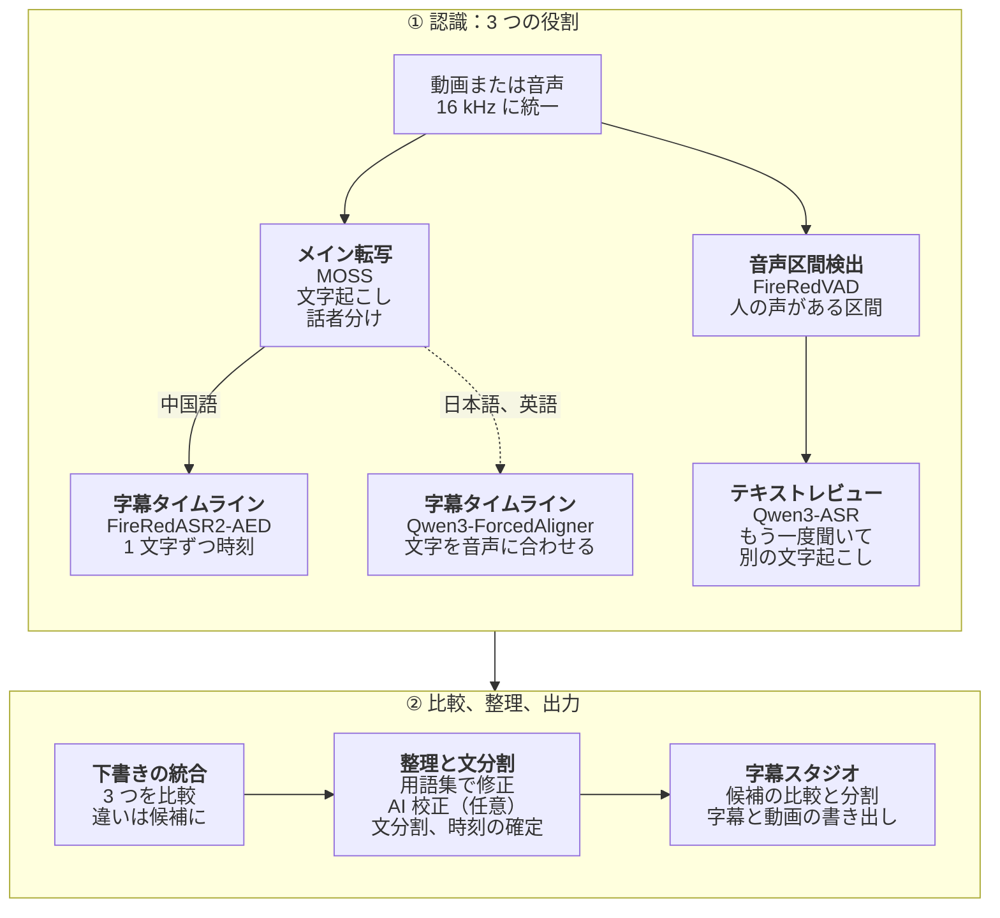

# 2ByteASR · 兔白字幕

**自動で字幕を付けるだけでなく、話者を分け、1 文字ずつ時刻を合わせ、ひとつの画面で直して、切って、そのまま書き出せます。**

ゲーム実況、配信アーカイブ、複数人の会話動画のための無料デスクトップ字幕アプリ。 
中国語が中心で、日本語と英語の認識にも対応。すべて自分の PC で動かすことも、自分のクラウドサービスにつなぐこともできます。

[中文](README.md) · [English](README_EN.md) · **日本語** · [한국어](README_KO.md)

## ダウンロード

現在のバージョン：**0.7.5**（2026-10-17）。お使いのコンピューターに合うインストーラーをひとつ選んでください。

| お使いのコンピューター | ダウンロード |
| --- | --- |
| **Windows 10 22H2 以降（64 ビット）** 正式版 | **[2ByteASR-Setup-0.7.5.exe](https://github.com/NOTBAD314/2ByteASR/releases/download/v0.7.5/2ByteASR-Setup-0.7.5.exe)**（約 1 GB） インストーラーにはコード署名がないため、「不明な発行元」と表示されることがあります。[Windows へのインストール](docs/product-guide.ja.md#windows-へのインストール)を参照してください。 |
| **Apple シリコン（M1 以降）の Mac、macOS 15 以降** **実験版** | **[2ByteASR-0.7.5-macos-arm64-Setup.dmg](https://github.com/NOTBAD314/2ByteASR/releases/download/v0.7.5/2ByteASR-0.7.5-macos-arm64-Setup.dmg)**（約 0.5 GB） GitHub の仮想 Mac でのみ確認しています。**Intel Mac には対応していません。** Apple の公証を受けていないため、初回の開き方は [Mac へのインストール](docs/product-guide.ja.md#mac-へのインストール実験版)を参照してください。 |

- **中国本土でダウンロードが遅い・できない場合：** まず GitCode のミラーから [Windows 版](https://gitcode.com/Notbad314/2ByteASR/releases/download/v0.7.5/2ByteASR-Setup-0.7.5.exe) · [Mac 版](https://gitcode.com/Notbad314/2ByteASR/releases/download/v0.7.5/2ByteASR-0.7.5-macos-arm64-Setup.dmg)。それでも駄目なら第三者の高速化サービス gh-proxy から [Windows](https://gh-proxy.com/https://github.com/NOTBAD314/2ByteASR/releases/download/v0.7.5/2ByteASR-Setup-0.7.5.exe) · [Mac](https://gh-proxy.com/https://github.com/NOTBAD314/2ByteASR/releases/download/v0.7.5/2ByteASR-0.7.5-macos-arm64-Setup.dmg)。どこから取得してもファイルは同じで、`SHA256SUMS.txt` で確認できます。
- **0.6.5 / 0.7.0 / 0.7.1 / 0.7.2 / 0.7.3 / 0.7.4 をお使いの場合：** アプリ右上の「更新を確認」から、変わった部分だけをダウンロードできます。0.6.0 以前は、アンインストールせずに新しいインストーラーで上書きしてください。
- **ほかの添付ファイルは不要です。** [Releases ページ](https://github.com/NOTBAD314/2ByteASR/releases/latest)の `Source`、`ThirdParty`、`update`、`.sig` などは、ソースコード、ライセンス資料、アプリ内更新のためのものです。`SHA256SUMS.txt` でダウンロードしたファイルが完全かどうか確認できます。

0.7.1 の実際の画面です。サンプルはプロジェクトで作ったテストカード映像と 2 人分の中国語合成音声で、NVIDIA GPU 上のローカル MOSS + FireRedASR2-AED + Qwen3-ASR で認識しました。話者名は話者管理で変更しています。

## はじめる前に

- **アプリは無料です。** 公式版は無料で、有料機能、登録、サブスクリプションはありません。開発を支援したい方は[愛発電](#作者を支援する)へ。
- **ローカル認識には、まずモデルのダウンロードが必要です。** インストーラーに認識モデルは含まれていません。初めてローカルで認識するとき、選んだ方法に合わせてモデルワークショップがモデルと実行環境をダウンロードします（NVIDIA 高品質プランはモデルだけで約 11 GB、ほかに実行環境）。その後はオフラインで使え、映像や音声が PC の外に出ることはありません。
- **クラウド認識と AI 機能はご自身のアカウントで使います。** クラウド認識にはサービスのアカウントと API キーが必要で、料金はサービス側の規定に従い、音声はそのサービスにアップロードされます。AI による文分割、AI 校正、翻訳、AI 用語作成にはご自身のテキスト AI サービスが必要です（送るのは字幕の文字だけ）。これらを使わなくても、認識、編集、書き出しはできます。
- **すべての PC ですべてのモデルが動くわけではありません。** まず下の表をご覧ください。

| お使いのコンピューター | おすすめの認識方法 | 特長 |
| --- | --- | --- |
| Windows、NVIDIA GPU あり | **この PC で認識**：MOSS + FireRedASR2-AED + Qwen3-ASR | 無料でアップロードなし。話者分離、1 文字ずつの時刻、3 モデルの比較 |
| Windows、NVIDIA GPU なし | **クラウド認識**（API キーが必要）、または **軽量（この PC）**（SenseVoice、CPU） | クラウドは従量課金で音声をアップロード。軽量は無料だが遅く、話者は分けない |
| Apple シリコンの Mac（実験版） | **この Mac で認識**（MLX）、Apple GPU での **MOSS + FireRed**、またはクラウド | メモリ 16 GB 以上を推奨。NVIDIA GPU より遅い |

- クラウドサービスのうち、MOSS Pro クラウドと百炼 / Qwen Cloud の Qwen-Audio 3.1 は話者を分けられます。クラウド認識と軽量方式は、どちらもローカルの Qwen3 アライナー（CPU 可）を加えると 1 文字ずつの時刻が付きます。
- Mac の MLX 方式はコミュニティ実装で、実機の Mac では未確認です。
- NVIDIA GPU が必要な組み合わせは開始前に表示され、「この PC で使える方法に変える」から切り替えられます。詳しくは[認識方法の選び方](docs/product-guide.ja.md#認識方法の選び方)を参照してください。

## できること

- **[話者を分ける](#話者を分ける)。** 1 行ずつ話者を付ける手間はいりません。話者分離に対応した方法なら、ひとりずつ字幕トラックに分かれ、名前、色、標準スタイルをまとめて管理でき、話者ごとに書き出せます。
- **[文字の境界で字幕を分割](#文字の境界で分割し動画も切る)**。波形を何度も聞き直す必要はありません。1 文字ずつ時刻があるので、分割しても文字がずれません。同じタイムラインで動画も切れ、書き出しは編集結果どおりになります。
- **[モデルごとの聞き取りを比べる](#モデルごとの聞き取りを比べる)。** ローカルの複数モデル方式では、同じ行を複数のモデルが聞き、違う文字と出どころを示します。クリックひとつで採用できます。
- **[一度まとめれば使い回せる用語集](#一度まとめれば使い回せる用語集)。** キャラクター名、技名、よくある誤認識をゲームごとに管理し、認識時の修正にも、既存字幕の校正にも使えます。
- **[配信アーカイブから切り抜き候補を探す](#配信アーカイブから切り抜き候補を探す)。** 字幕と bilibili のコメント XML から、理由と時間範囲付きの候補を挙げ、選んだものからクリップを生成します。
- **[字幕、原稿、完成動画を書き出す](#書き出し)。** SRT、ASS、TXT、JSON、話者別の字幕、字幕を焼き込んだ MP4 / MKV / MOV。

## 実際の操作

以下の動画とスクリーンショットは、日本語表示の 0.7.1 の実際のウィンドウから録画したものです。サンプル音声が中国語なので、字幕は中国語です。画面や認識結果を描き直してはいません。

### 話者を分ける

- タイムラインでは話者ごとに字幕トラックがあります（上のメイン画像を参照）。字幕を別のトラックへドラッグすると、その人の発言に変わります。
- 話者管理では、名前、色、標準スタイルの変更、誤って分かれた話者の統合、選択した字幕の割り当て、特定の話者だけを残す操作ができます。どれも元に戻せます。
- **話者を分けられる方法：** ローカルの MOSS（NVIDIA GPU、または Mac の Apple GPU）、MOSS Pro クラウド（MOSI）、百炼 / Qwen Cloud の Qwen-Audio 3.1。そのほかの方法は話者 1 人として出力され、字幕スタジオで手動で分けられます。

### 文字の境界で分割し、動画も切る

- **字幕の分割**（C キー。日本語表示では「レーザーツール」「カッターツール」と表記が揺れています）：切る前に前後の 2 行を確認でき、吸着をオンにすると文字と文字の間で止まります。文字の発音の途中で切ると、その文字は前の行に残ります。結合ツール（B）で 2 行をつなげます。どちらも Ctrl+Z で戻せます。
- **1 文字ずつの時刻がない場合**（文単位の時刻しか返さないクラウドサービスなど）は、文字数の割合で分割位置を推定し、「文字の境界は推定です」と表示します。聞いて確かめてください。
- **動画のカット**は別の操作です。映像トラックでクリップを分割、削除したり、隙間をリップル削除したり、話の間を検出してまとめて削除したりできます。字幕トラックも一緒に動き、書き出しは編集後のタイムラインで行われます。元の素材ファイルは書き換えません。

### モデルごとの聞き取りを比べる

- R キーでレビューモードに入ると、各行に動いたモデルの読みが並び、現在の文字と違う文字と出どころのモデルが表示されます。クリック（または 1〜4 キー）で採用して次の字幕へ進みます。これも元に戻せます。
- 候補が出るのは複数のモデルを使ったときだけです。Windows の NVIDIA ローカル方式で 3 つ、Mac の MOSS + FireRed で 2 つ。クラウドのみや軽量方式では比べる候補はありません。

### 一度まとめれば使い回せる用語集

ここには 3 つの別々の機能があり、どれかひとつだけ使うこともできます。

1. **用語集の管理**：ゲームや内容ごとに用語集を作り、正しい表記、別名、よくある誤認識を登録します。一部のゲームには参考用語が内蔵されていますが、文字を書き換えるのは確認済みの用語だけです。一括読み込みや、設定した AI による用語の提案（書き込む前に確認）もできます。
2. **認識時の適用**：確認済みの用語で、認識後によくある誤認識を規則どおりに直します。ローカルの Qwen3-ASR（中国語）、Qwen-Audio 3.1、MOSS Pro クラウドは認識中にも用語を参考にします。
3. **用語集で既存の字幕を校正**（「AI 用語集校正」）：用語集との照合だけ（ローカル、無料）でも、設定したテキスト AI による校正でも使えます。提案は一覧で確認してからまとめて適用でき、1 回で元に戻せます。

上の「モデルごとの聞き取りを比べる」とは別の機能で、そちらには用語集は必要ありません。

### 配信アーカイブから切り抜き候補を探す

字幕スタジオの「クリップアシスタント」で、認識済みの字幕と、必要なら bilibili 形式のコメント XML ファイルを読み込みます。まず PC 上でコメントが集中した場面や字幕中の強い反応を探し、テキスト AI を設定していれば AI が順位を付け、タイトルと理由を書きます。候補には時間範囲があり、プレビュー、「クリップへ追加」のあと「クリップを生成」で、その部分だけを残したタイムラインを作れます（「フル録画へ戻る」でいつでも元に戻せます）。

読むのは字幕とコメントだけで、映像は見ません。コメントの自動ダウンロードもしません。キーワードとコメントの反応は中国語向けに調整されています。AI がない場合は、ローカル分析で要確認と表示されます。

### 書き出し

- **字幕：** SRT、ASS、TXT、JSON。話者はまとめても、別々でも、両方でも書き出せます。翻訳がある場合は原文、訳文、2 言語の SRT を選べます。SRT は CapCut（剪映）などの編集ソフトにも読み込めます。
- **動画：** MP4、MKV、MOV で、字幕は画面に焼き込みます。全体でも、イン点からアウト点までの範囲でも書き出せます。フォント、縁取り、位置、登場と退場のアニメーションはプリセットがあり、AI は不要です。
- **そのほか：** 静止画（PNG / JPG）の書き出しとサムネイル作成。

## そのほかの便利な機能

- **はじめてのガイド：** 初回起動時に PC に合う認識方法を選べます。31 ステップのアニメーション付きチュートリアルはサンプルプロジェクトを使うので、モデル不要、アップロードなし、費用もかかりません。
- **原稿を合わせる：** 1 行ずつ書いた原稿があれば、文字単位の時刻で各行に時間を付けます。文章は書き換えません（ホーム画面からは今のところ中国語のみ）。
- **句読点：** 原文のまま、句読点を付ける、付けない、から選べます。変わるのは表示と書き出しだけです。
- **ショートカット：** すべて設定から変更でき、重なったときはどの機能と重なったかを表示します。
- **表示言語とテーマ：** 简体中文、繁體中文、English、日本語、한국어。テーマは 15 種類（ライト・ダーク・ハイコントラスト）で、外観ページでカードを押すとすぐにプレビューできます。日本語・英語・韓国語表示でも一部の項目が中国語のまま残っています。
- **日本語・英語と翻訳：** 「日本語（おすすめ）」「英語（おすすめ）」の認識プランがあります。中国語・日本語・英語の字幕は、ご自身のテキスト AI で簡体字・繁体字中国語、英語、日本語、韓国語に翻訳し、2 言語字幕として書き出せます。
- **外部 AI（MCP）：** Claude Desktop などの AI クライアントから、現在のプロジェクトの字幕を読んだり検索したりできます。文字の変更はアプリで「承認」したときだけ反映されます。初期設定はオフで、確認済みなのは Windows のみです。
- **アプリ内更新（Windows）：** 変わった部分だけをダウンロードし、確認してから置き換え、失敗したら自動で元に戻します。設定、用語集、プロジェクト、モデルは残ります。

## クイックスタート

1. **インストールして起動します。** 上の表から合うインストーラーをダウンロードしてください。
2. **認識方法を選びます。** 初回起動時に「この PC で認識」「クラウド認識」「軽量（この PC）」から選ぶと、必要なモデルをダウンロードするか、キーを入力する「API の申請と設定」を開きます。
3. **素材を入れて開始します。** 動画や音声をホーム画面にドロップし、用語集を選んで「字幕生成を開始」を押します。
4. **字幕スタジオで直して書き出します。** 文字の確認、分割と結合、スタイルの調整のあと、字幕を書き出すか、動画をエンコードします。

まず画面に慣れたい場合は、右上の「ヘルプ → はじめてのチュートリアル」でサンプルプロジェクトを試せます。インストール、費用、更新、よくある質問は[使い方ガイド](docs/product-guide.ja.md)にあります。

## さらに詳しく

<b>認識プランの組み立て（3 つの役割とモデル一覧）</b>

 

1 回の認識では、素材と機器に合わせて最大 3 つの役割を組み合わせます。

| 役割 | 内容 | 主な選択肢 |
| --- | --- | --- |
| メイン転写 | 文字に起こします。MOSS は話者も分けます | MOSS、SenseVoice、Whisper、Qwen3-ASR、クラウドサービス |
| 字幕タイムライン | 1 文字ずつ開始・終了時刻を付け、区切りや分割を文字の境界に合わせます | FireRedASR2-AED、Qwen3-ForcedAligner（CPU 可）、Paraformer |
| テキストレビュー | 別のモデルでもう一度聞き、違いを一覧にします | Qwen3-ASR などのローカル／オンライン方式 |

- **ローカルモデル：** MOSS-Transcribe-Diarize、FireRedASR2-AED、Qwen3-ASR 1.7B、SenseVoice Small、Paraformer Large、Whisper large-v3-turbo、Fun-ASR Nano、FireRedASR2-LLM、GLM-ASR-Nano、Canary-Qwen-2.5B（英語）、Qwen3-ForcedAligner 0.6B、日本語 CTC アライナー、Mac 用の MLX 版 Qwen3-ASR。Windows では MOSS、FireRedASR2-AED、Qwen3-ASR 1.7B、FireRedASR2-LLM に NVIDIA GPU が必要です。
- **クラウド認識（ご自身のアカウント）：** MOSS Pro クラウド（MOSI）、Alibaba Cloud 百炼 / Qwen Cloud の録音ファイル認識、iFlytek Spark-ASR 2.0、Groq Whisper、OpenAI、および OpenRouter、Azure、互換エンドポイント（上級者向け、実キーでは未検証）。文単位の時刻しか返さないサービスでは、時刻は推定と表示されます。
- モデルはアプリに同梱されていません。モデルワークショップで必要なときにダウンロードし、すべてのファイルを SHA-256 で確認します。各モデルにはそれぞれのライセンスがあります（[モデルライセンス一覧](licenses/MODELS.md)）。

- [使い方ガイド](docs/product-guide.ja.md)：インストール、初回起動、認識方法の選び方、費用とプライバシー、更新、よくある質問、ソースからの実行
- [画面紹介](docs/product-demo.ja.md)：認識の進行、完了画面、モデルワークショップ、書き出し、テーマなど（0.7.1 の画面）
- [API の申請と設定](docs/api-setup/README.md)（中国語）：各クラウド認識・テキスト AI の申請手順と料金の注意
- [Mac 版の説明](docs/deployment/macos-experimental.zh-CN.md)（中国語）· [更新方法](UPDATING.md)（中国語）· [0.7.5 リリースノート](docs/releases/0.7.5.md)（中国語・英語・日本語・韓国語）· [変更履歴](CHANGELOG.md) · [貢献ガイド](CONTRIBUTING.md)

## 認識の流れ

録音がどうやって字幕になるのかを知りたい方向けに、Windows + NVIDIA GPU の標準ローカルプラン（MOSS + FireRedASR2-AED + Qwen3-ASR）の流れを下の図にまとめました。点線は日本語・英語の素材だけが通る経路です。

ひとことで言うと：MOSS が全体を聞いて文字に起こし、誰が話しているかを分けます。同時に FireRedVAD が実際に人の声がある区間を探し、声のない行は取り除きます。続いて FireRedASR2-AED と Qwen3-ASR がそれぞれ独立にもう一度聞き、前者は 1 文字ずつ開始・終了時刻を付け、後者は別の文字起こしを作ります。アプリは MOSS の文と話者を骨組みにして 3 つの聞き取りを比べ、ほかの 2 モデルの表記が一致し、安全チェックも通ったときだけ自動で置き換えます。それ以外の違いは印を付け、字幕スタジオのレビューモードであなたが選べるように残します。その後、中国語の素材は用語集で修正し、設定したテキスト AI で校正します（任意。修正はすべて先にローカルの安全チェックを通ります）。文分割はローカル規則か AI で行いますが、AI が決めるのは区切る位置だけで、文字は変えられません。最後に字幕の文字に抜けや余分がないかを確認し、時刻を動画のフレームに合わせて読む時間を確保します。日本語と英語の素材では中国語用のタイムラインモデルを使わずに Qwen3-ForcedAligner で合わせ、文分割のあとに最終的なテキストでもう一度合わせます（日本語は CTC アライナーで行頭を補正することもできます）。

ほかのプランでも役割は同じで、担当するモデルが変わるだけです。クラウド認識ではサービス側が文字起こしをします（MOSS Pro クラウドと Qwen-Audio 3.1 は話者も分けます）。1 文字ずつの時刻はローカルの Qwen3-ForcedAligner（CPU 可）で補えます。ない場合はサービスが返す文単位の時刻を使い、推定と表示します。軽量方式（SenseVoice）はメイン転写だけで、話者は分けません。Mac では MLX 版 Qwen3-ASR とアライナー、または Apple GPU 上の MOSS + FireRed を使います。長い配信アーカイブが一度に GPU メモリに収まらないときは、MOSS が自動でいくつかの区間に分けて認識し、声紋で区間どうしの話者を対応させます。

## 作者を支援する

2ByteASR が役に立ったら、愛発電（Afdian）で今後の開発を支援できます：**[afdian.com/a/2byteasr](https://afdian.com/a/2byteasr)**。支援は任意で、しなくてもすべての機能を使えます。

## フィードバック、ライセンス、サードパーティー

問題は [Issues](https://github.com/NOTBAD314/2ByteASR/issues) へ、バージョン、認識方法、再現手順、スクリーンショットを添えてお知らせください。

プロジェクト独自のコードは **GPL-3.0-only** です（[英語の正式な条文](LICENSE)／[適用範囲](PROJECT_LICENSE.md)）。公式版は無料で提供されます。GPL に従えば商用利用、改変、有償での再配布が可能で、配布時には対応するソースコードの提供などの条件を満たす必要があります。私的な改変は公開する必要はなく、通常の字幕、動画、画像は本ソフトで作成したという理由だけで GPL の対象になることはありません。サードパーティーのコンポーネントにはそれぞれのライセンスがあります。高品質レンダラーで使う Remotion は個人と従業員 3 人以下の営利団体は無料ですが、それより大きい営利団体は別途 Company License が必要です。GSAP は標準ライセンスに従います。詳しくは[サードパーティー通知](THIRD_PARTY_NOTICES.md)と[モデルライセンス一覧](licenses/MODELS.md)を参照してください。完全版インストーラーの配布資料は整備中です（[配布状況](licenses/DISTRIBUTION-STATUS.md)）。

ソースコード：`main` ブランチがアプリのソースです。0.7.5 のインストーラーに対応するビルド元はタグ `v0.7.5` で、完全なビルド入力はリリースの `2ByteASR-Source-0.7.5.zip` にあります（[0.7.5 リリースノート](docs/releases/0.7.5.md#ソースと検証)の「ソースと検証」を参照）。[SOURCE_DELIVERY.md](SOURCE_DELIVERY.md) は 0.5.0 の時点で書かれたもので、0.7.5 向けには更新されていません。
