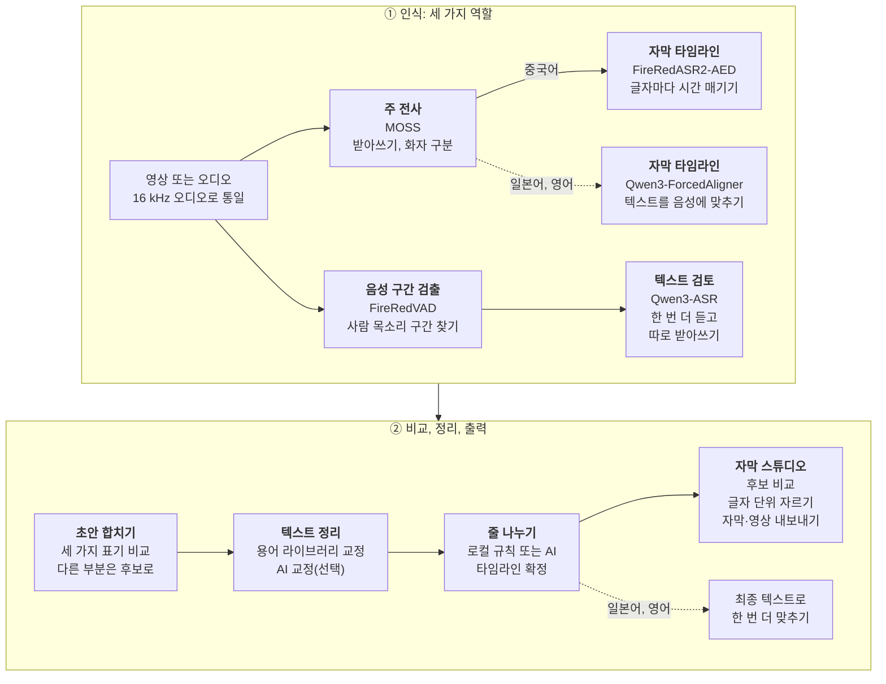

# 2ByteASR · 兔白字幕

**자동 자막으로 끝나지 않습니다. 누가 말했는지 나누고, 글자마다 시간을 맞추고, 한 창에서 고치고 잘라 바로 내보냅니다.**

게임 실황, 방송 다시보기, 여러 사람이 대화하는 영상을 위해 만든 무료 데스크톱 자막 앱입니다. 
중국어를 중심으로 하며 일본어와 영어 인식도 지원합니다. 모든 처리를 내 컴퓨터에서 할 수도 있고, 직접 쓰는 클라우드 서비스에 연결할 수도 있습니다.

[中文](README.md) · [English](README_EN.md) · [日本語](README_JA.md) · **한국어**

## 다운로드

현재 버전: **0.7.5**(2026-10-17). 내 컴퓨터에 맞는 설치 프로그램을 하나 고르세요.

| 내 컴퓨터 | 다운로드 |
| --- | --- |
| **Windows 10 22H2 이상(64비트)** 정식 버전 | **[2ByteASR-Setup-0.7.5.exe](https://github.com/NOTBAD314/2ByteASR/releases/download/v0.7.5/2ByteASR-Setup-0.7.5.exe)**(약 1 GB) 설치 프로그램에 코드 서명이 없어서 Windows가 “알 수 없는 게시자” 경고를 표시할 수 있습니다. [Windows에 설치하기](docs/product-guide.ko.md#windows에-설치하기)를 참고하세요. |
| **Apple 실리콘(M1 이후) Mac, macOS 15 이상** **실험판** | **[2ByteASR-0.7.5-macos-arm64-Setup.dmg](https://github.com/NOTBAD314/2ByteASR/releases/download/v0.7.5/2ByteASR-0.7.5-macos-arm64-Setup.dmg)**(약 0.5 GB) GitHub의 가상 Mac에서만 확인했습니다. **Intel Mac은 지원하지 않습니다.** Apple 공증을 받지 않았으므로 처음 여는 방법은 [Mac에 설치하기](docs/product-guide.ko.md#mac에-설치하기실험판)를 참고하세요. |

- **중국 본토에서 다운로드가 느리거나 안 된다면:** 먼저 GitCode 미러에서 [Windows 설치 프로그램](https://gitcode.com/Notbad314/2ByteASR/releases/download/v0.7.5/2ByteASR-Setup-0.7.5.exe) · [Mac 설치 파일](https://gitcode.com/Notbad314/2ByteASR/releases/download/v0.7.5/2ByteASR-0.7.5-macos-arm64-Setup.dmg)을 받으세요. 그래도 안 되면 제3자 가속 서비스 gh-proxy: [Windows](https://gh-proxy.com/https://github.com/NOTBAD314/2ByteASR/releases/download/v0.7.5/2ByteASR-Setup-0.7.5.exe) · [Mac](https://gh-proxy.com/https://github.com/NOTBAD314/2ByteASR/releases/download/v0.7.5/2ByteASR-0.7.5-macos-arm64-Setup.dmg). 어느 곳에서 받아도 파일은 같으며 `SHA256SUMS.txt`로 확인할 수 있습니다.
- **이미 0.6.5, 0.7.0, 0.7.1, 0.7.2, 0.7.3, 0.7.4를 쓰고 있다면:** 앱 오른쪽 위의 “업데이트 확인”을 누르면 바뀐 부분만 내려받습니다. 0.6.0 이하라면 기존 버전을 제거하지 말고 새 설치 프로그램을 실행해 덮어 설치하세요.
- **다른 첨부 파일은 받지 않아도 됩니다.** [Releases 페이지](https://github.com/NOTBAD314/2ByteASR/releases/latest)의 `Source`, `ThirdParty`, `update`, `.sig` 등은 소스 코드, 라이선스 자료, 앱 내 업데이트용 파일입니다. 내려받은 파일이 온전한지는 `SHA256SUMS.txt`로 확인할 수 있습니다.

한국어 인터페이스로 찍은 실제 0.7.2 화면입니다. 예제는 프로젝트에서 직접 만든 테스트 카드 영상과 두 사람의 중국어 합성 음성이며, NVIDIA GPU에서 로컬 MOSS + FireRedASR2-AED + Qwen3-ASR로 인식했습니다. 화자 이름 “스트리머”와 “팀원”은 화자 관리에서 바꾼 것입니다.

## 시작하기 전에

- **앱은 무료입니다.** 공식 버전은 무료로 제공되며 유료 기능, 회원 가입, 구독이 없습니다. 개발을 후원하고 싶다면 [Afdian](#개발자-후원)을 참고하세요.
- **로컬 인식은 먼저 모델을 내려받아야 합니다.** 설치 프로그램에는 음성 인식 모델이 들어 있지 않습니다. 처음 로컬로 인식할 때 고른 방식에 맞춰 “모델 워크숍”에서 모델과 실행 환경을 내려받습니다(NVIDIA 고품질 방식은 모델만 약 11 GB이고 실행 환경이 따로 필요합니다). 그다음부터는 오프라인으로 인식할 수 있고, 영상과 음성이 컴퓨터 밖으로 나가지 않습니다.
- **클라우드 인식과 AI 기능은 본인 계정으로 사용합니다.** 클라우드 인식에는 서비스 계정과 API Key가 필요하고, 요금은 서비스 업체의 규정에 따라 청구되며, 음성은 선택한 업체로 업로드됩니다. AI 줄 나누기, AI 교정, 번역, AI 용어 생성에는 직접 설정한 텍스트 AI 서비스가 필요합니다(자막 텍스트만 보냅니다). 이런 기능을 쓰지 않아도 인식, 편집, 내보내기는 모두 할 수 있습니다.
- **모든 컴퓨터에서 모든 모델이 돌아가지는 않습니다.** 먼저 아래 표를 보세요.

| 내 컴퓨터 | 권장 인식 방식 | 특징 |
| --- | --- | --- |
| Windows, NVIDIA GPU 있음 | **이 컴퓨터에서 인식**: MOSS + FireRedASR2-AED + Qwen3-ASR | 무료이며 업로드하지 않습니다. 화자 구분, 글자별 타이밍, 세 모델 비교 |
| Windows, NVIDIA GPU 없음 | **클라우드 인식**(API Key 필요) 또는 **경량 로컬**(SenseVoice, CPU 사용) | 클라우드는 사용량에 따라 요금이 붙고 음성을 업로드합니다. 경량 로컬은 무료지만 느리고 화자를 나누지 않습니다 |
| Apple 실리콘 Mac(실험판) | **이 Mac에서 인식**(MLX), Apple GPU로 돌리는 **MOSS + FireRed**, 또는 클라우드 | 메모리 16 GB 이상 권장. NVIDIA GPU보다 느립니다 |

- 클라우드 서비스 중에서는 MOSS Pro 클라우드와 Bailian / Qwen Cloud의 Qwen-Audio 3.1이 화자를 나눌 수 있습니다. 클라우드 인식과 경량 로컬 모두 로컬 Qwen3 정렬 모델(CPU 사용 가능)을 더하면 글자별 타이밍을 얻을 수 있습니다.
- Mac의 MLX 방식은 커뮤니티 구현이며, 실제 Mac 기기에서는 아직 확인하지 않았습니다.
- NVIDIA GPU가 필요한 조합은 시작하기 전에 미리 표시되고, 대신 쓸 수 있는 방식을 알려 줍니다. 자세한 비교는 [인식 방식 고르기](docs/product-guide.ko.md#인식-방식-고르기)를 참고하세요.

## 할 수 있는 일

- **[누가 말하는지 구분합니다](#누가-말하는지-구분하기).** 한 줄씩 화자를 붙일 필요가 없습니다. 화자 구분을 지원하는 방식은 사람마다 자막 트랙을 따로 만들고, 이름·색상·기본 스타일을 한곳에서 관리하며, 화자별로 나눠 내보낼 수 있습니다.
- **[글자 경계에 맞춰 자막을 나눕니다](#글자-단위로-자막을-나누고-영상도-자르기).** 파형을 몇 번씩 다시 들으며 맞출 필요가 없습니다. 글자마다 시작과 끝 시간이 있어서 자막을 자르면 글자 경계를 따라갑니다. 같은 타임라인에서 영상도 자를 수 있고, 내보내는 영상은 편집 결과를 그대로 따릅니다.
- **[같은 문장을 여러 모델의 표기와 비교합니다](#같은-문장을-여러-모델의-표기와-비교하기).** 로컬 다중 모델 방식에서는 여러 모델이 같은 줄을 각각 듣고, 표기가 다른 글자를 출처와 함께 표시합니다. 클릭 한 번으로 원하는 표기를 적용합니다.
- **[용어 라이브러리](#용어-라이브러리-한-번-정리해-두고-계속-쓰기)는 한 번 정리해 두면 계속 쓸 수 있습니다.** 캐릭터 이름, 기술 이름, 자주 틀리는 표기를 게임별로 정리해 두면 인식할 때 오류를 고치는 데 쓰이고, 이미 있는 자막을 교정할 때도 쓸 수 있습니다.
- **[방송 다시보기에서 클립 후보를 찾습니다](#방송-다시보기에서-클립-후보-찾기).** 자막과 Bilibili 탄막 XML을 바탕으로 잘라 낼 만한 구간을 이유, 시간 범위와 함께 보여 주고, 고른 후보로 편집본을 만듭니다.
- **[자막, 원고, 완성 영상을 내보냅니다](#내보내기).** SRT, ASS, TXT, JSON, 화자별 자막 파일, 그리고 자막을 입힌 MP4 / MKV / MOV.

## 실제 사용 모습

아래 녹화 영상과 스크린샷은 한국어 인터페이스로 실행한 실제 0.7.2 창에서 찍은 것입니다. 예제 음성이 중국어라서 자막은 중국어입니다. 화면이나 인식 결과를 다시 그리지 않았습니다.

### 누가 말하는지 구분하기

- 타임라인에는 화자마다 자막 트랙이 하나씩 있습니다(위의 메인 이미지 참고). 자막을 다른 트랙으로 끌어다 놓으면 그 사람이 한 말로 바뀝니다.
- “화자 관리”에서 이름을 바꾸고, 색상과 기본 스타일을 정하고, 잘못 나뉜 화자를 합치고, 선택한 자막을 특정 화자에게 지정하거나 한 화자의 자막만 남길 수 있습니다. 모든 작업은 실행 취소할 수 있습니다.
- **화자를 나눌 수 있는 방식:** 로컬 MOSS(NVIDIA GPU 또는 Mac의 Apple GPU), MOSS Pro 클라우드(MOSI), Bailian / Qwen Cloud의 Qwen-Audio 3.1. 다른 방식은 화자 한 명으로 출력하며, 자막 스튜디오에서 직접 나눌 수 있습니다.

### 글자 단위로 자막을 나누고, 영상도 자르기

- **자막 나누기**(“자르기 도구”, C): 자르기 전에 앞뒤 두 부분을 미리 볼 수 있고, 스냅을 켜면 글자와 글자 사이에서 멈춥니다. 한 글자의 발음 도중에 자르면 그 글자는 앞부분에 남습니다. 병합 도구(B)는 두 줄을 한 줄로 합칩니다. 둘 다 Ctrl+Z로 되돌릴 수 있습니다.
- **글자별 타이밍이 없을 때**(예: 문장 단위 시간만 돌려주는 클라우드 서비스)는 글자 수 비율로 자르는 위치를 추정하고, 화면에 “글자 경계는 추정값입니다”라고 표시합니다. 들어 보고 확인하세요.
- **영상 자르기**는 별개의 작업입니다. 비디오 트랙에서 클립을 분할하거나 삭제하고 빈 구간을 리플 삭제할 수 있으며, 말이 멈춘 구간을 찾아 한 번에 지울 수도 있습니다. 자막 트랙도 함께 움직이고, 내보내는 영상은 편집한 타임라인대로 만들어지며, 원본 파일은 수정되지 않습니다.

### 같은 문장을 여러 모델의 표기와 비교하기

- R을 누르면 검토 모드로 들어갑니다. 줄마다 실행된 모델들의 표기가 나열되고, 현재 텍스트와 다른 글자가 강조되며 어느 모델의 표기인지 표시됩니다. 카드를 클릭하거나 1–4를 눌러 적용하며, 이것도 실행 취소할 수 있습니다.
- 후보는 인식할 때 여러 모델을 실행한 경우에만 생깁니다. Windows의 NVIDIA 로컬 방식은 결과가 세 개, Mac의 MOSS + FireRed는 두 개입니다. 클라우드만 쓰거나 경량 로컬로 인식했다면 비교할 후보가 없습니다.

### 용어 라이브러리: 한 번 정리해 두고 계속 쓰기

여기에는 서로 다른 세 가지 기능이 있으며, 하나만 써도 됩니다.

1. **용어 라이브러리 관리**: 게임이나 콘텐츠마다 라이브러리를 만들고, 용어마다 올바른 표기, 별칭, 자주 틀리는 표기를 적습니다. 일부 게임에는 참고 용어가 기본으로 들어 있으며, 직접 확인한 용어만 글자를 고치는 데 쓰입니다. 일괄 가져오기도 할 수 있고, 설정한 AI에게 용어를 제안받을 수도 있습니다(확인한 뒤에만 저장됩니다).
2. **인식할 때 적용**: 확인한 용어는 인식이 끝난 뒤 규칙에 따라 자주 틀리는 표기를 올바르게 고칩니다. 로컬 Qwen3-ASR(중국어), Qwen-Audio 3.1, MOSS Pro 클라우드는 인식하는 동안에도 이 용어를 참고합니다.
3. **용어 라이브러리로 기존 자막 교정**(“AI 용어 라이브러리 교정”): 용어 라이브러리와 맞춰 보기만 할 수도 있고(로컬, 무료), 설정한 텍스트 AI에게 교정을 맡길 수도 있습니다. 제안을 먼저 목록으로 보여 주고, 확인하면 한꺼번에 적용하며, 한 번에 실행 취소할 수 있습니다.

위의 “여러 모델의 표기 비교”와는 다른 기능입니다. 모델 비교는 여러 인식 모델이 들은 내용을 비교하는 것이라 용어 라이브러리가 필요 없습니다.

### 방송 다시보기에서 클립 후보 찾기

자막 스튜디오의 “클립 어시스턴트”는 인식한 자막과, 필요하면 Bilibili 형식의 탄막 XML 파일을 읽습니다. 먼저 이 컴퓨터에서 탄막이 몰린 구간과 자막 속 반응이 큰 구간을 찾고, 텍스트 AI를 설정해 두었다면 AI가 순위를 매기고 제목과 이유를 씁니다. 후보마다 시간 범위가 있어서 미리 보고 “클립에 추가”한 뒤 “클립 생성”을 누르면 그 구간만 남긴 타임라인이 만들어집니다(“전체 녹화본으로 돌아가기”로 언제든 전체를 되돌릴 수 있습니다).

자막과 탄막만 읽습니다. 영상 화면은 보지 않고 탄막을 자동으로 내려받지도 않으며, 키워드와 탄막 반응은 중국어에 맞춰 조정되어 있습니다. AI 없이 분석하면 로컬 분석 결과이고 내용 확인이 필요하다고 표시됩니다.

### 내보내기

- **자막:** SRT, ASS, TXT, JSON. 화자는 합쳐서, 따로, 또는 두 가지 모두로 내보낼 수 있습니다. 번역이 있으면 원문, 번역문, 이중 언어 SRT 중에서 고를 수 있습니다. SRT는 CapCut / Jianying 같은 편집 프로그램으로도 가져올 수 있습니다.
- **영상:** MP4, MKV, MOV로 자막을 화면에 입혀 내보냅니다. 전체 타임라인이나 인 포인트부터 아웃 포인트까지의 구간을 고를 수 있습니다. 글꼴, 외곽선, 위치, 등장·퇴장 애니메이션은 기본 프리셋이 있어서 AI가 필요 없습니다.
- **그 밖에:** 현재 화면 정지 이미지(PNG / JPG) 저장과 표지 편집.

## 그 밖의 편의 기능

- **처음 사용 안내:** 처음 실행하면 먼저 내 컴퓨터에 맞는 인식 방식을 고릅니다. 애니메이션이 들어간 31단계 튜토리얼은 예제 프로젝트로 진행하므로 모델도, 업로드도, 비용도 필요 없습니다.
- **원고 맞추기:** 한 줄씩 정리한 원고가 이미 있다면 글자 단위 타이밍으로 각 줄에 시간을 맞추며, 글은 고치지 않습니다(홈 화면의 이 기능은 현재 중국어만 지원합니다).
- **문장 부호:** 원문 그대로 두기, 문장 부호 추가, 문장 부호 없음 중에서 고를 수 있습니다. 표시와 내보내기에만 영향을 주며 원문은 바뀌지 않습니다.
- **단축키:** 모든 단축키를 설정에서 바꿀 수 있고, 겹치면 어느 기능과 겹치는지 알려 줍니다.
- **인터페이스:** 简体中文, 繁體中文, English, 日本語, 한국어. 라이트, 다크, 고대비를 포함한 15가지 테마가 있고, “모양” 페이지에서 카드를 클릭하면 바로 미리 볼 수 있습니다. 영어·일본어·한국어 인터페이스에는 아직 중국어로 표시되는 항목이 조금 남아 있습니다.
- **영어·일본어와 번역:** “영어 추천”, “일본어 추천” 인식 구성이 있고, 영어는 단어 경계에서 줄을 나눕니다. 중국어·일본어·영어 자막은 직접 설정한 텍스트 AI로 중국어 간체, 중국어 번체, 영어, 일본어, 한국어로 번역해 이중 언어 자막으로 내보낼 수 있습니다.
- **외부 AI(MCP):** Claude Desktop 같은 AI 클라이언트가 현재 프로젝트의 자막을 읽고 검색할 수 있습니다. 글자를 고치는 작업은 2ByteASR에서 승인해야 적용됩니다. 기본값은 꺼짐이며, 지금은 Windows에서만 확인했습니다.
- **앱 내 업데이트(Windows):** 바뀐 부분만 내려받고, 검증한 뒤에 교체하며, 실패하면 자동으로 이전 버전으로 되돌립니다. 설정, 용어 라이브러리, 프로젝트, 모델은 그대로 남습니다.

## 빠른 시작

1. **설치하고 실행합니다.** 위 표에서 맞는 설치 프로그램을 내려받으세요.
2. **인식 방식을 고릅니다.** 처음 실행할 때 “이 컴퓨터에서 인식”, “클라우드 인식”, “경량 로컬” 중 하나를 고르면, 필요한 모델을 내려받도록 안내하거나 Key를 입력할 수 있는 “API 신청 및 설정”을 엽니다.
3. **미디어를 넣고 인식을 시작합니다.** 영상이나 오디오를 홈 화면에 끌어다 놓고, 쓸 용어 라이브러리를 고른 뒤 “자막 생성 시작”을 누릅니다.
4. **자막 스튜디오에서 고치고 내보냅니다.** 텍스트를 교정하고, 자막을 나누거나 합치고, 스타일을 조정한 다음 자막을 내보내거나 자막을 입힌 영상을 인코딩합니다.

화면부터 익히고 싶다면 오른쪽 위의 “도움말 → 초보자 튜토리얼”에서 예제 프로젝트를 따라 해 보세요. 설치, 비용, 업데이트, 자주 묻는 질문은 [사용 가이드](docs/product-guide.ko.md)에 있습니다.

## 더 알아보기

<b>인식 구성은 어떻게 짜이나요(세 가지 역할과 모델 목록)</b>

 

한 번 인식할 때 최대 세 가지 역할을 미디어와 장비에 맞게 조합합니다.

| 역할 | 하는 일 | 대표적인 선택지 |
| --- | --- | --- |
| 주 전사 | 텍스트를 받아 적습니다. MOSS는 화자도 구분합니다 | MOSS, SenseVoice, Whisper, Qwen3-ASR, 클라우드 서비스 |
| 자막 타임라인 | 글자마다 시작·끝 시간을 매겨서 줄 나누기와 자르기가 글자 경계를 따르게 합니다 | FireRedASR2-AED, Qwen3-ForcedAligner(CPU 사용 가능), Paraformer |
| 텍스트 검토 | 다른 모델로 한 번 더 듣고, 표기가 다른 부분을 보여 줍니다 | Qwen3-ASR 등 로컬 또는 온라인 방식 |

- **로컬 모델:** MOSS-Transcribe-Diarize, FireRedASR2-AED, Qwen3-ASR 1.7B, SenseVoice Small, Paraformer Large, Whisper large-v3-turbo, Fun-ASR Nano, FireRedASR2-LLM, GLM-ASR-Nano, Canary-Qwen-2.5B(영어), Qwen3-ForcedAligner 0.6B, 그리고 Mac용 MLX 버전 Qwen3-ASR. Windows에서는 MOSS, FireRedASR2-AED, Qwen3-ASR 1.7B, FireRedASR2-LLM에 NVIDIA GPU가 필요합니다.
- **클라우드 인식(본인 계정):** MOSS Pro 클라우드(MOSI), Alibaba Cloud Bailian / Qwen Cloud 녹음 파일 인식, iFlytek Spark-ASR 2.0, Groq Whisper, OpenAI, 그리고 OpenRouter, Azure, 사용자 지정 호환 엔드포인트(고급 기능, 실제 키로는 테스트하지 않음). 문장 단위 시간만 돌려주는 서비스는 자막 시간이 추정값으로 표시됩니다.
- 모델은 앱에 포함되어 있지 않습니다. 모델 워크숍에서 필요할 때 내려받고, 모든 파일을 SHA-256으로 확인하며, 모델마다 각자의 라이선스를 따릅니다([모델 라이선스 표](licenses/MODELS.md)).

- [사용 가이드](docs/product-guide.ko.md): 설치, 첫 실행, 인식 방식 고르기, 비용과 개인정보, 업데이트, 자주 묻는 질문, 소스에서 실행하기
- [인터페이스 둘러보기](docs/product-demo.ko.md): 인식 진행, 완료 화면, 모델 워크숍, 내보내기, 테마 등 더 많은 스크린샷(0.7.2 한국어 화면, 일부는 0.7.1 중국어 화면)
- [API 신청 및 설정](docs/api-setup/README.md)(중국어): 클라우드 인식과 텍스트 AI 서비스별 신청 절차와 요금 안내
- [Mac 실험판 안내](docs/deployment/macos-experimental.zh-CN.md)(중국어) · [업데이트 방법](UPDATING.md)(중국어) · [0.7.5 릴리스 노트](docs/releases/0.7.5.md)(중국어·영어·일본어·한국어) · [변경 기록](CHANGELOG.md) · [기여 안내](CONTRIBUTING.md)

## 인식 과정

녹음이 어떻게 자막이 되는지 궁금하다면 아래 그림을 보세요. Windows + NVIDIA GPU의 기본 로컬 방식(MOSS + FireRedASR2-AED + Qwen3-ASR)을 그린 것이며, 점선은 일본어·영어 미디어만 거치는 경로입니다.

간단히 말하면: MOSS가 파일 전체를 듣고 텍스트를 받아 적으며 누가 말하는지 구분합니다. 동시에 FireRedVAD가 실제로 사람 목소리가 있는 구간을 찾고, 목소리가 없는 줄은 버립니다. 이어서 FireRedASR2-AED와 Qwen3-ASR가 각자 한 번 더 듣습니다. 앞의 모델은 글자마다 시작·끝 시간을 매기고, 뒤의 모델은 또 하나의 받아쓰기를 만듭니다. 앱은 MOSS의 문장과 화자를 뼈대로 세 가지 표기를 비교하며, 나머지 두 모델의 표기가 같고 변경이 안전 검사를 통과할 때만 자동으로 바꿉니다. 그 밖의 차이는 표시해 두고, 자막 스튜디오의 검토 모드에서 직접 고를 수 있게 남깁니다. 그다음 중국어 미디어는 용어 라이브러리로 교정하고, 직접 설정한 텍스트 AI로 교정합니다(선택 사항이며, 모든 수정은 먼저 로컬 안전 검사를 통과해야 합니다). 줄 나누기는 로컬 규칙이나 AI로 하지만, AI는 어디서 나눌지만 정하고 글자는 바꿀 수 없습니다. 마지막으로 빠지거나 더해진 글자가 없는지 확인하고, 시간을 영상 프레임에 맞추며 읽을 시간을 확보합니다. 일본어와 영어 미디어는 중국어용 타임라인 모델 대신 Qwen3-ForcedAligner로 맞추고, 줄 나누기 뒤에 최종 텍스트로 한 번 더 맞춥니다(일본어는 CTC 정렬 모델로 줄 시작을 보정할 수도 있습니다).

다른 방식도 역할은 같고 맡는 모델만 바뀝니다. 클라우드 인식에서는 서비스가 텍스트를 받아 적습니다(MOSS Pro 클라우드와 Qwen-Audio 3.1은 화자도 구분합니다). 글자 단위 시간은 로컬 Qwen3-ForcedAligner(CPU 사용 가능)로 보충할 수 있고, 없으면 서비스가 돌려준 문장 단위 시간을 쓰며 추정값으로 표시합니다. 경량 로컬(SenseVoice)은 주 전사만 하고 화자는 구분하지 않습니다. Mac에서는 MLX 버전 Qwen3-ASR과 정렬 모델, 또는 Apple GPU에서 돌리는 MOSS + FireRed를 씁니다. 긴 방송 다시보기가 한 번에 GPU 메모리에 들어가지 않으면 MOSS가 자동으로 몇 구간으로 나눠 인식하고, 목소리 특징으로 구간 사이의 화자를 맞춥니다.

## 개발자 후원

이 앱이 도움이 되었다면 Afdian(爱发电)에서 앞으로의 개발을 후원할 수 있습니다: **[afdian.com/a/2byteasr](https://afdian.com/a/2byteasr)**. 후원은 자유이며, 후원하지 않아도 모든 기능을 쓸 수 있습니다.

## 피드백, 라이선스, 서드파티 구성 요소

문제가 있으면 [Issues](https://github.com/NOTBAD314/2ByteASR/issues)에 버전, 사용한 인식 방식, 재현 절차, 스크린샷을 함께 남겨 주세요.

프로젝트 자체 코드는 **GPL-3.0-only** 라이선스를 따릅니다([영어 원문](LICENSE), [적용 범위](PROJECT_LICENSE.md)). 공식 버전은 무료로 제공됩니다. GPL에 따라 상업적 이용, 수정, 유료 배포가 허용되며, 배포할 때는 해당 소스 코드 제공 등의 조건을 지켜야 합니다. 개인적으로 수정한 내용은 공개하지 않아도 되며, 일반적인 자막, 영상, 이미지는 이 소프트웨어로 만들었다는 이유만으로 GPL이 적용되지 않습니다. 서드파티 구성 요소는 각자의 라이선스를 따릅니다. 고품질 렌더러에 쓰이는 Remotion은 개인과 직원 3명 이하의 영리 조직에는 무료이며, 그보다 큰 영리 조직은 Remotion의 Company License를 별도로 구매해야 합니다. GSAP는 표준 라이선스 조건을 따릅니다. 자세한 내용은 [서드파티 고지](THIRD_PARTY_NOTICES.md)와 [모델 라이선스 표](licenses/MODELS.md)를 참고하세요. 전체 설치 패키지의 배포 자료는 아직 정리 중입니다([배포 현황](licenses/DISTRIBUTION-STATUS.md)).

소스: `main` 브랜치에 앱 소스가 있습니다. 0.7.5 설치 프로그램의 빌드 소스는 태그 `v0.7.5`이며, 전체 빌드 입력은 릴리스의 `2ByteASR-Source-0.7.5.zip`에 있습니다([0.7.5 릴리스 노트](docs/releases/0.7.5.md#소스와-검증)의 “소스와 검증” 참고). [SOURCE_DELIVERY.md](SOURCE_DELIVERY.md)는 0.5.0 때 작성되었으며 0.7.5에 맞춰 갱신되지 않았습니다.
