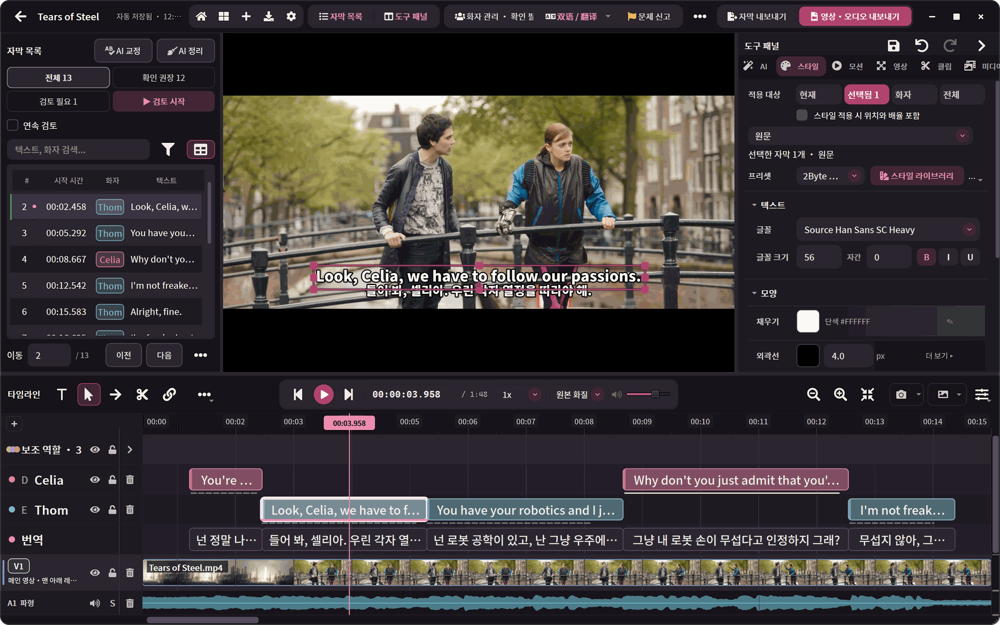
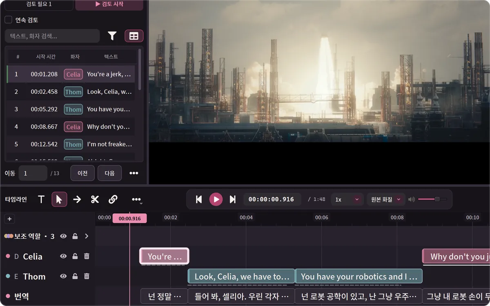
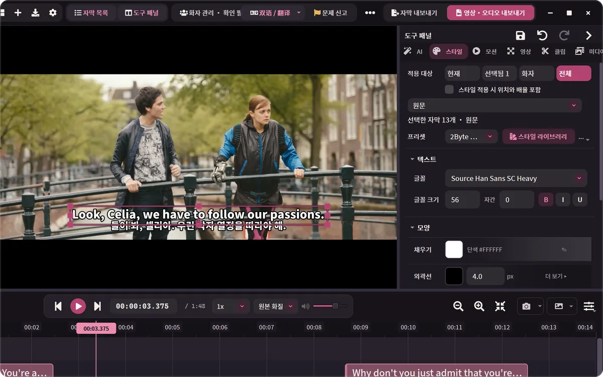
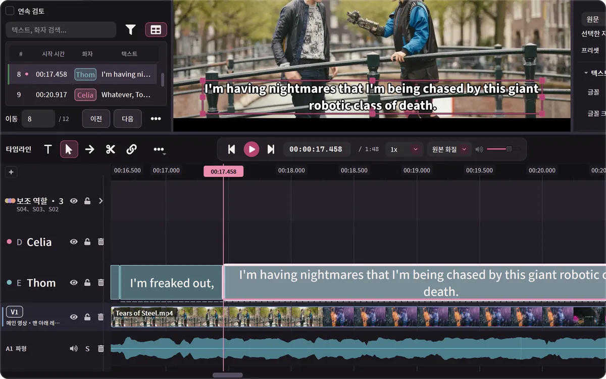
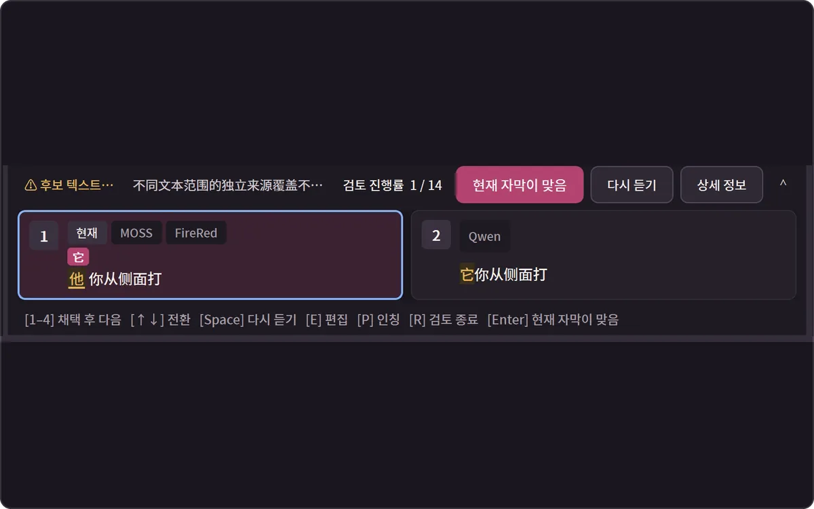
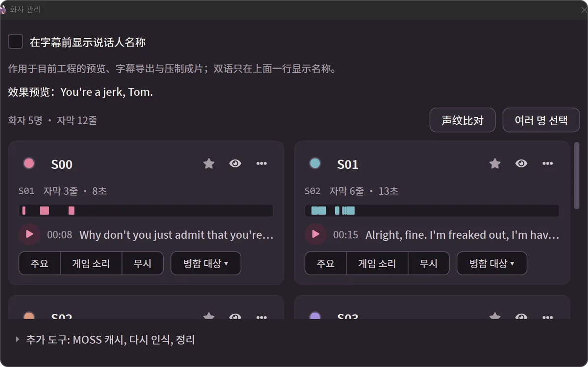
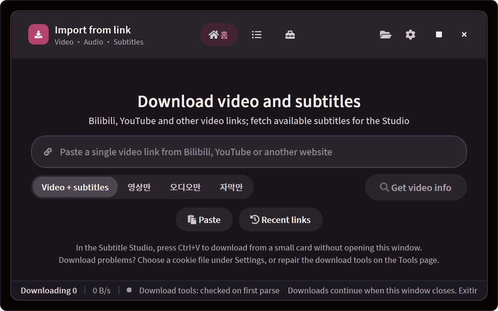
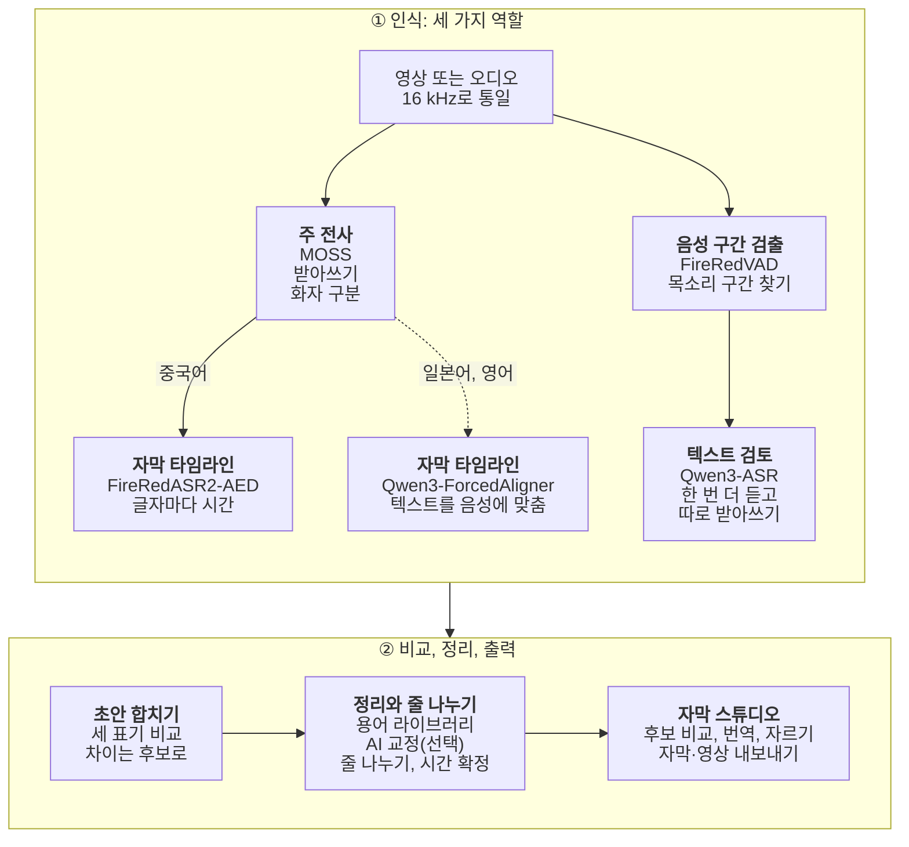

# 2ByteASR · 兔白字幕

### 자막 편집·번역 워크벤치

받아쓰기, 교정, 번역, 자르기, 내보내기를 한 창에서. 
무료입니다. 모든 처리를 내 컴퓨터에서 할 수도 있고, 직접 쓰는 클라우드 서비스에 연결할 수도 있습니다.

[English](README.md) · [中文](README_ZH.md) · [日本語](README_JA.md) · **한국어**

실제 0.8.7 화면입니다. 예제: [Tears of Steel](https://mango.blender.org/) (© Blender Foundation, [CC BY 3.0](https://creativecommons.org/licenses/by/3.0/)). NVIDIA GPU에서 로컬 MOSS + Qwen3-ForcedAligner + Qwen3-ASR로 인식했습니다. 화자 이름은 화자 관리에서 입력했고, 한국어 번역은 자막 스튜디오의 수동 번역으로 입력했습니다(AI는 쓰지 않았습니다).

| 받아쓰기 | 교정 | 번역 | 자르기 | 내보내기 |
| --- | --- | --- | --- | --- |
| 로컬이나 클라우드로, 화자를 구분해서 | 모델 비교, 용어 라이브러리, AI 교정 | 원문과 번역의 두 층, 빠진 곳은 더블클릭으로 채우기 | 글자 경계에서 나누고, 말이 멈춘 구간은 한 번에 삭제 | 자막 파일, 또는 자막을 입힌 영상 |

## 다운로드

현재 버전: **0.8.7**(2026-10-27. 이번에는 Windows만 있고 Mac은 0.8.6 그대로). 내 컴퓨터에 맞는 설치 프로그램을 하나 고르세요.

| 내 컴퓨터 | 다운로드 |
| --- | --- |
| **Windows 10 1809 이상(64비트)** 정식 버전 | **[2ByteASR-Setup-0.8.7.exe](https://github.com/NOTBAD314/2ByteASR/releases/download/v0.8.7/2ByteASR-Setup-0.8.7.exe)**(약 1 GB) 설치 프로그램에 코드 서명이 없어서 Windows가 “알 수 없는 게시자” 경고를 표시할 수 있습니다. [Windows에 설치하기](docs/product-guide.ko.md#windows에-설치하기)를 참고하세요. |
| **Apple 실리콘(M1 이후) Mac, macOS 14 이상** **실험판** | **[2ByteASR-0.8.6-macos-arm64-Setup.dmg](https://github.com/NOTBAD314/2ByteASR/releases/download/v0.8.6/2ByteASR-0.8.6-macos-arm64-Setup.dmg)**(약 0.5 GB) GitHub의 가상 Mac에서만 확인했습니다. **Intel Mac은 지원하지 않습니다.** Apple 공증을 받지 않았으므로 처음 여는 방법은 [Mac에 설치하기](docs/product-guide.ko.md#mac에-설치하기실험판)를 참고하세요. |

- **중국 본토에서 다운로드가 느리거나 안 된다면:** 먼저 GitCode 미러에서 [Windows 설치 프로그램](https://gitcode.com/Notbad314/2ByteASR/releases/download/v0.8.7/2ByteASR-Setup-0.8.7.exe) · [Mac 설치 파일](https://gitcode.com/Notbad314/2ByteASR/releases/download/v0.8.6/2ByteASR-0.8.6-macos-arm64-Setup.dmg)을 받으세요. 그래도 안 되면 제3자 가속 서비스 gh-proxy: [Windows](https://gh-proxy.com/https://github.com/NOTBAD314/2ByteASR/releases/download/v0.8.7/2ByteASR-Setup-0.8.7.exe) · [Mac](https://gh-proxy.com/https://github.com/NOTBAD314/2ByteASR/releases/download/v0.8.6/2ByteASR-0.8.6-macos-arm64-Setup.dmg). 어느 곳에서 받아도 파일은 같으며 `SHA256SUMS.txt`로 확인할 수 있습니다.
- **이미 0.6.5, 0.7.x, 0.8.0–0.8.6를 쓰고 있다면:** 앱 오른쪽 위의 “업데이트 확인”을 누르면 바뀐 부분만 내려받습니다. 0.6.0 이하라면 기존 버전을 제거하지 말고 새 설치 프로그램을 실행해 덮어 설치하세요.
- **다른 첨부 파일은 받지 않아도 됩니다.** [Releases 페이지](https://github.com/NOTBAD314/2ByteASR/releases/latest)의 `Source`, `ThirdParty`, `update`, `.sig` 등은 소스 코드, 라이선스 자료, 앱 내 업데이트용 파일입니다. 내려받은 파일이 온전한지는 `SHA256SUMS.txt`로 확인할 수 있습니다.
- **Linux:** [Docker 0.8.1](https://github.com/NOTBAD314/2ByteASR/releases/tag/v0.8.1-docker.1)(amd64 / CPU, 브라우저에서 기존 화면 사용, NVIDIA GPU 불필요)이 있습니다. [빌드 및 실행 방법](README.docker.md)을 참고하세요.

## 무엇을 하시나요?

<table>
<tr>
<td width="50%" valign="top">

**게임 실황, 방송 다시보기** 
화자마다 자막 트랙을 따로 두고, 용어 라이브러리로 캐릭터 이름과 기술 이름을 기억시키고, Bilibili 탄막 XML로 잘라 낼 만한 구간을 찾습니다. 
→ [화자 구분](#할-수-있는-일) · [용어 라이브러리](docs/product-guide.ko.md#자막-스튜디오-기본-조작)

</td>
<td width="50%" valign="top">

**외국어 영상에 자막 달기** 
YouTube, Bilibili 등의 링크를 붙여 넣으면 영상과 원래 자막을 함께 프로젝트로 가져옵니다. 일본어나 영어를 인식하고, 직접 설정한 텍스트 AI로 번역해 이중 언어 자막으로 내보냅니다. 
→ [링크 다운로드](#할-수-있는-일) · [번역과 이중 언어](#할-수-있는-일)

</td>
</tr>
<tr>
<td width="50%" valign="top">

**인터뷰, 팟캐스트, 강의** 
원고가 있다면 글을 고치지 않고 시간만 맞춥니다. 말이 멈춘 구간은 한 번에 지우고, 일괄 바꾸기와 간체·번체 변환도 할 수 있습니다. 
→ [자막 스튜디오 기본 조작](docs/product-guide.ko.md#자막-스튜디오-기본-조작)

</td>
<td width="50%" valign="top">

**이미 자막이 있다면** 
SRT / ASS를 가져와 교정하고, 번역하고, 스타일을 바꿔 다시 영상에 입힐 수 있습니다. 인식 모델은 필요 없습니다. 
→ [입력과 출력](docs/product-guide.ko.md#입력과-출력)

</td>
</tr>
</table>

## 할 수 있는 일

<table>
<tr>
<td width="50%" valign="top">

**번역과 이중 언어 자막** 
직접 설정한 텍스트 AI로 중국어 간체·번체, 영어, 일본어, 한국어 등으로 번역합니다. 번역이 빠진 곳은 번역 트랙을 더블클릭해 채웁니다. 원문과 번역은 각자 스타일을 가지며, 하나만 또는 둘 다 내보낼 수 있습니다.
</td>
<td width="50%" valign="top">

**스타일, 애니메이션, 영상 내보내기** 
글꼴, 외곽선, 위치, 등장·퇴장 애니메이션은 기본 프리셋이 있어 AI가 필요 없습니다. MP4 / MKV / MOV로, 전체 또는 인 포인트부터 아웃 포인트까지 내보냅니다.
</td>
</tr>
<tr>
<td width="50%" valign="top">

**글자·단어 경계에서 나누고, 영상도 자릅니다** 
글자와 단어마다 시간이 있어서 자르기 도구가 그 경계에서 멈춥니다. 비디오 트랙에서는 분할, 리플 삭제, 말이 멈춘 구간을 찾아 한 번에 지우기를 할 수 있습니다.
</td>
<td width="50%" valign="top">

**같은 문장을 여러 모델의 표기와 비교합니다** 
로컬 다중 모델 방식에서는 여러 모델이 같은 줄을 각각 듣습니다. 다른 글자와 출처가 표시되고, 클릭하거나 1–4를 눌러 적용합니다. 여기는 중국어 예제입니다(이 버전은 중국어 자막에만 후보를 보여 줍니다).
</td>
</tr>
<tr>
<td width="50%" valign="top">

**누가 말하는지 구분합니다** 
화자 구분을 지원하는 방식은 사람마다 자막 트랙을 따로 만듭니다. 이름·색상·기본 스타일을 한곳에서 관리하고, 잘못 나뉜 화자는 합칠 수 있으며, 모두 실행 취소할 수 있습니다.
</td>
<td width="50%" valign="top">

**링크를 붙여 넣으면 영상과 자막이 함께 들어옵니다** 
YouTube, Bilibili, 다운로더(yt-dlp)가 지원하는 그 밖의 단일 영상. 자막 스튜디오에서 Ctrl+V를 누르면 재생 헤드 위치로 바로 내려받습니다. 이 창은 아직 한국어 번역이 거의 없어 대부분 영어로 표시됩니다.
</td>
</tr>
</table>

그 밖에도: 용어 라이브러리와 AI 교정, 원고 맞추기, 화자별 내보내기, 예제 프로젝트로 하는 튜토리얼(모델 불필요), 11가지 인터페이스 언어와 15가지 테마. 자세한 내용은 [사용 가이드](docs/product-guide.ko.md)를 보세요.

## 시작하기 전에

- **앱은 무료입니다.** 공식 버전은 무료로 제공되며 유료 기능, 회원 가입, 구독이 없습니다. 개발을 후원하고 싶다면 [Afdian](#개발자-후원)을 참고하세요.
- **로컬 인식은 먼저 모델을 내려받아야 합니다.** 설치 프로그램에는 음성 인식 모델이 들어 있지 않습니다. 처음 로컬로 인식할 때 고른 방식에 맞춰 “모델 워크숍”에서 모델과 실행 환경을 내려받습니다(NVIDIA 고품질 방식은 모델만 약 11 GB이고 실행 환경이 따로 필요합니다). 그다음부터는 오프라인으로 인식할 수 있고, 영상과 음성이 컴퓨터 밖으로 나가지 않습니다.
- **클라우드 인식과 AI 기능은 본인 계정으로 사용합니다.** 클라우드 인식에는 서비스 계정과 API Key가 필요하고, 요금은 서비스 업체의 규정에 따라 청구되며, 음성은 선택한 업체로 업로드됩니다. AI 줄 나누기, AI 교정, 번역, AI 용어 생성에는 직접 설정한 텍스트 AI 서비스가 필요합니다(자막 텍스트만 보냅니다). 이런 기능을 쓰지 않아도 인식, 편집, 내보내기는 모두 할 수 있습니다.
- **모든 컴퓨터에서 모든 모델이 돌아가지는 않습니다.** 먼저 아래 표를 보세요.

| 내 컴퓨터 | 권장 인식 방식 | 특징 |
| --- | --- | --- |
| Windows, NVIDIA GPU 있음 | **이 컴퓨터에서 인식**: MOSS + FireRedASR2-AED + Qwen3-ASR | 무료이며 업로드하지 않습니다. 화자 구분, 글자별 타이밍, 세 모델 비교 |
| Windows, NVIDIA GPU 없음 | **클라우드 인식**(API Key 필요) 또는 **경량 로컬**(SenseVoice, CPU 사용) | 클라우드는 사용량에 따라 요금이 붙고 음성을 업로드합니다. 경량 로컬은 무료지만 느리고 화자를 나누지 않습니다 |
| Apple 실리콘 Mac(실험판) | **이 Mac에서 인식**(MLX), Apple GPU로 돌리는 **MOSS + FireRed**, 또는 클라우드 | 메모리 16 GB 이상 권장. NVIDIA GPU보다 느립니다 |

클라우드 서비스 중에서는 MOSS Pro 클라우드와 Bailian / Qwen Cloud의 Qwen-Audio 3.1이 화자를 나눌 수 있습니다. 클라우드 인식과 경량 로컬 모두 로컬 Qwen3 정렬 모델(CPU 사용 가능)을 더하면 글자별 타이밍을 얻을 수 있습니다. 자세한 비교는 [인식 방식 고르기](docs/product-guide.ko.md#인식-방식-고르기)를 참고하세요.

## 빠른 시작

1. **설치하고 실행합니다.** 위 표에서 맞는 설치 프로그램을 내려받으세요.
2. **인식 방식을 고릅니다.** 처음 실행할 때 “이 컴퓨터에서 인식”, “클라우드 인식”, “경량 로컬” 중 하나를 고르면, 필요한 모델을 내려받도록 안내하거나 Key를 입력할 수 있는 “API 신청 및 설정”을 엽니다.
3. **미디어를 넣습니다.** 영상이나 오디오를 홈 화면에 끌어다 놓거나 “링크 다운로드”에서 동영상 링크를 붙여 넣습니다. 쓸 용어 라이브러리를 고른 뒤 “자막 생성 시작”을 누릅니다. 자막이 있는 영상은 바로 자막 스튜디오로 가져갈 수 있습니다.
4. **자막 스튜디오에서 고치고, 번역하고, 내보냅니다.** 텍스트를 교정하고, 자막을 나누거나 합치고, 번역하고, 스타일을 조정한 다음 자막을 내보내거나 자막을 입힌 영상을 인코딩합니다.

화면부터 익히고 싶다면 오른쪽 위의 “도움말 → 초보자 튜토리얼”에서 예제 프로젝트를 따라 해 보세요. 설치, 비용, 업데이트, 자주 묻는 질문은 [사용 가이드](docs/product-guide.ko.md)에 있습니다.

## 더 알아보기

<b>인식 구성은 어떻게 짜이나요(세 가지 역할과 모델 목록)</b>

 

한 번 인식할 때 최대 세 가지 역할을 미디어와 장비에 맞게 조합합니다.

| 역할 | 하는 일 | 대표적인 선택지 |
| --- | --- | --- |
| 주 전사 | 텍스트를 받아 적습니다. MOSS는 화자도 구분합니다 | MOSS, SenseVoice, Whisper, Qwen3-ASR, 클라우드 서비스 |
| 자막 타임라인 | 글자마다 시작·끝 시간을 매겨서 줄 나누기와 자르기가 글자 경계를 따르게 합니다 | FireRedASR2-AED, Qwen3-ForcedAligner(CPU 사용 가능), Paraformer |
| 텍스트 검토 | 다른 모델로 한 번 더 듣고, 표기가 다른 부분을 보여 줍니다 | Qwen3-ASR 등 로컬 또는 온라인 방식 |

- **로컬 모델:** MOSS-Transcribe-Diarize, FireRedASR2-AED, Qwen3-ASR 1.7B, SenseVoice Small, Paraformer Large, Whisper large-v3-turbo, Fun-ASR Nano, FireRedASR2-LLM, GLM-ASR-Nano, Canary-Qwen-2.5B(영어), Qwen3-ForcedAligner 0.6B, 그리고 Mac용 MLX 버전 Qwen3-ASR. Windows에서는 MOSS, FireRedASR2-AED, Qwen3-ASR 1.7B, FireRedASR2-LLM에 NVIDIA GPU가 필요합니다.
- **클라우드 인식(본인 계정):** MOSS Pro 클라우드(MOSI), Alibaba Cloud Bailian / Qwen Cloud 녹음 파일 인식, iFlytek Spark-ASR 2.0, Groq Whisper, OpenAI, 그리고 OpenRouter, Azure, 사용자 지정 호환 엔드포인트(고급 기능, 실제 키로는 테스트하지 않음). 문장 단위 시간만 돌려주는 서비스는 자막 시간이 추정값으로 표시됩니다.
- 모델은 앱에 포함되어 있지 않습니다. 모델 워크숍에서 필요할 때 내려받고, 모든 파일을 SHA-256으로 확인하며, 모델마다 각자의 라이선스를 따릅니다([모델 라이선스 표](licenses/MODELS.md)).

<b>녹음이 자막이 되기까지(인식 과정)</b>

 

Windows + NVIDIA GPU의 기본 로컬 방식(MOSS + FireRedASR2-AED + Qwen3-ASR)입니다. 점선은 일본어·영어 미디어만 거치는 경로입니다.

MOSS가 파일 전체를 듣고 텍스트를 받아 적으며 누가 말하는지 구분합니다. FireRedVAD는 실제로 사람 목소리가 있는 구간을 찾습니다. 이어서 FireRedASR2-AED와 Qwen3-ASR가 각자 한 번 더 듣고, 앞의 모델은 글자마다 시간을 매기고 뒤의 모델은 또 하나의 받아쓰기를 만듭니다. 앱은 MOSS의 문장과 화자를 뼈대로 세 가지 표기를 비교하며, 나머지 두 모델의 표기가 같고 변경이 안전 검사를 통과할 때만 자동으로 바꿉니다. 그 밖의 차이는 자막 스튜디오의 검토 모드에서 직접 고를 수 있게 남깁니다. 그다음 용어 라이브러리로 교정하고, 선택에 따라 AI 교정을 합니다. 줄 나누기는 로컬 규칙이나 AI로 하지만, AI는 어디서 나눌지만 정하고 글자는 바꿀 수 없습니다.

다른 방식도 역할은 같습니다. 클라우드 인식에서는 서비스가 텍스트를 받아 적고, 글자 단위 시간은 로컬 Qwen3-ForcedAligner로 보충할 수 있습니다. 경량 로컬(SenseVoice)은 주 전사만 합니다. Mac에서는 MLX 버전 Qwen3-ASR과 정렬 모델, 또는 Apple GPU에서 돌리는 MOSS + FireRed를 씁니다.

- [사용 가이드](docs/product-guide.ko.md): 설치, 첫 실행, 인식 방식 고르기, 비용과 개인정보, 자막 스튜디오 조작, 업데이트, 자주 묻는 질문, 소스에서 실행하기
- [인터페이스 둘러보기](docs/product-demo.ko.md): 인식 진행, 완료 화면, 모델 워크숍, 내보내기, 테마 등 더 많은 스크린샷(0.7.2 한국어 화면, 일부는 0.7.1 중국어 화면)
- [API 신청 및 설정](docs/api-setup/README.md)(중국어): 클라우드 인식과 텍스트 AI 서비스별 신청 절차와 요금 안내
- [Mac 실험판 안내](docs/deployment/macos-experimental.zh-CN.md)(중국어) · [업데이트 방법](UPDATING.md)(중국어) · [0.8.7 릴리스 노트](docs/releases/0.8.7.md)(중국어·영어·일본어·한국어) · [변경 기록](CHANGELOG.md) · [기여 안내](CONTRIBUTING.md)

## 개발자 후원

이 앱이 도움이 되었다면 Afdian(爱发电)에서 앞으로의 개발을 후원할 수 있습니다: **[afdian.com/a/2byteasr](https://afdian.com/a/2byteasr)**. 후원은 자유이며, 후원하지 않아도 모든 기능을 쓸 수 있습니다.

## 피드백, 라이선스, 서드파티 구성 요소

문제가 있으면 [Issues](https://github.com/NOTBAD314/2ByteASR/issues)에 버전, 사용한 인식 방식, 재현 절차, 스크린샷을 함께 남겨 주세요.

프로젝트 자체 코드는 **GPL-3.0-only** 라이선스를 따릅니다([영어 원문](LICENSE), [적용 범위](PROJECT_LICENSE.md)). 공식 버전은 무료로 제공됩니다. GPL에 따라 상업적 이용, 수정, 유료 배포가 허용되며, 배포할 때는 해당 소스 코드 제공 등의 조건을 지켜야 합니다. 개인적으로 수정한 내용은 공개하지 않아도 되며, 일반적인 자막, 영상, 이미지는 이 소프트웨어로 만들었다는 이유만으로 GPL이 적용되지 않습니다. 서드파티 구성 요소는 각자의 라이선스를 따릅니다. 고품질 렌더러에 쓰이는 Remotion은 개인과 직원 3명 이하의 영리 조직에는 무료이며, 그보다 큰 영리 조직은 Remotion의 Company License를 별도로 구매해야 합니다. GSAP는 표준 라이선스 조건을 따릅니다. 자세한 내용은 [서드파티 고지](THIRD_PARTY_NOTICES.md)와 [모델 라이선스 표](licenses/MODELS.md)를 참고하세요. 전체 설치 패키지의 배포 자료는 아직 정리 중입니다([배포 현황](licenses/DISTRIBUTION-STATUS.md)).

소스: `main` 브랜치에 앱 소스가 있습니다. 0.8.7 설치 프로그램의 빌드 소스는 태그 `v0.8.7`이며, 전체 빌드 입력은 릴리스의 `2ByteASR-Source-0.8.7.zip`에 있습니다([0.8.7 릴리스 노트](docs/releases/0.8.7.md#소스와-검증)의 “소스와 검증” 참고). [SOURCE_DELIVERY.md](SOURCE_DELIVERY.md)는 0.5.0 때 작성되었으며 0.8.7에 맞춰 갱신되지 않았습니다.
