

# 2ByteASR · 兔白字幕

### 무료 자막 프로그램. 받아쓰기, 교정, 번역, 편집, 내보내기를 한곳에서

Windows와 Mac에서 쓸 수 있습니다. NVIDIA GPU가 있으면 전부 오프라인으로 처리할 수 있습니다.

[1.1.5 다운로드](#다운로드) · [기능](#기능) · [자주 묻는 질문](#자주-묻는-질문) · [사용 가이드](docs/product-guide.ko.md)

[English](README.md) · [中文](README_ZH.md) · [日本語](README_JA.md) · **한국어**

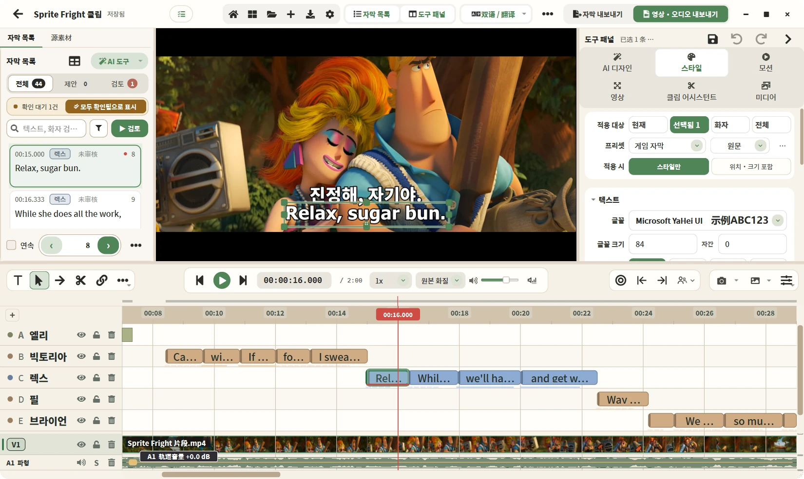

예제 영상: [Sprite Fright](https://studio.blender.org/films/sprite-fright/) © Blender Foundation · [CC BY 4.0](https://creativecommons.org/licenses/by/4.0/)

## 기능

| 받아쓰기 | 교정 | 번역 | 편집 | 내보내기 |
| :---: | :---: | :---: | :---: | :---: |
| 로컬 또는 클라우드 | 여러 모델 비교 | 2개 국어 자막 | 단어 단위로 나누기 | 자막 파일 또는 영상 |

<table>
<tr>
<td colspan="2" valign="top">
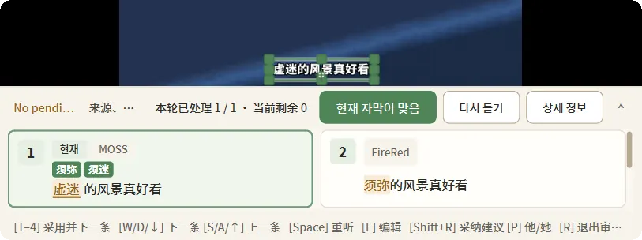

**모델마다 다르게 적었다면? 맞는 쪽을 클릭** 
다른 글자는 강조되고, 어느 모델이 적었는지도 보입니다.
</td>
</tr>
<tr>
<td width="50%" valign="top">
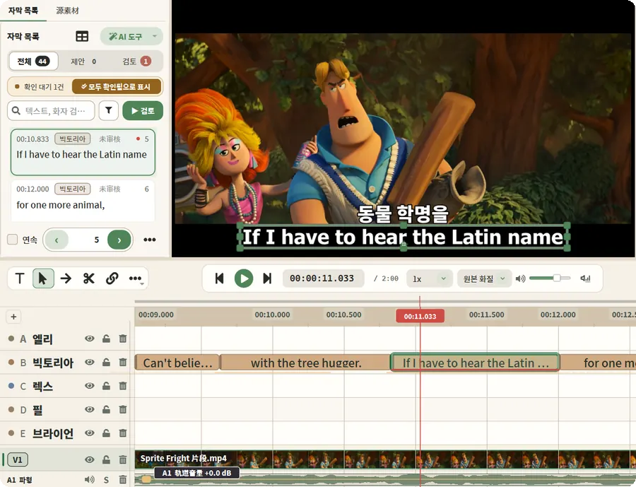

**자르기는 단어 사이에서만** 
단어 중간이 잘리지 않고, 번역도 함께 나뉩니다.
</td>
<td width="50%" valign="top">
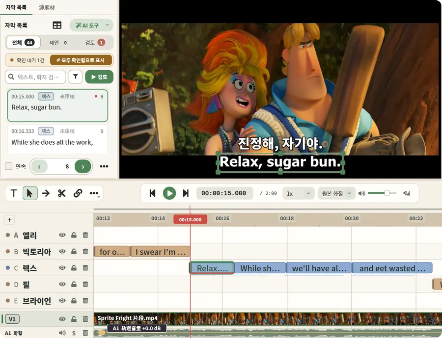

**클릭 한 번으로 2개 국어 자막** 
내 텍스트 AI로 번역하고, 빠진 줄은 더블클릭해서 채웁니다.
</td>
</tr>
<tr>
<td width="50%" valign="top">
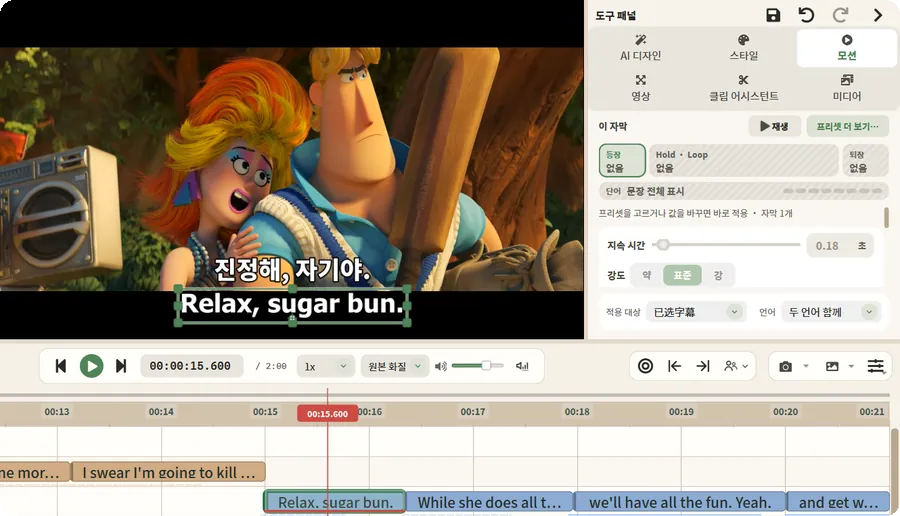

**수십 가지 자막 애니메이션** 
마우스를 올리면 미리보기, 길이는 드래그로 바꿉니다.
</td>
<td width="50%" valign="top">
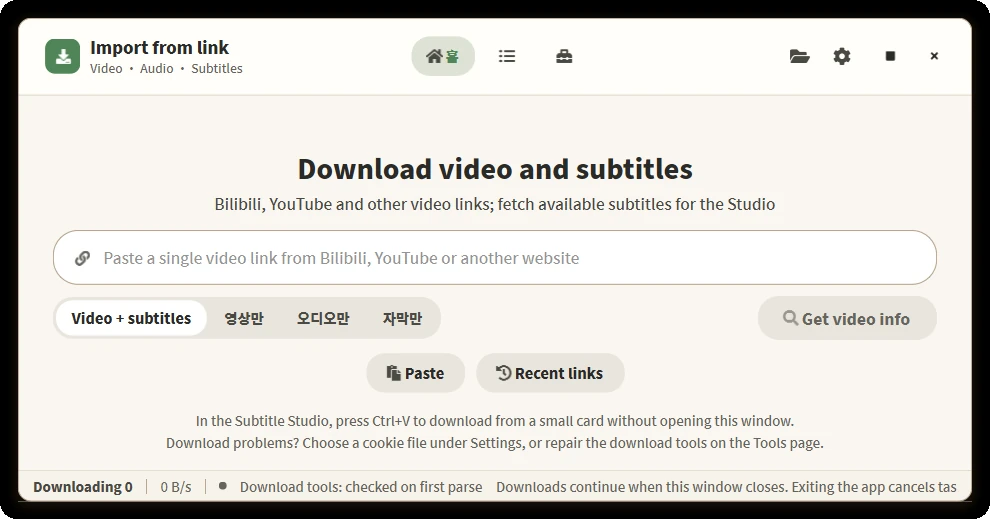

**링크만 붙여 넣으면 다운로드** 
YouTube, Bilibili 영상을 자막과 함께 가져옵니다.
</td>
</tr>
<tr>
<td width="50%" valign="top">
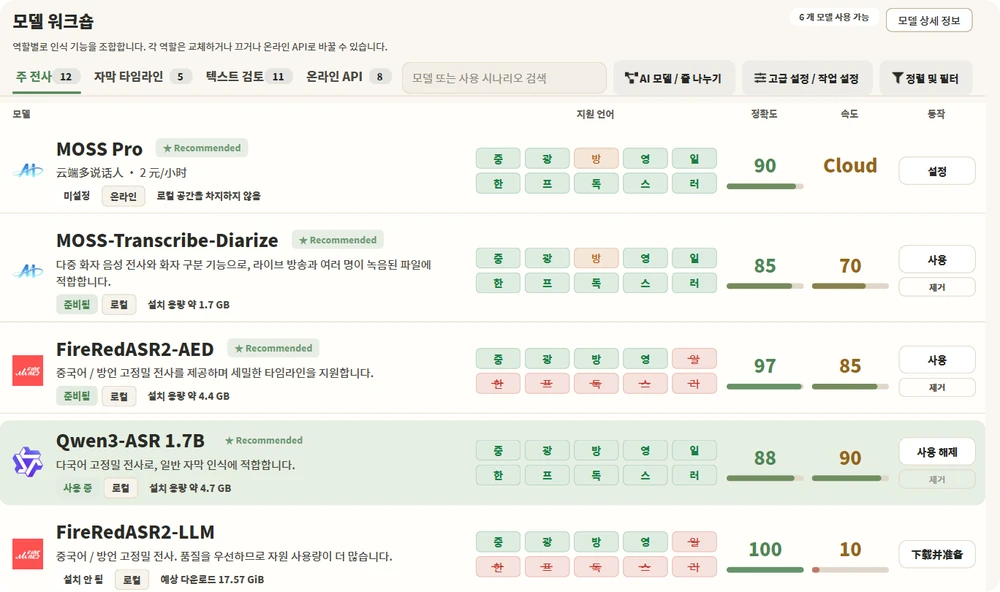

**모델 워크숍: 고르고 클릭 한 번으로 설치** 
지원 언어, 정확도, 속도를 한눈에 비교합니다.
</td>
<td width="50%" valign="top">
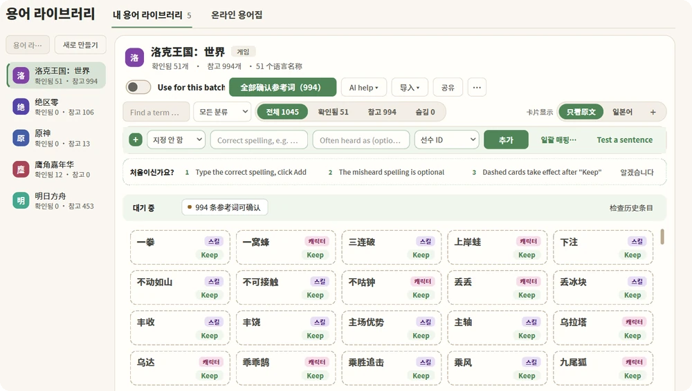

**용어 라이브러리: 캐릭터 이름을 정확하게** 
여러 게임의 용어집이 들어 있고, 직접 추가할 수도 있습니다.
</td>
</tr>
</table>

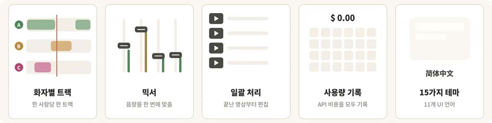

## 자막이 정확한 이유

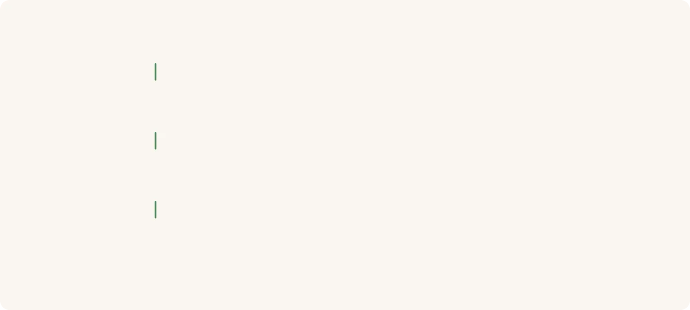

## AI가 하는 일, 하지 않는 일

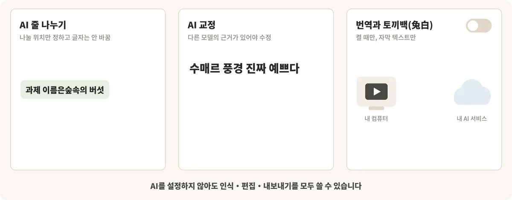

## 토끼백에게 물어보기

스튜디오 구석의 토끼 토끼백(兔白)이 사용법 질문에 답해 줍니다. “자막 번역은 어떻게 하나요?”라고 물으면 위치를 알려 주고 바로 데려가 줍니다. 텍스트 AI를 연결하면 자막 점검, 한 줄 수정, 전체 바꾸기도 할 수 있습니다. 바꾸기 전에 먼저 물어보고, 모든 변경은 되돌릴 수 있습니다.

## 이런 작업에

| 작업 | 이렇게 쓰세요 |
| --- | --- |
| 게임 방송, 다시보기 | 화자마다 트랙 하나, 용어 라이브러리로 캐릭터 이름 관리, 탄막으로 하이라이트 찾기 |
| 외국어 영상에 자막 달기 | 링크로 가져와 받아쓰고 번역해서 2개 국어 자막 내보내기 |
| 인터뷰, 팟캐스트, 강의 | 있는 대본에 바로 타이밍 맞추기, 말 사이 공백 한 번에 삭제 |
| 이미 자막 파일이 있을 때 | SRT / ASS를 불러와 수정, 번역, 스타일 변경. 모델 필요 없음 |

## 다운로드

현재 버전은 **Windows 1.1.5** (2026-11-25) 및 **Apple Silicon Mac 1.1.2**입니다.

| 환경 | 다운로드 |
| --- | --- |
| Windows 10 1809 이상, 64비트 | [2ByteASR-Setup-1.1.5.exe](https://github.com/NOTBAD314/2ByteASR/releases/download/v1.1.5/2ByteASR-Setup-1.1.5.exe), 약 1172MB |
| Apple Silicon Mac, macOS14 이상 | [2ByteASR-1.1.2-macos-arm64-Setup.dmg](https://github.com/NOTBAD314/2ByteASR/releases/download/v1.1.2/2ByteASR-1.1.2-macos-arm64-Setup.dmg), 약 592MB, **실험판**. Intel Mac 미지원 |

작업을 저장하고 종료한 뒤 기존 설치 위에 설치하세요. Windows 0.6.5 이상은 앱 내 업데이트도 지원하며, Mac은 Applications의 앱을 교체하세요. [릴리스 노트](https://github.com/NOTBAD314/2ByteASR/releases/tag/v1.1.5) · [GitCode 미러](https://gitcode.com/Notbad314/2ByteASR/releases/tag/v1.1.5) · [설치 안내](docs/product-guide.ko.md). Windows Authenticode 서명과 Apple 공증은 없습니다. Source, 라이선스, 구성요소 및 서명 첨부는 소스 제공과 검증, 앱 내 업데이트용입니다.

Linux용 [Docker 0.8.1](https://github.com/NOTBAD314/2ByteASR/releases/tag/v0.8.1-docker.1)도 사용할 수 있습니다.

## 자주 묻는 질문

<b>무료인가요?</b>

네. 유료 기능도, 가입도 없습니다. 클라우드 받아쓰기와 AI 기능만 내 계정을 쓰고, 해당 서비스 요금이 나옵니다.

<b>영상이 업로드되나요?</b>

로컬로 받아쓰면 업로드되지 않습니다. 클라우드를 고르면 오디오가 선택한 서비스로 갑니다. AI 기능은 자막 텍스트만 보냅니다.

<b>제 컴퓨터에서 돌아갈까요?</b>

| 내 컴퓨터 | 추천 |
| --- | --- |
| NVIDIA GPU가 있는 Windows | 로컬: 화자 구분, 세 모델 비교 |
| NVIDIA GPU가 없는 Windows | 클라우드, 또는 CPU로 도는 가벼운 로컬 |
| Apple Silicon Mac | 로컬 또는 클라우드, 메모리 16 GB 이상 권장 |

모델은 처음 받아쓸 때 내려받습니다(NVIDIA용 고품질 구성은 약 11 GB). 자세한 내용은 [인식 방식 고르기](docs/product-guide.ko.md#인식-방식-고르기)를 보세요.

<b>“알 수 없는 게시자”라고 나와요</b>

설치 파일에 코드 서명이 없어서 경고가 뜹니다. 릴리스 페이지의 SHA256SUMS로 파일을 확인할 수 있습니다.

## 후원과 피드백

- 마음에 드셨다면 [Afdian](https://afdian.com/a/2byteasr)에서 개발자를 후원할 수 있습니다.
- 문제가 있으면 버전과 스크린샷을 붙여 [Issues](https://github.com/NOTBAD314/2ByteASR/issues)에 남겨 주세요.
- 커뮤니티: [Discord](https://discord.gg/PSuTx9XfV) · QQ 그룹 1124254900
- 코드는 [GPL-3.0](LICENSE)입니다. 이 프로그램으로 만든 자막과 영상은 여러분의 것입니다. 서드파티 구성 요소는 [여기](THIRD_PARTY_NOTICES.md)를 보세요.
- 더 보기: [사용 가이드](docs/product-guide.ko.md) · [API 설정](docs/api-setup/README.md) · [변경 기록](CHANGELOG.md) · [기여하기](CONTRIBUTING.md)
