

# 2ByteASR · 兔白字幕

### Ücretsiz altyazı yazılımı: tek bir yerde yazıya dökün, düzeltin, çevirin, düzenleyin ve dışa aktarın

Windows ve Mac'te çalışır. Bir NVIDIA GPU ile her şey çevrimdışı kalabilir.

[İndir 1.2.0](#i̇ndir) · [Özellikler](#özellikler) · [SSS](#sss) · [Kullanım kılavuzu](docs/product-guide.en.md)

[English](README.md) · [中文](README_ZH.md) · [日本語](README_JA.md) · [한국어](README_KO.md) · **Türkçe**

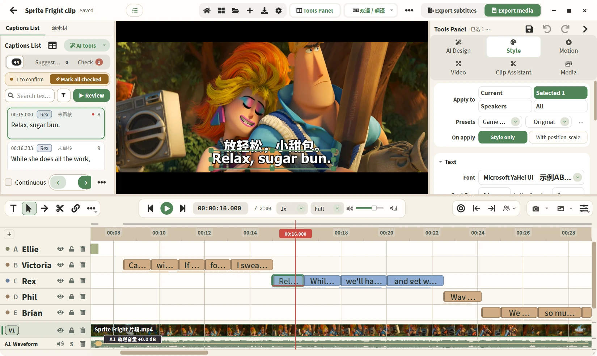

Örnek film: [Sprite Fright](https://studio.blender.org/films/sprite-fright/) © Blender Foundation · [CC BY 4.0](https://creativecommons.org/licenses/by/4.0/)

## Özellikler

| Yazıya Dök | Düzelt | Çevir | Düzenle | Dışa Aktar |
| :---: | :---: | :---: | :---: | :---: |
| Yerel veya bulut | Modelleri karşılaştır | İki dilli altyazılar | Kelimeye göre böl | Altyazı veya video |

<table>
<tr>
<td colspan="2" valign="top">
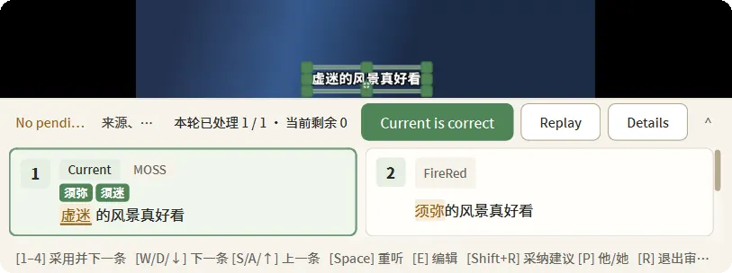

**Modeller farklı mı yazdı? Doğru olana tıklayın** 
Farklılıklar vurgulanır ve hangi modelin ne yazdığını görebilirsiniz.
</td>
</tr>
<tr>
<td width="50%" valign="top">
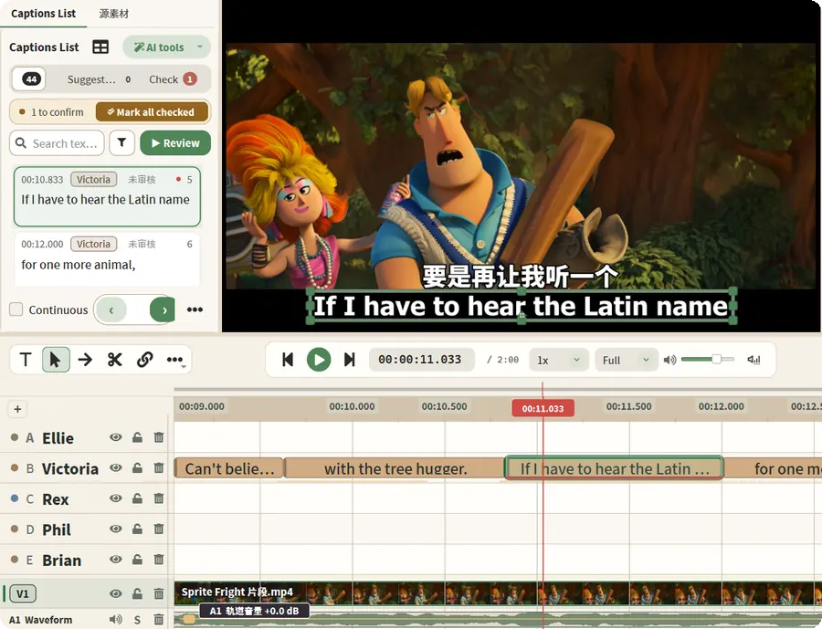

**Jilet yalnızca kelimeler arasından keser** 
Hiçbir kelime ortadan ikiye bölünmez ve çeviri de onunla birlikte bölünür.
</td>
<td width="50%" valign="top">
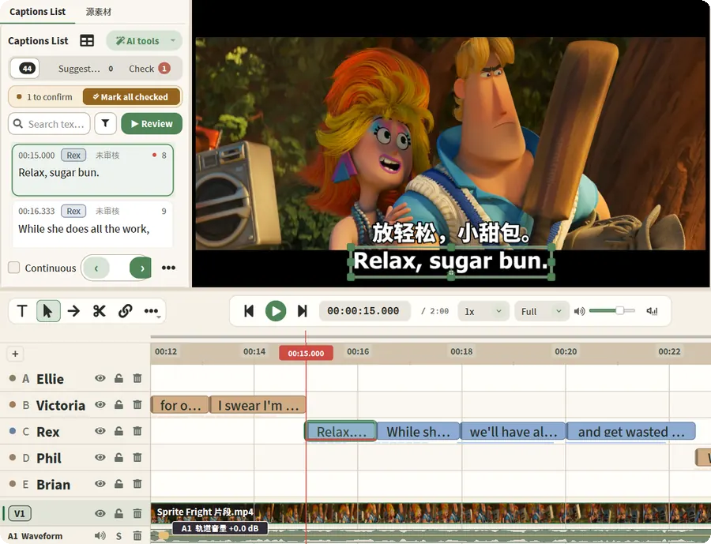

**Tek tıkla iki dilli altyazılar** 
Kendi metin yapay zekanızı kullanır. Kaçırdığı herhangi bir satırı doldurmak için çift tıklayın.
</td>
</tr>
<tr>
<td width="50%" valign="top">
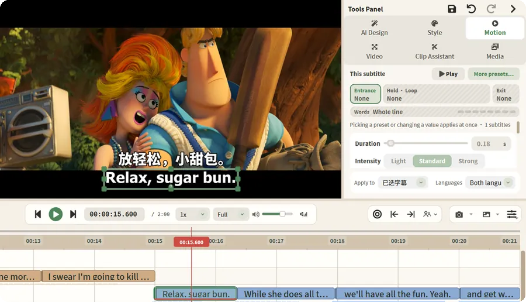

**Düzinelerce altyazı animasyonu** 
Önizlemek için üzerine gelin, süreyi değiştirmek için sürükleyin.
</td>
<td width="50%" valign="top">
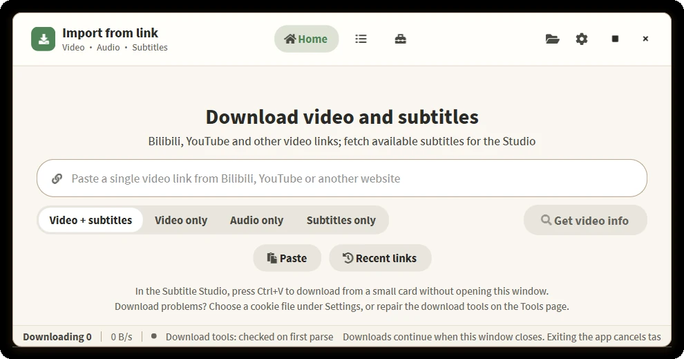

**İndirmek için bir bağlantı yapıştırın** 
YouTube ve Bilibili videolarını altyazılarıyla birlikte indirin.
</td>
</tr>
<tr>
<td width="50%" valign="top">
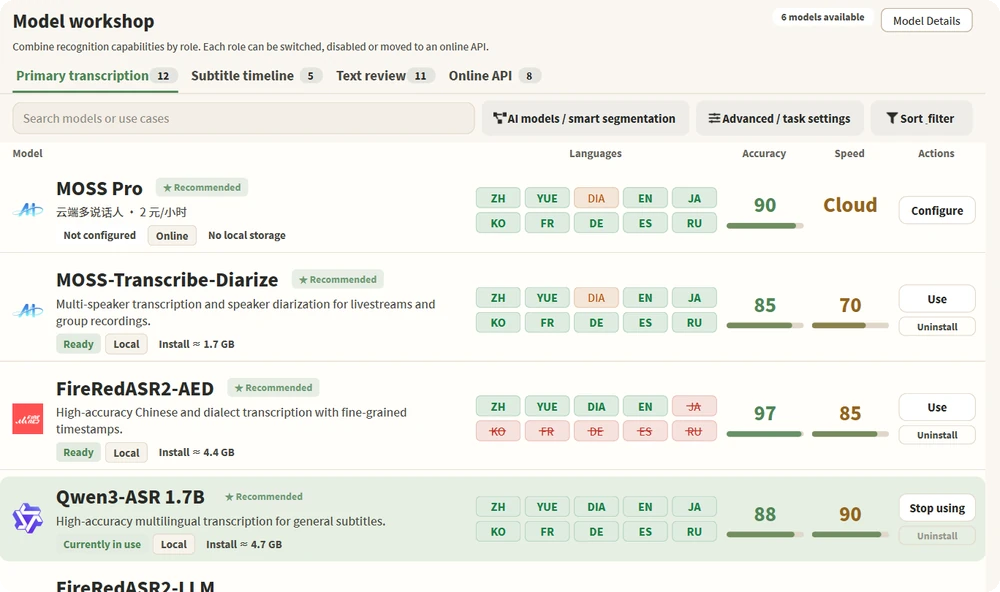

**Model atölyesi: bir model seçin, tek tıkla kurun** 
Dilleri, doğruluğu ve hızı yan yana karşılaştırın.
</td>
<td width="50%" valign="top">
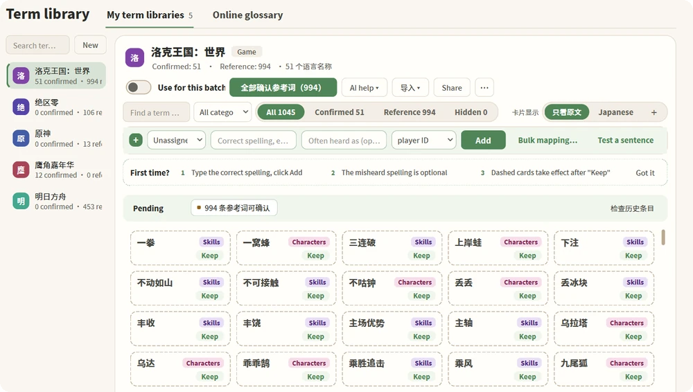

**Terim kitaplığı: karakter adları doğru yazılır** 
Çeşitli oyunlar için terim kitaplıklarıyla gelir ve kendi kitaplığınızı ekleyebilirsiniz.
</td>
</tr>
</table>

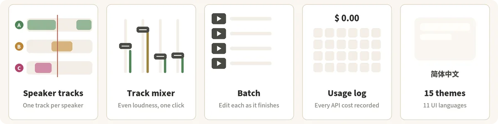

## Altyazılar neden doğrudur

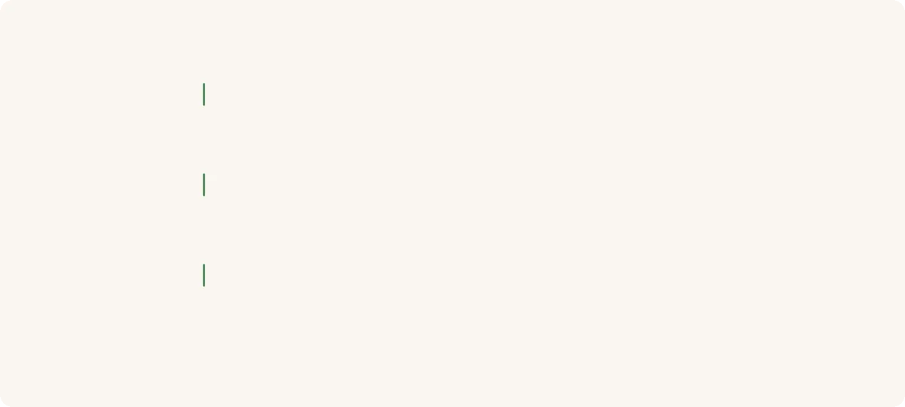

## Yapay zeka ne yapar, ne yapmaz

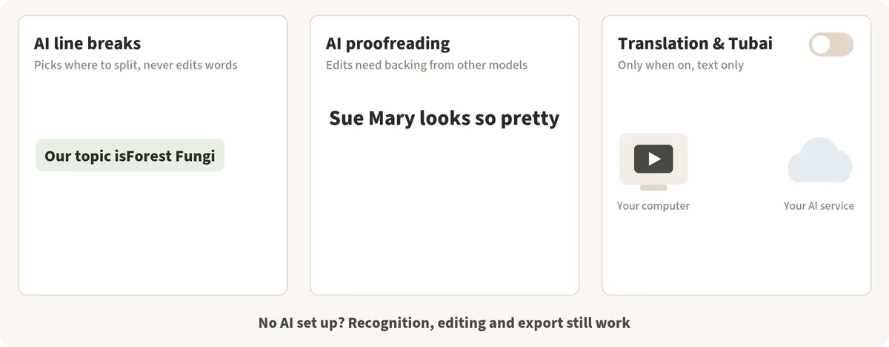

## Tubai'ye Sorun

Stüdyonun köşesindeki tavşan uygulama hakkındaki soruları yanıtlar. “Altyazıları nasıl çeviririm?” diye sorun; size nerede olduğunu gösterir ve sizi oraya götürebilir. Bağlı bir metin yapay zekasıyla altyazılarınızı kontrol edebilir, bir satırı düzeltebilir veya tüm projede bir kelimeyi değiştirebilir. Herhangi bir şeyi değiştirmeden önce sorar ve her değişiklik geri alınabilir.

## Kimler için

| Üzerinde çalıştığınız | Bunu deneyin |
| --- | --- |
| Oyun yayınları ve VOD'lar | Konuşmacı başına bir iz, karakter adları için terim kitaplığı, öne çıkanları bulmak için danmaku |
| Yabancı dildeki videolar | Bağlantı yapıştırın, yazıya dökün, çevirin, iki dilli altyazı dışa aktarın |
| Röportajlar, podcast'ler, dersler | Mevcut bir metni zamanlayın, duraklamaları tek seferde kaldırın |
| Zaten altyazısı olan videolar | Düzeltmek, çevirmek ve yeniden biçimlendirmek için SRT / ASS içe aktarın; model gerekmez |

## İndir

Güncel sürümler **Windows 1.2.0** (2026-11-28) ve **Apple silicon Mac 1.1.2**'dir.

| Bilgisayarınız | İndir |
| --- | --- |
| Windows 10 1809 veya üzeri, 64-bit | [2ByteASR-Setup-1.2.0.exe](https://github.com/NOTBAD314/2ByteASR/releases/download/v1.2.0/2ByteASR-Setup-1.2.0.exe), yaklaşık 1178 MB |
| Apple silicon Mac (M1 veya üzeri), macOS 14 veya üzeri | [2ByteASR-1.1.2-macos-arm64-Setup.dmg](https://github.com/NOTBAD314/2ByteASR/releases/download/v1.1.2/2ByteASR-1.1.2-macos-arm64-Setup.dmg), yaklaşık 592 MB; **deneysel**, Intel derlemesi yok |

Mevcut sürümün üzerine kurulum yapmadan önce çalışmanızı kaydedip çıkın. Windows 0.6.5 veya üzeri uygulama içi güncellemeleri de destekler. Mac'te Uygulamalar klasöründeki uygulamayı değiştirin. [Sürüm notları](https://github.com/NOTBAD314/2ByteASR/releases/tag/v1.2.0) · [GitCode yansısı](https://gitcode.com/Notbad314/2ByteASR/releases/tag/v1.2.0) · [Windows kılavuzu](docs/product-guide.en.md#installing-on-windows) · [Mac kılavuzu](docs/product-guide.en.md#installing-on-mac-experimental). Windows Authenticode ile imzalanmamıştır; Mac Apple tarafından noter onaylı değildir. Kaynak, lisans, bileşen ve imza dosyaları kaynak teslimi, doğrulama ve uygulama içi güncellemeler içindir.

Linux: [Docker 0.8.1 sürümü](https://github.com/NOTBAD314/2ByteASR/releases/tag/v0.8.1-docker.1) kullanılmaya devam etmektedir; bkz. [Derleme ve çalıştırma](README.docker.md).

## SSS

<b>Ücretsiz mi?</b>

Evet. Ücretli özellik yok, kayıt yok. Yalnızca bulut yazıya dökme ve yapay zeka özellikleri, ilgili sağlayıcı tarafından faturalandırılan kendi hesabınızı kullanır.

<b>Videom yükleniyor mu?</b>

Yerel yazıya dökmede hayır. Bulut yazıya dökmede ses seçtiğiniz sağlayıcıya gider. Yapay zeka özellikleri yalnızca altyazı metnini gönderir.

<b>Bilgisayarımda çalışır mı?</b>

| Bilgisayarınız | Önerilen |
| --- | --- |
| NVIDIA GPU'lu Windows | Yerel: konuşmacılar ayrılır, üç model karşılaştırılır |
| NVIDIA GPU'suz Windows | Bulut veya CPU üzerinde hafif yerel seçenek |
| Apple silicon Mac | Yerel veya bulut; 16 GB veya daha fazla bellek önerilir |

Modeller ilk kez yazıya döktüğünüzde indirilir; NVIDIA yüksek kaliteli set yaklaşık 11 GB'tır. Bkz. [Tanıma rotası seçme](docs/product-guide.en.md#choosing-a-recognition-route).

<b>Windows “Bilinmeyen yayıncı” uyarısı mı veriyor?</b>

Yükleyiciler kodla imzalanmamıştır, bu yüzden sistem sizi uyarır. Dosyaları sürüm sayfasındaki SHA256SUMS ile doğrulayabilirsiniz.

## Destek ve geri bildirim

- Beğendiniz mi? Yazarı [Afdian](https://afdian.com/a/2byteasr) üzerinden destekleyebilirsiniz.
- Bir sorun mu buldunuz? Sürümünüz ve bir ekran görüntüsüyle bir [issue](https://github.com/NOTBAD314/2ByteASR/issues) açın.
- Sohbet: [Discord](https://discord.gg/PSuTx9XfV) · QQ grubu 1124254900
- Kod [GPL-3.0](LICENSE) lisanslıdır. Onunla oluşturduğunuz altyazılar ve videolar sizindir. Üçüncü taraf bileşenler: [bildirimler](THIRD_PARTY_NOTICES.md).
- Daha fazlası: [Kullanım kılavuzu](docs/product-guide.en.md) · [API kurulumu](docs/api-setup/README.md) · [Değişiklik günlüğü](CHANGELOG.md) · [Katkıda bulunma](CONTRIBUTING.md)
