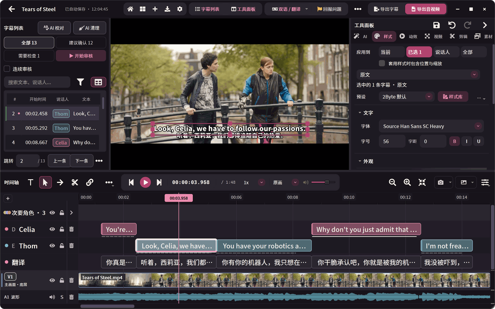
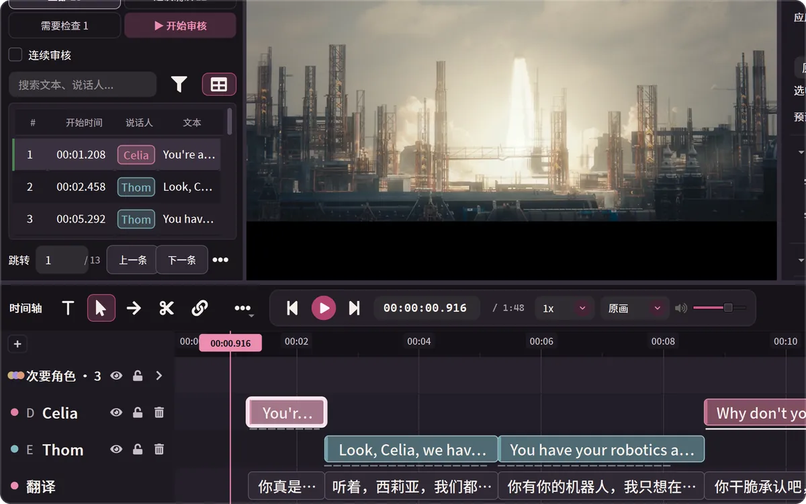
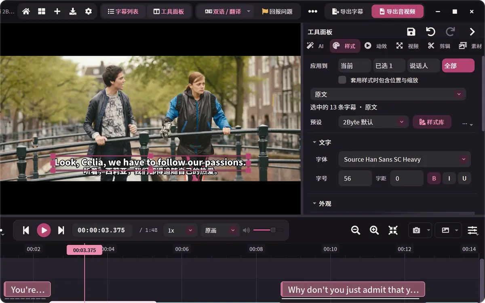
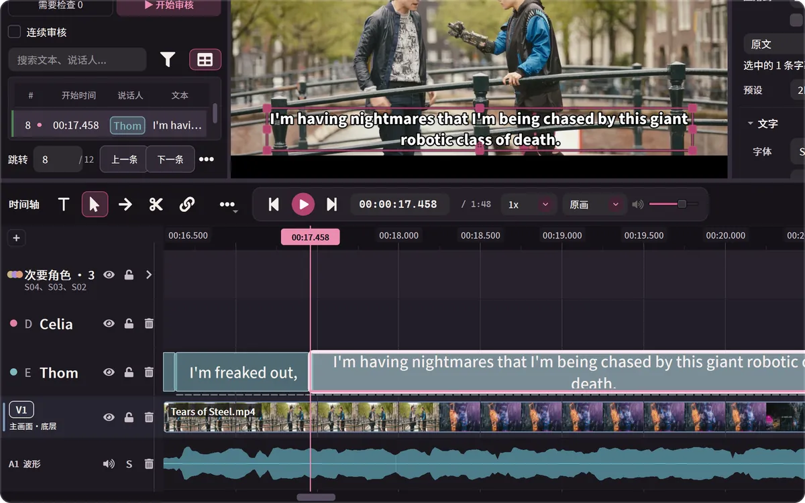
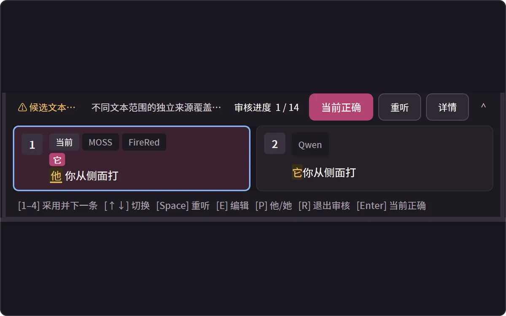
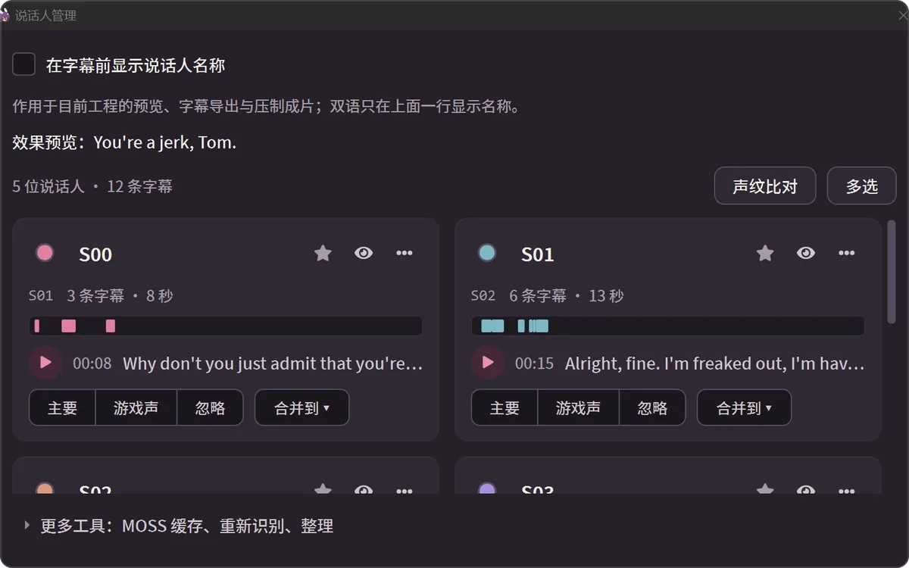
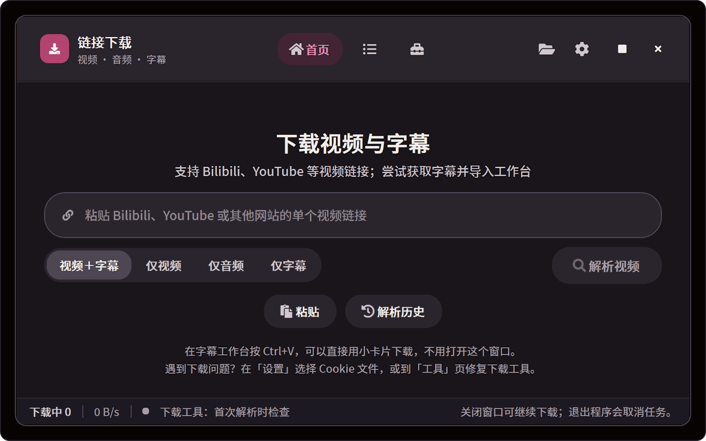
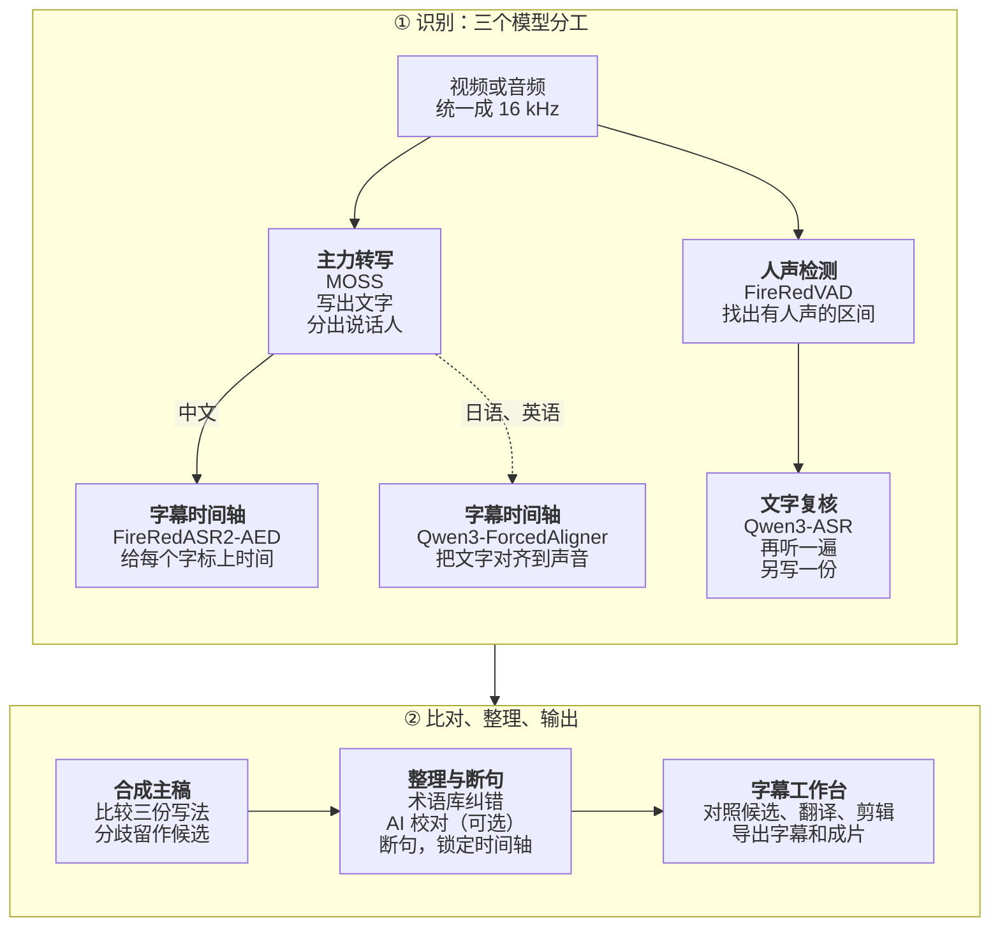

# 兔白字幕 · 2ByteASR

### 字幕剪辑翻译工作台

识别、校对、翻译、剪辑、压制，在一个窗口里做完。 
免费，可以全部在本机运行，也能接入你自己的云端服务。

[English](README.md) · **中文** · [日本語](README_JA.md) · [한국어](README_KO.md)

0.8.7 真实界面截图。示例影片：[Tears of Steel](https://mango.blender.org/) (© Blender Foundation, [CC BY 3.0](https://creativecommons.org/licenses/by/3.0/))，由本机 MOSS + Qwen3-ForcedAligner + Qwen3-ASR 识别（NVIDIA 显卡）。说话人名称在说话人管理里输入，中文译文用工作台的手动补译写入，没有用 AI。

| 识别 | 校对 | 翻译 | 剪辑 | 导出 |
| --- | --- | --- | --- | --- |
| 本机或云端，分清谁在说话 | 多模型候选、术语库、AI 校对 | 原文译文两层，缺译双击补写 | 按字切分，一键删口播停顿 | 字幕文件，或压好字幕的成片 |

## 下载

当前版本 **0.8.7**（2026-10-27；这一版只有 Windows，Mac 仍是 0.8.6）。按你的电脑选一个安装程序：

| 你的电脑 | 下载 |
| --- | --- |
| **Windows 10 1809 或更新（64 位）** 正式版 | **[2ByteASR-Setup-0.8.7.exe](https://github.com/NOTBAD314/2ByteASR/releases/download/v0.8.7/2ByteASR-Setup-0.8.7.exe)**（约 1 GB） 安装程序没有代码签名，Windows 可能提示“未知发布者”，见 [Windows 安装](docs/product-guide.zh-CN.md#windows-安装)。 |
| **Mac：Apple 芯片（M1 及以后），macOS 14 或更新** **实验版** | **[2ByteASR-0.8.6-macos-arm64-Setup.dmg](https://github.com/NOTBAD314/2ByteASR/releases/download/v0.8.6/2ByteASR-0.8.6-macos-arm64-Setup.dmg)**（约 0.5 GB） 只在 GitHub 的虚拟 Mac 上验证过，**不支持 Intel Mac**；没有经过 Apple 公证，第一次打开见 [Mac 安装](docs/product-guide.zh-CN.md#mac-安装实验版)。 |

- **中国大陆下载慢或打不开：** 先从 GitCode 国内镜像下载 [Windows 安装程序](https://gitcode.com/Notbad314/2ByteASR/releases/download/v0.8.7/2ByteASR-Setup-0.8.7.exe) · [Mac 安装包](https://gitcode.com/Notbad314/2ByteASR/releases/download/v0.8.6/2ByteASR-0.8.6-macos-arm64-Setup.dmg)；还不行再用第三方加速站 gh-proxy：[Windows](https://gh-proxy.com/https://github.com/NOTBAD314/2ByteASR/releases/download/v0.8.7/2ByteASR-Setup-0.8.7.exe) · [Mac](https://gh-proxy.com/https://github.com/NOTBAD314/2ByteASR/releases/download/v0.8.6/2ByteASR-0.8.6-macos-arm64-Setup.dmg)。各来源的文件完全相同，可用 `SHA256SUMS.txt` 核对。
- **已经装了 0.6.5、0.7.x、0.8.0–0.8.6：** 在程序右上角“检查更新”，只下载有变化的部分。0.6.0 及更早版本：直接运行新的安装程序覆盖安装，不要先卸载。
- **其他附件不用下载。** [Releases 页面](https://github.com/NOTBAD314/2ByteASR/releases/latest)里的 `Source`、`ThirdParty`、`update`、`.sig` 等文件是给源码、许可材料和程序内更新用的。下载后可用 `SHA256SUMS.txt` 核对文件是否完整。
- **Linux：** 有 [Docker 版 0.8.1](https://github.com/NOTBAD314/2ByteASR/releases/tag/v0.8.1-docker.1)（amd64 / CPU，浏览器中操作原界面，无需 NVIDIA 显卡），见[构建与使用说明](README.docker.md)。

## 你要做的是…

<table>
<tr>
<td width="50%" valign="top">

**游戏实况、直播回放** 
多人对话每人一条字幕轨；术语库记住角色名和招式；结合 B 站弹幕 XML 找值得剪的片段。 
→ [分清谁在说话](#能做什么) · [术语库](docs/product-guide.zh-CN.md#字幕工作台常用操作)

</td>
<td width="50%" valign="top">

**外语视频配中文字幕** 
贴 YouTube、B 站等链接，视频和原字幕一起下载进工程；识别日语、英语，用你的文字 AI 翻成中文，导出双语字幕。 
→ [链接下载](#能做什么) · [翻译与双语](#能做什么)

</td>
</tr>
<tr>
<td width="50%" valign="top">

**访谈、播客、网课** 
已经有文稿时直接对上时间，不改写文字；一键删掉口播停顿；批量替换、简繁转换。 
→ [字幕工作台常用操作](docs/product-guide.zh-CN.md#字幕工作台常用操作)

</td>
<td width="50%" valign="top">

**手上已经有字幕** 
导入 SRT / ASS，校对、翻译、换样式，再重新压进视频。不用先装识别模型。 
→ [输入与输出](docs/product-guide.zh-CN.md#输入与输出)

</td>
</tr>
</table>

## 能做什么

<table>
<tr>
<td width="50%" valign="top">

**翻译与双语** 
用你的文字 AI 翻成简繁中文、英语、日语、韩语等；缺译的地方在译文轨上双击补写。原文和译文各有样式，可导出原文、译文或双语字幕。
</td>
<td width="50%" valign="top">

**样式、动效、压制** 
字体、描边、位置和入场退场动效都有现成预设，不需要 AI；压进 MP4 / MKV / MOV，整段或只导出入点到出点。
</td>
</tr>
<tr>
<td width="50%" valign="top">

**按字（词）切分，顺手剪视频** 
每个字、每个词都有起止时间，剃刀停在字词之间；视频轨上可以分割、波纹删除，或检测口播停顿后一次删掉。
</td>
<td width="50%" valign="top">

**同一句，对照几个模型的写法** 
本机多模型方案会让几个模型各听一遍；写法不同的字标出来，看清来源后点一下（或按 1–4）采用。这里用的是中文示例：这一版只对中文字幕列出候选。
</td>
</tr>
<tr>
<td width="50%" valign="top">

**分清谁在说话** 
支持说话人区分的方案会把每个人放进自己的字幕轨；改名、配色、默认样式在一处管理，分错的可以合并，都能撤销。
</td>
<td width="50%" valign="top">

**贴链接，视频和字幕一起进来** 
YouTube、B 站和下载器（yt-dlp）支持的其他单个视频；在工作台按 Ctrl+V 就能下载到播放头位置。
</td>
</tr>
</table>

还有：术语库与 AI 校对、匹配已有文稿、按说话人分别导出、新手教学（范例工程，不用模型）、11 种界面语言和 15 套主题。详见[使用指南](docs/product-guide.zh-CN.md)。

## 开始前先了解

- **软件免费。** 官方版本免费提供，没有付费功能、注册或订阅。想支持开发，可以到[爱发电](#支持作者)赞助。
- **本机识别需要先下载模型。** 安装程序不包含识别模型。第一次本机识别时，程序会按你选的方案在“模型工坊”下载模型和运行环境（例如 NVIDIA 高质量方案的模型约 11 GB，另加运行环境），之后可以离线识别，影音不离开电脑。
- **云端识别和 AI 功能用你自己的账号。** 云端识别需要服务商账号和 API Key，按服务商的规则收费，音频会上传到你选的服务商。AI 断句、AI 校对、翻译和 AI 建词需要你自己的文字 AI 服务（只发送字幕文字）。不用这些，也能完成识别、编辑和导出。
- **不是每台电脑都能跑每个模型。** 先看下表：

| 你的电脑 | 推荐的识别方式 | 特点 |
| --- | --- | --- |
| Windows，有 NVIDIA 显卡 | **本机识别**：MOSS + FireRedASR2-AED + Qwen3-ASR | 免费、不上传；分说话人，有逐字时间，三个模型可对照 |
| Windows，没有 NVIDIA 显卡 | **云端识别**（自备 API Key），或 **轻量本机**（SenseVoice，用 CPU） | 云端按用量收费、要上传音频；轻量本机免费但较慢，不分说话人 |
| Mac，Apple 芯片（实验版） | **Mac 本机识别**（MLX）、**MOSS + FireRed**（Apple GPU），或云端 | 建议 16 GB 以上内存；比 NVIDIA 显卡慢 |

云端服务里，MOSS Pro 云端和百炼 / Qwen Cloud 的 Qwen-Audio 3.1 能分说话人；云端识别和轻量本机都能加装本机的 Qwen3 对齐模型（可用 CPU），补上逐字时间。详细比较见[选择识别方式](docs/product-guide.zh-CN.md#选择识别方式)。

## 快速开始

1. **安装并启动。** 下载上方对应的安装程序。
2. **选择识别方式。** 第一次启动时选“本机识别”“云端识别”或“轻量本机”，程序会带你下载需要的模型，或打开“申请与设置 API”填写 Key。
3. **导入素材。** 把视频或音频拖进首页，或点“链接下载”贴视频链接；选好词库，点“开始生成字幕”。已有字幕的视频可以直接进工作台。
4. **在字幕工作台里修改、翻译和导出。** 校对文字、切分合并、翻译、调整样式，再导出字幕或压制成片。

想先熟悉界面，可以点右上角“说明 → 新手教学”，跟着范例工程走一遍。安装、费用、更新和常见问题见[使用指南](docs/product-guide.zh-CN.md)。

## 进阶与文档

<b>识别方案是怎么组成的（三种分工与模型列表）</b>

 

一次识别最多有三种分工，按素材和设备组合：

| 分工 | 做什么 | 代表方案 |
| --- | --- | --- |
| 主力转写 | 写出文字；MOSS 还会区分说话人 | MOSS、SenseVoice、Whisper、Qwen3-ASR、云端服务 |
| 字幕时间轴 | 给每个字标上起止时间，断句和切分都沿着字的边界 | FireRedASR2-AED、Qwen3-ForcedAligner（可用 CPU）、Paraformer |
| 文字复核 | 用另一个模型再听一遍，列出写法不同的地方 | Qwen3-ASR 等本地或在线方案 |

- **本机模型：** MOSS-Transcribe-Diarize、FireRedASR2-AED、Qwen3-ASR 1.7B、SenseVoice Small、Paraformer Large、Whisper large-v3-turbo、Fun-ASR Nano、FireRedASR2-LLM、GLM-ASR-Nano、Canary-Qwen-2.5B（英语）、Qwen3-ForcedAligner 0.6B，以及 Mac 上的 MLX 版 Qwen3-ASR。在 Windows 上，MOSS、FireRedASR2-AED、Qwen3-ASR 1.7B 和 FireRedASR2-LLM 需要 NVIDIA 显卡。
- **云端识别（自备账号）：** MOSS Pro 云端（MOSI）、阿里云百炼 / Qwen Cloud 录音文件识别、讯飞 Spark-ASR 2.0、Groq Whisper、OpenAI，以及 OpenRouter、Azure 和自定义兼容接口（进阶，未用真实密钥实测）。只回传句段时间的服务，字幕时间会标为“估算”。
- 模型不随程序附带，在模型工坊按需下载，每个文件都核对 SHA-256，并遵守各自的许可（[模型许可表](licenses/MODELS.md)）。

<b>一段录音是怎么变成字幕的（识别流程）</b>

 

下图是 Windows + NVIDIA 显卡的默认本机方案（MOSS + FireRedASR2-AED + Qwen3-ASR）；虚线是只有日语、英语素材才走的路线。

MOSS 先听完整段，写出文字并分出谁在说话；FireRedVAD 找出真正有人声的区间。FireRedASR2-AED 和 Qwen3-ASR 各自再听一遍，前者给每个字标上起止时间，后者写出另一份文字。软件以 MOSS 的句子和说话人为骨架比较三份写法：只有另外两个模型写法一致、改动又通过安全检查时才自动替换，其余不同的写法留在工作台的审核模式里由你决定。之后按术语库纠错，再交给你配置的文字 AI 校对（可选）；断句可以用本地规则或 AI，但 AI 只决定在哪里断开、不能改字。

换成其他方案时，分工不变：云端识别由服务商写出文字，逐字时间可以用本机的 Qwen3-ForcedAligner 补上；轻量本机（SenseVoice）只做主力转写；Mac 用 MLX 版 Qwen3-ASR 加对齐模型，或在 Apple GPU 上跑 MOSS + FireRed。

- [使用指南](docs/product-guide.zh-CN.md)：安装、第一次启动、选择识别方式、费用与隐私、工作台常用操作、更新、常见问题、从源码运行
- [界面一览](docs/product-demo.zh-CN.md)：识别进度、完成页、模型工坊、导出、主题等更多截图（0.7.1 界面）
- [申请与设置 API](docs/api-setup/README.md)：各家云端识别和文字 AI 的申请步骤与费用说明
- [Mac 实验版说明](docs/deployment/macos-experimental.zh-CN.md) · [更新方式](UPDATING.md) · [0.8.7 发布说明](docs/releases/0.8.7.md) · [更新日志](CHANGELOG.md) · [参与贡献](CONTRIBUTING.md)

## 支持作者

如果兔白字幕帮到了你，可以在爱发电支持作者继续开发：**[afdian.com/a/2byteasr](https://afdian.com/a/2byteasr)**。赞助完全自愿，不赞助也能使用全部功能。

## 反馈、许可与第三方组件

遇到问题请到 [Issues](https://github.com/NOTBAD314/2ByteASR/issues) 反馈，附上版本、所用的识别方案、复现步骤和截图。 
Discord 交流群：https://discord.gg/PSuTx9XfV · QQ 交流群：1124254900

项目自有代码采用 **GPL-3.0-only**（[标准英文全文](LICENSE) / [适用范围](PROJECT_LICENSE.md)）。官方版本免费提供；允许依 GPL 商用、修改和收费分发，分发时须履行对应源码等条件。私人修改无需公开，普通字幕、视频和图片不会仅因使用本软件生成而自动适用 GPL。第三方组件保留各自许可：高保真渲染用到的 Remotion 对个人和员工不超过 3 人的营利组织免费，更大的营利组织需另购其 Company License；GSAP 采用其标准条款。详见[第三方说明](THIRD_PARTY_NOTICES.md)与[模型许可表](licenses/MODELS.md)，完整安装包的分发材料仍在整理中（[分发状态](licenses/DISTRIBUTION-STATUS.md)）。

源码：`main` 分支是程序源码；与 0.8.7 安装包对应的构建来源是 tag `v0.8.7`，完整构建输入在 Release 的 `2ByteASR-Source-0.8.7.zip`（说明见 [0.8.7 发布说明的“源码与校验”](docs/releases/0.8.7.md#源码与校验)）。[源码交付记录](SOURCE_DELIVERY.md)写于 0.5.0 阶段，尚未按 0.8.7 更新。
