

# 兔白字幕 · 2ByteASR

### 免费的字幕软件，识别、校对、翻译、剪辑、导出一次做完

Windows 和 Mac 都能用，有 NVIDIA 显卡可以全程离线。

[下载 1.2.0](#下载) · [功能](#功能) · [常见问题](#常见问题) · [使用指南](docs/product-guide.zh-CN.md)

[English](README.md) · **中文** · [日本語](README_JA.md) · [한국어](README_KO.md)

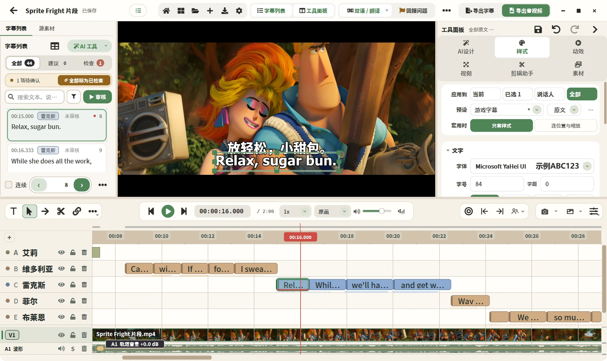

示例影片：[Sprite Fright](https://studio.blender.org/films/sprite-fright/) © Blender Foundation · [CC BY 4.0](https://creativecommons.org/licenses/by/4.0/)

## 功能

| 识别 | 校对 | 翻译 | 剪辑 | 导出 |
| :---: | :---: | :---: | :---: | :---: |
| 本机或云端 | 多模型对照 | 双语字幕 | 按字切分 | 字幕或成片 |

<table>
<tr>
<td colspan="2" valign="top">
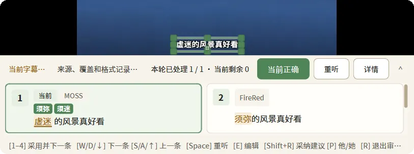

**几个模型写得不一样？点一下选对的** 
不同的字会标出来，还能看到是哪个模型写的。
</td>
</tr>
<tr>
<td width="50%" valign="top">
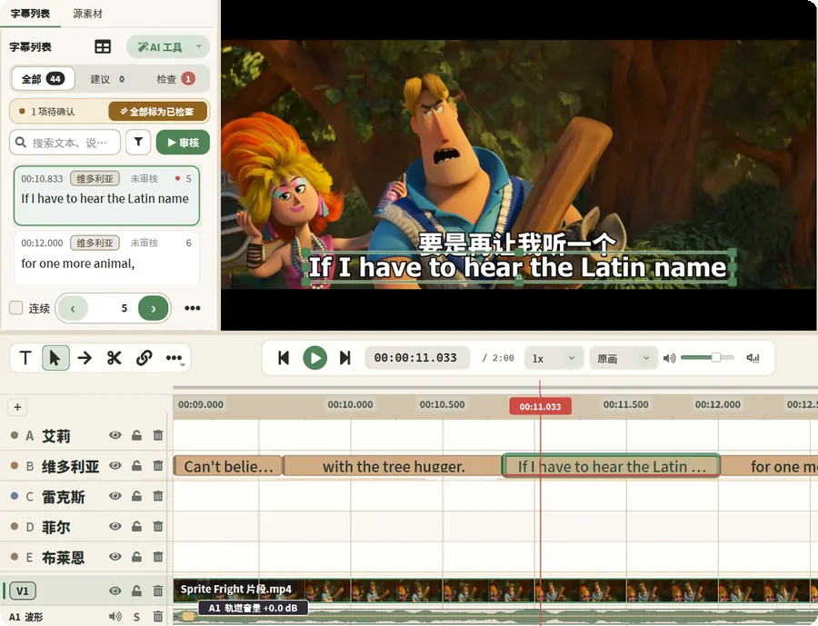

**剃刀只切在词和词之间** 
不会把一个词切成两半，译文也跟着分开。
</td>
<td width="50%" valign="top">
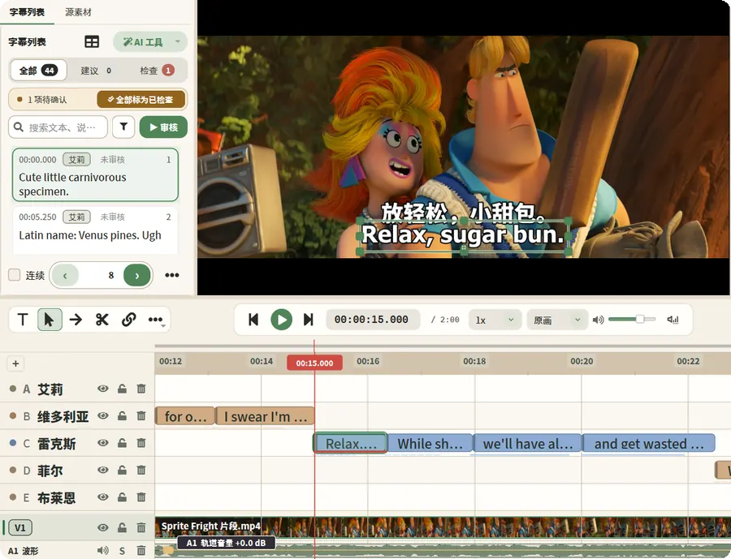

**一键翻译成双语字幕** 
用你自己的文字 AI，漏译的句子双击就能补。
</td>
</tr>
<tr>
<td width="50%" valign="top">
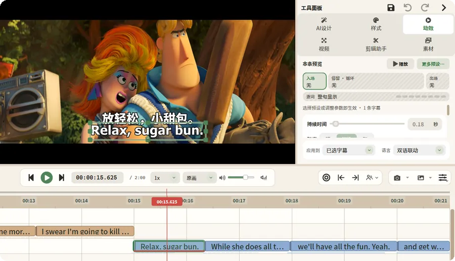

**几十种字幕动效** 
鼠标移上去就能预览，时长拖一下就能改。
</td>
<td width="50%" valign="top">
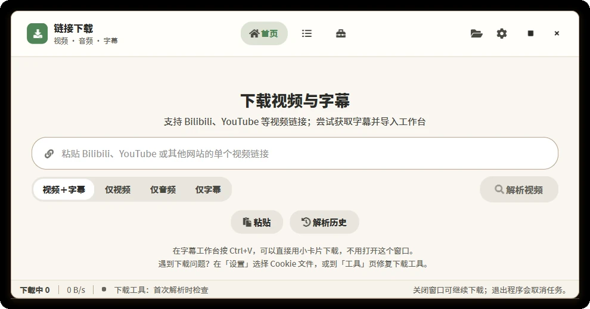

**贴链接就能下载** 
YouTube、B 站的视频连同字幕一起下载。
</td>
</tr>
<tr>
<td width="50%" valign="top">
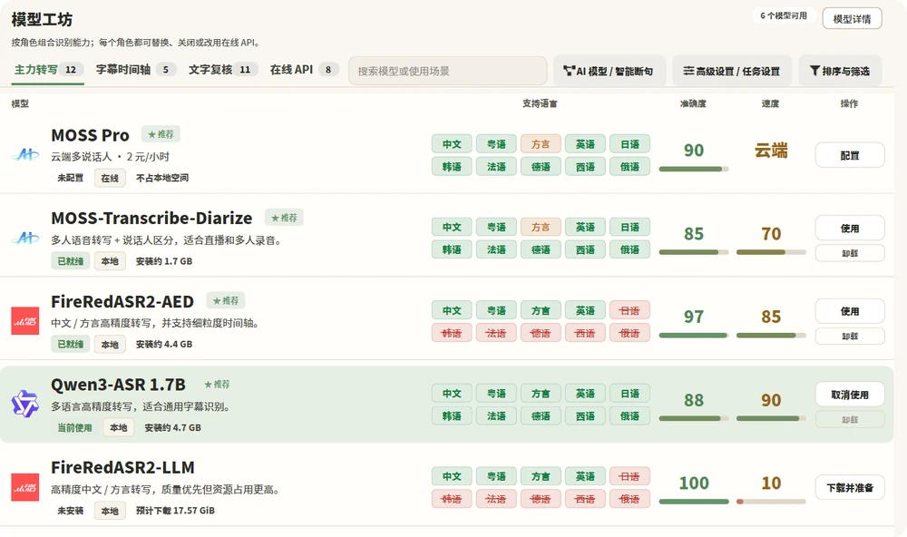

**模型工坊：挑模型、一键安装** 
每个模型支持哪些语言、准不准、快不快，一眼就能比较。
</td>
<td width="50%" valign="top">
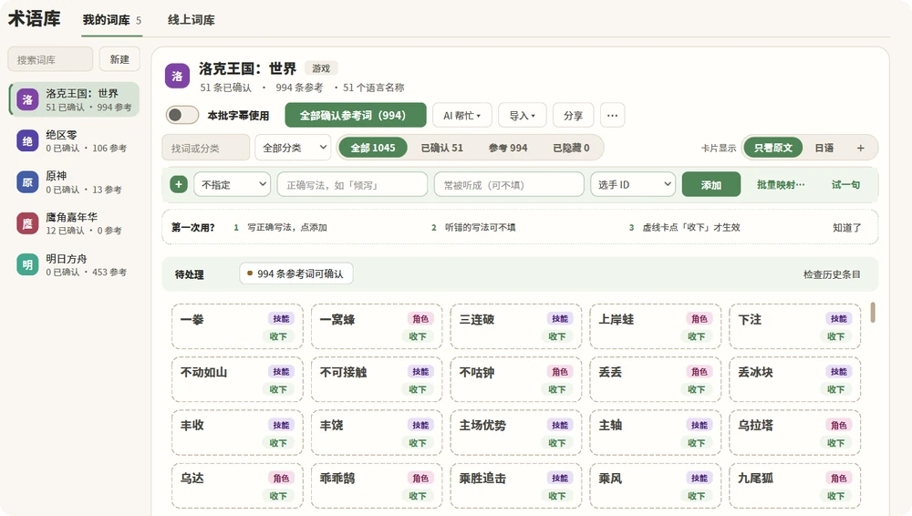

**术语库：角色名不再写错** 
自带多款游戏的词库，也能自己加词。识别和翻译时都会用上。
</td>
</tr>
</table>

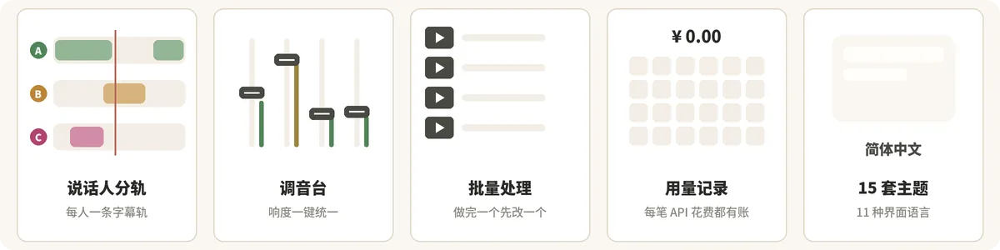

## 字幕为什么准

## AI 做什么、不做什么

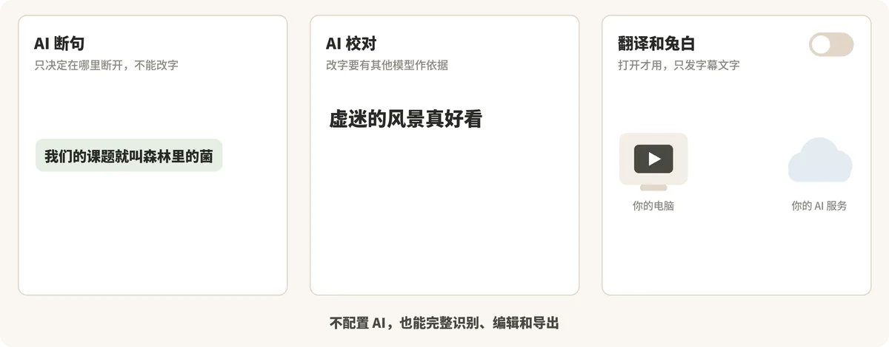

## 不会用就问兔白

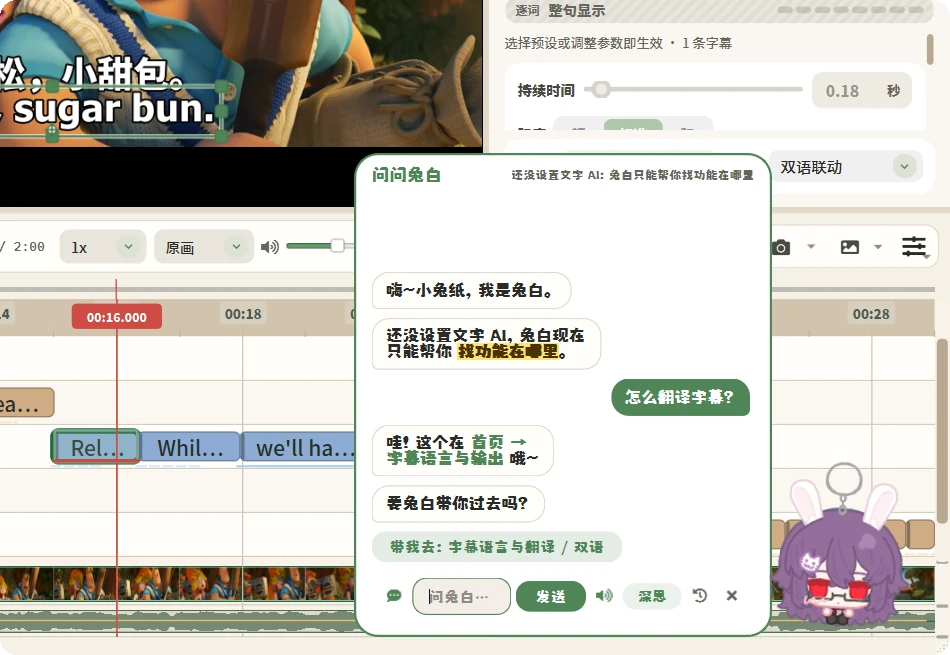

问她“怎么翻译字幕？”，她会告诉你在哪，还能直接带你过去。接上文字 AI 后，她还能帮你检查字幕、改字、批量替换。改之前她会先问你，改错了也能撤销。

## 适合谁

| 你在做 | 可以这样用 |
| --- | --- |
| 游戏实况、直播回放 | 每人一条字幕轨，术语库记住角色名，用弹幕找精彩片段 |
| 外语视频配中文 | 贴链接下载，识别后翻译，导出双语字幕 |
| 访谈、播客、网课 | 已有文稿直接对时间，一键删掉停顿 |
| 已经有字幕 | 导入 SRT / ASS 改字、翻译、换样式，不用下载模型 |

## 下载

当前版本为 **Windows 1.2.0**（2026-11-28）和 **Apple Silicon Mac 1.1.2**。

| 你的电脑 | 下载 |
| --- | --- |
| Windows 10 1809及以上，64位 | [2ByteASR-Setup-1.2.0.exe](https://github.com/NOTBAD314/2ByteASR/releases/download/v1.2.0/2ByteASR-Setup-1.2.0.exe)，约1178MB |
| Apple Silicon Mac（M1及以上），macOS14及以上 | [2ByteASR-1.1.2-macos-arm64-Setup.dmg](https://github.com/NOTBAD314/2ByteASR/releases/download/v1.1.2/2ByteASR-1.1.2-macos-arm64-Setup.dmg)，约592MB；**实验版**，不支持Intel Mac |

先保存工程并关闭软件，再直接覆盖安装，不必卸载。Windows 0.6.5及以上也可在程序内检查更新；Mac将应用拖入Applications覆盖。[本版变化、实测范围和校验清单](https://github.com/NOTBAD314/2ByteASR/releases/tag/v1.2.0) · [GitCode大陆镜像](https://gitcode.com/Notbad314/2ByteASR/releases/tag/v1.2.0) · [安装说明](docs/product-guide.zh-CN.md)。Windows安装包未做Authenticode签名，Mac没有Apple公证；请核对SHA256SUMS。Source、许可、组件及.sig附件用于对应源码、校验和程序内更新，通常不必手动下载。

Linux可使用[Docker 0.8.1版](https://github.com/NOTBAD314/2ByteASR/releases/tag/v0.8.1-docker.1)，见[构建与运行](README.docker.md)。

## 常见问题

<b>要钱吗？</b>

不要。没有付费功能，也不用注册。只有云端识别和 AI 功能会用到你自己的账号，按服务商的价格收费。

<b>视频会被上传吗？</b>

本机识别不会。用云端识别时，音频会发给你选的服务商；AI 功能只发字幕文字。

<b>我的电脑能用吗？</b>

| 你的电脑 | 推荐 |
| --- | --- |
| Windows，有 NVIDIA 显卡 | 本机识别：分说话人，三个模型对照 |
| Windows，没有 NVIDIA 显卡 | 云端识别，或用 CPU 跑的轻量本机识别 |
| Apple 芯片 Mac | 本机识别或云端识别，建议 16 GB 以上内存 |

模型第一次识别时再下载，NVIDIA 高质量方案约 11 GB。详见[选择识别方式](docs/product-guide.zh-CN.md#选择识别方式)。

<b>安装时提示“未知发布者”？</b>

安装包没有做数字签名，所以系统会提示。可以用 Release 页面里的 SHA256SUMS 核对文件。

## 支持与反馈

- 觉得好用，可以在[爱发电](https://afdian.com/a/2byteasr)支持作者。
- 遇到问题到 [Issues](https://github.com/NOTBAD314/2ByteASR/issues) 反馈，附上版本和截图。
- 交流群：[Discord](https://discord.gg/PSuTx9XfV) · QQ 群 1124254900
- 代码采用 [GPL-3.0](LICENSE)，用它做出来的字幕和视频归你。第三方组件见[第三方说明](THIRD_PARTY_NOTICES.md)。
- 更多文档：[使用指南](docs/product-guide.zh-CN.md) · [申请 API](docs/api-setup/README.md) · [更新日志](CHANGELOG.md) · [参与贡献](CONTRIBUTING.md)
