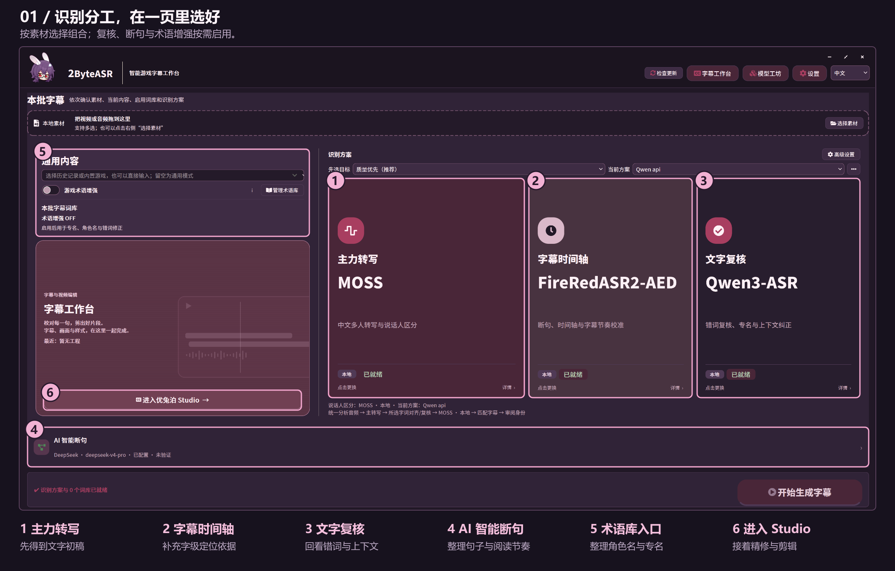
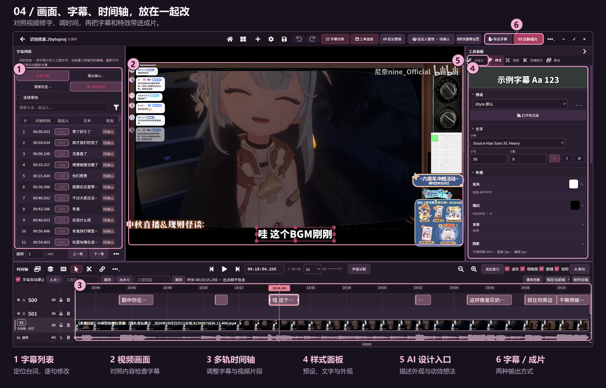
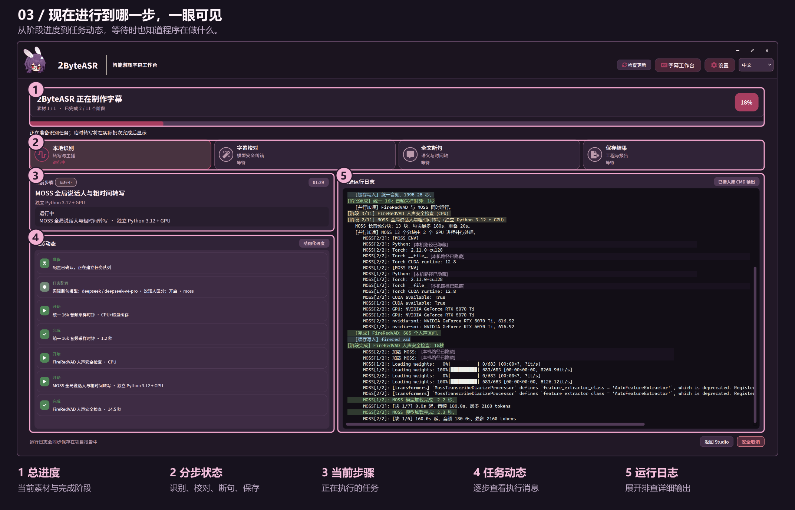
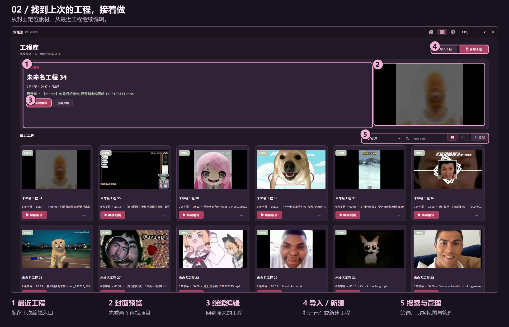

# 2ByteASR · 图文介绍

[HTML 产品介绍页](index.html)可在下载仓库后直接打开；[返回 README](../../README.md)。

## 识别方案

## Studio 精修

## 运行进度

## 工程库

四张图片来自用户提供的真实界面。标注只说明可见区域，未改变原有控件与运行状态；运行日志中的本机路径已隐藏。

[无标注识别图](assets/originals/recognition.png) · [无标注Studio图](assets/originals/studio.png) · [无标注进度图（路径已隐藏）](assets/originals/progress.png) · [无标注工程库图](assets/originals/library.png)
