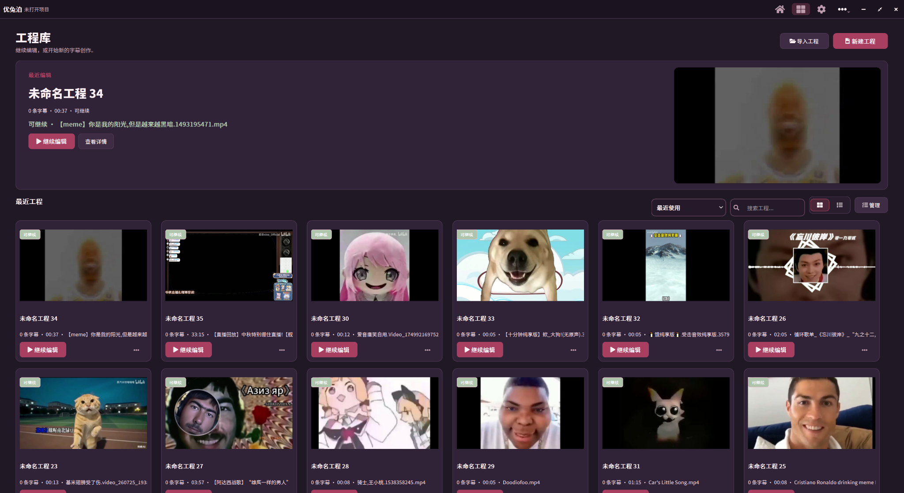
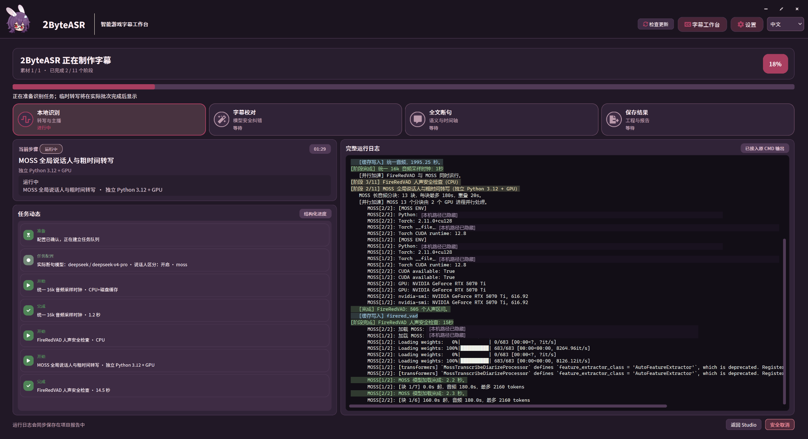

# 2ByteASR 图文介绍

[返回完整 README](../../README.md) · [HTML 介绍页](index.html) · [单文件离线审阅版](../overview-review.html)

GitHub 显示 HTML 源码。下载 `docs/overview-review.html` 后可离线打开；完整网页目录为 `docs/overview/`，请连同 CSS、JS、assets 一起保留。单文件中的外部文档链接仍需网络和仓库访问权限。

## 识别方案

转写、时间定位和复核各有分工，模型组合与 AI 辅助步骤按需选择。

## Studio 字幕与视频编辑

对照画面校对文字与起止，组织视频片段并输出。图中呈现编辑总览，字级操作需要工程具有相应时间信息。

辅助界面：工程库与任务进度

截图来自用户提供的真实界面，未重绘控件或修改运行状态。保留[识别原图](assets/originals/recognition.png)和[Studio 原图](assets/originals/studio.png)。
