# 兔白字幕 2ByteASR 1.2.0（Windows x64）

语言 · Language · 言語 · 언어　**[简体中文](#简体中文)** · [English](#english) · [日本語](#日本語) · [한국어](#한국어)

<b>简体中文</b>

## 简体中文

### 下载

| 你的电脑 | 下载 | 说明 |
| --- | --- | --- |
| **Windows 10 1809 及以上（64 位）** | [2ByteASR-Setup-1.2.0.exe](https://github.com/NOTBAD314/2ByteASR/releases/download/v1.2.0/2ByteASR-Setup-1.2.0.exe)（约 1178 MB） | 双击安装，或在程序内「检查更新」。 |
| **Mac（Apple 芯片，macOS 14 及以上）** | [2ByteASR 1.1.2 DMG](https://github.com/NOTBAD314/2ByteASR/releases/download/v1.1.2/2ByteASR-1.1.2-macos-arm64-Setup.dmg)（约 592 MB） | 继续使用 1.1.2。实验版，尚未公证。 |

中国大陆可使用 [GitCode 镜像](https://gitcode.com/Notbad314/2ByteASR/releases/tag/v1.2.0)，也可通过 [gh-proxy 下载 Windows 安装包](https://gh-proxy.com/https://github.com/NOTBAD314/2ByteASR/releases/download/v1.2.0/2ByteASR-Setup-1.2.0.exe)。

### 有什么变化（相对 1.1.5）

#### 新增

- **兔白住进了软件里。** 打开软件时她在首页等你，点她才打开对话框，收起对话框她也会留在画面上；可以把她抓起来甩、摸头、拉耳朵。
- **闲着时兔白会自己找事做。** 她会拿扳手敲「AI 设置」的齿轮、翻术语库的书、把一排按钮像骨牌一样推倒、吊在按钮下荡；光标从她头上掠过，她会跳起来扑，抓到就挂在光标上。走路、跳跃和摆弄道具也会发出音效，可在对话框里关掉。
- **兔白跟着你做到哪一步。** 识别时她坐在进度条上报进度，结果页、AI 词库校对和导出视频时会提示下一步；在模型工坊拿放大镜端详模型，在字幕工作台缩小到角落睡觉，不挡时间轴。

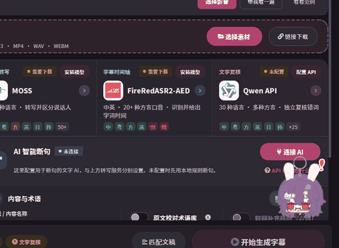
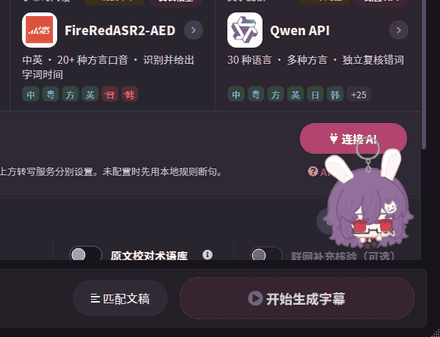

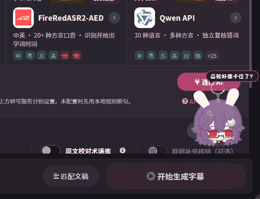
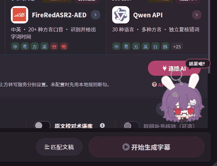

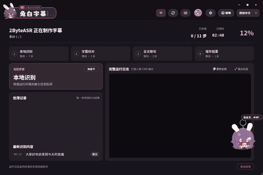
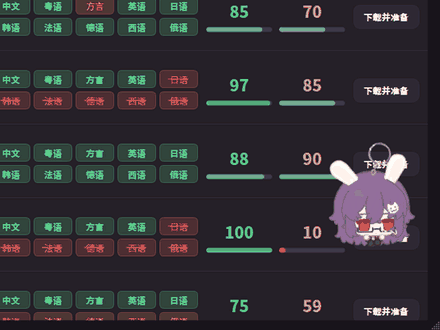

- **新手教学改成「我想……」问题卡。** 六张最常问的大卡加其他小问题，可以搜索，点开就陪你做一次；新增看懂时间轴、选字幕与套用范围、AI 补字幕和修字幕、剪视频入门四课。

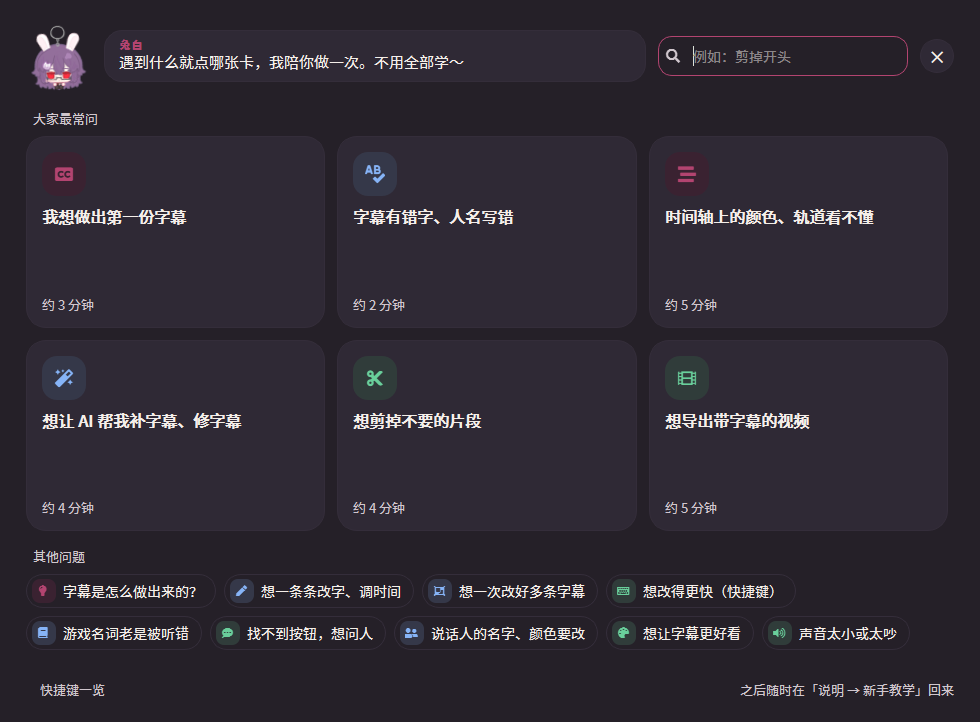

- **字幕工作台可以用 AI 粗剪文稿。** 分三步：挑剪法（找废话、只留高光、剪背景人声）、试听剪口、确认剪掉；某一类剪口可以先停用，剪完也能全部还原。
- **「专名与方案」一页处理本片的错词和常用方案。** 重复出现的错词一键全改，新词和人名可以收进本系列的方案卡，打开「新片自动」后下一集直接套用。

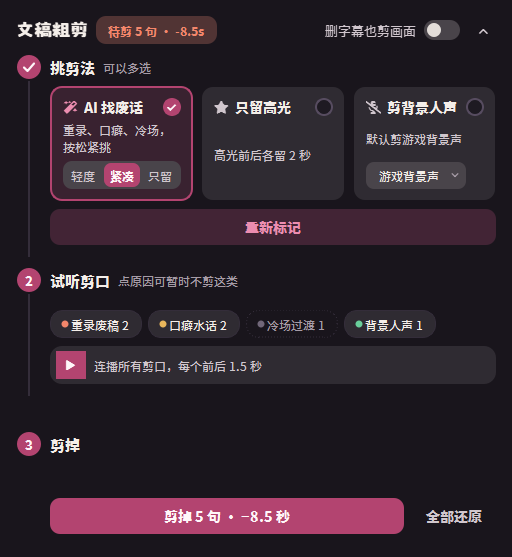
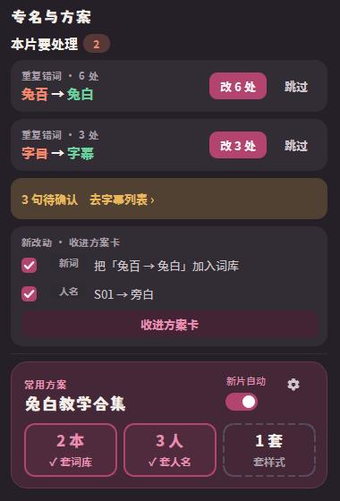

- **双语字幕列表分两行显示，可以单句重翻。** 原文和译文上下对照，哪一句译得不好就只重翻那一句。
- **术语库可以随手贴。** 把一段「错词 → 正确词」直接贴进来就能整理成词条，接了文字 AI 时还会补上常见的同音别名。
- **链接下载换成售票窗口，兔白助手有六步安装引导。** 用四张票选下载视频、音频或字幕；助手引导一步步装进 Chrome、Edge 或 Brave，「我的浏览器」里能看到连接状态。

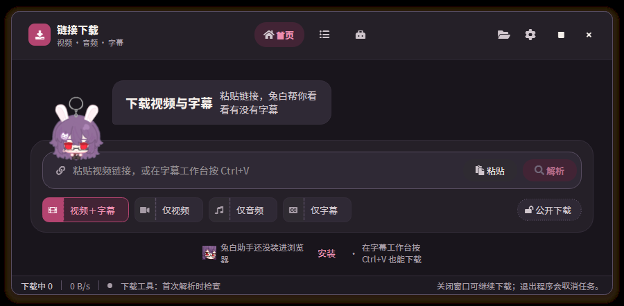
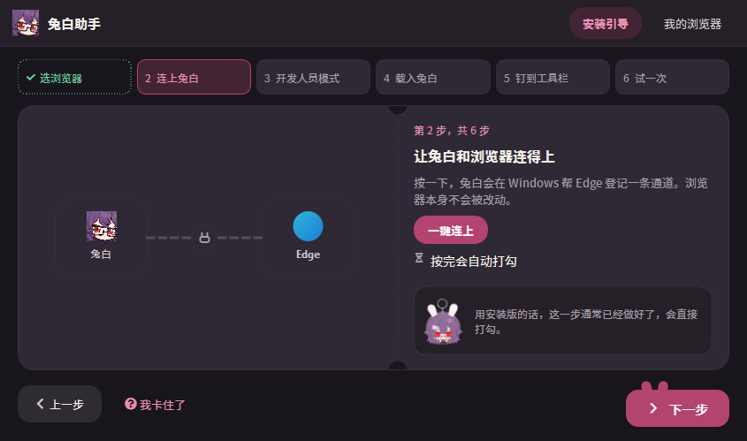

#### 改进

- **封面模板支持大图预览与标题编辑。** 可以填好主副标题，再把模板套到当前画面。
- **模型工坊改善 Haas 日语模型的下载与验证。** 下载后会检查是否可用，回到首页就能选。

- **云端字幕 AI 默认不开深度思考。** 断句和校对更快、更省；需要时可以在高级设置里按服务和模型单独打开，并看到实际用了多少思考 Token。
- **匹配文稿新增「参考纠错」。** 只拿文稿纠正识别错字、不改时间，选中的词可以当场加进词库。
- **字幕样式默认套用到全片，字效预设直接预览效果。** 不用先全选字幕，挑预设时就能看到字动起来的样子。
- **AI 词库校对和说话人管理更顺手。** 校对可以用四个按键快速过一遍、当场改别名；说话人管理能「记住名字」「套用常用名」，Ctrl+Z 可以撤销，已经命名的说话人不会被覆盖。
- **长视频断句重排更快。** 在一个约 45 分钟样本的三个分片上，离线重排总耗时低约 14%，分片输出一致。
- **首页和字体更清爽。** 正文回到思源黑体，按钮点缀猫啃什锦黑；左上角换成「兔白字幕」，语言保护选项收起但照常生效。时间轴轨道多时，在轨道名上滚动滚轮就能上下滑。

#### 修正

- **开软件后一两秒主页排版错乱，左边「字幕工作台」卡被压扁。** 现在启动画面结束时主页已经排好。
- **工作台播放跨过相连剪点时容易停顿。** 现在会直接跳过相连的已删片段。
- **日语断句时间超出原句范围，甚至整片断句失败。** 现在时间限制在原句内，局部拆分不合格时保留原句。
- **日语校对把证据不足的改字也算进待处理数量。**
- **只装了 Qwen3 Ultra 对齐时，匹配文稿仍要求旧版 ForcedAligner 0.6B。**

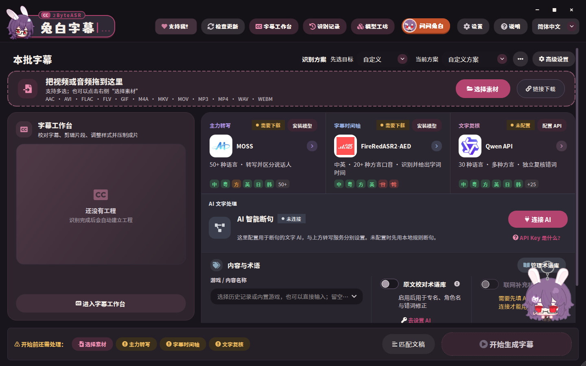

### 已经装过旧版本

- **Windows 1.1.5** 可在程序内「检查更新」，约 **125 MB**，也可保存并退出后运行 Setup 覆盖安装。
- **Windows 0.6.5–1.1.4** 可在程序内更新，下载量取决于已安装的组件。
- **更早的 Windows 版本** 可在保存并退出后直接运行 Setup 覆盖安装。
- 覆盖安装会保留工程、设置、词库、模型和运行环境。

<b>English</b>

## English

### Download

| Your computer | Download | Notes |
| --- | --- | --- |
| **Windows 10 1809 or later (64-bit)** | [2ByteASR-Setup-1.2.0.exe](https://github.com/NOTBAD314/2ByteASR/releases/download/v1.2.0/2ByteASR-Setup-1.2.0.exe) (about 1178 MB) | Run Setup or use Check for updates. |
| **Apple silicon Mac, macOS 14 or later** | [2ByteASR 1.1.2 DMG](https://github.com/NOTBAD314/2ByteASR/releases/download/v1.1.2/2ByteASR-1.1.2-macos-arm64-Setup.dmg) (about 592 MB) | 1.1.2 remains the Mac download. Experimental and unnotarized. |

For mainland China, use [GitCode](https://gitcode.com/Notbad314/2ByteASR/releases/tag/v1.2.0) or [gh-proxy for Windows Setup](https://gh-proxy.com/https://github.com/NOTBAD314/2ByteASR/releases/download/v1.2.0/2ByteASR-Setup-1.2.0.exe).

### What changed since 1.1.5

#### New

- **Tubai lives in the app now.** She waits on the home page, opens her chat when you click her and stays on screen when you fold it. You can pick her up and swing her, pat her head or pull her ears.
- **She keeps herself busy.** She taps the AI settings gear with a wrench, reads the glossary's book, knocks a row of buttons over like dominoes and swings from a button. Sweep the pointer over her head and she leaps for it and hangs on. Walking, jumping and playing with props have sound effects that can be turned off in her chat.
- **She follows your work.** She rides the progress bar during recognition, suggests the next step on the result page, in AI glossary review and in video export, inspects models with a magnifier in the Model Workshop and naps in a corner of Studio, clear of the timeline.

- **A new tutorial built around questions.** Six common "I want to…" cards plus smaller topics, with search. New lessons cover reading the timeline, choosing captions and scope, AI caption repair and basic video cutting.
- **AI transcript rough cut in Studio.** Choose what to cut, audition every cut point, then apply. Each cut reason can be turned off, and everything can be restored.
- **Terms & Schemes.** Fix a repeated misspelling everywhere at once and save new terms and speaker names to the series scheme, which can apply itself to the next episode.
- **Bilingual cue list on two lines, with single-line retranslation.**
- **Paste a list of corrections into the glossary.** It turns them into entries, and with a text AI connected it also suggests common sound-alike aliases.
- **A ticket-booth link downloader and a six-step browser helper guide** for Chrome, Edge and Brave, with a My browsers page that shows each connection.
#### Improved

- **Cover templates have a larger preview.** Enter a title and subtitle before applying the template to the current frame.
- **Improved Haas Japanese model download and validation.** The Model Workshop checks the download before Haas is selectable on the home page.

- **Cloud caption AI no longer uses deep thinking by default**, so it is faster and cheaper. Advanced settings can turn it on per service and model and show the thinking tokens actually used.
- **Script matching can correct recognized text from a reference script** without changing timing, and add selected words to the glossary.
- **Caption styles apply to the whole video by default** and effect presets show a visual preview. AI glossary review has a four-key quick review, and Speaker Manager can remember and reuse common names.
- **Faster regrouping on long videos:** offline regrouping took about 14% less time across three shards of a 45-minute sample, with identical shard output.
- **Cleaner home page.** Body text is back to Source Han Sans, and the timeline track list scrolls with the mouse wheel.

#### Fixed

- **The home page no longer looks broken for a second or two after launch**, and the Studio card on the left is no longer squashed.
- **Studio playback skips adjacent cuts in one jump.**
- **Japanese grouping keeps cue times inside the source line** and keeps the original line instead of failing the whole video.
- **Japanese proofreading no longer counts weakly supported edits**, and script matching accepts Qwen3 Ultra alignment without the old ForcedAligner 0.6B.

### Upgrading

- **Windows 1.1.5** can use Check for updates (about **125 MB**) or run Setup after closing the app.
- **Windows 0.6.5–1.1.4** can update in the app. Download size varies by installed components.
- **Earlier Windows versions** can close the app and install over the existing copy.
- Installing over the existing copy preserves projects, settings, glossaries, models and the runtime.

<b>日本語</b>

## 日本語

### ダウンロード

| 環境 | ダウンロード | 備考 |
| --- | --- | --- |
| **Windows 10 1809 以降（64 ビット）** | [2ByteASR-Setup-1.2.0.exe](https://github.com/NOTBAD314/2ByteASR/releases/download/v1.2.0/2ByteASR-Setup-1.2.0.exe)（約 1178 MB） | インストーラー、またはアプリ内の更新確認をご利用ください。 |
| **Apple シリコン Mac、macOS 14 以降** | [2ByteASR 1.1.2 DMG](https://github.com/NOTBAD314/2ByteASR/releases/download/v1.1.2/2ByteASR-1.1.2-macos-arm64-Setup.dmg)（約 592 MB） | 引き続き 1.1.2 をご利用ください。実験版、公証なし。 |

中国本土では [GitCode](https://gitcode.com/Notbad314/2ByteASR/releases/tag/v1.2.0) または [gh-proxy](https://gh-proxy.com/https://github.com/NOTBAD314/2ByteASR/releases/download/v1.2.0/2ByteASR-Setup-1.2.0.exe) を利用できます。

### 1.1.5 からの変更

#### 新機能

兔白（トゥーバイ）がアプリの中で暮らすようになりました。ホームで待っていて、クリックするとチャットが開き、閉じても画面に残ります。暇なときはレンチで歯車を叩いたり、ボタンをドミノのように倒したり、ポインターに飛びついてぶら下がったりします。歩いたり跳んだりすると効果音が鳴り、チャット画面でオフにできます。認識中は進捗バーに乗り、結果画面や書き出しでは次の操作を案内します。チュートリアルは「〜したい」という質問カード形式になり、検索できます。Studio には AI による原稿の粗編集、二段表示の対訳字幕リスト、一行だけの再翻訳が加わりました。リンクダウンロードは新しいデザインになり、ブラウザー補助ツールは 6 ステップで導入できます。

#### 改善

カバーのテンプレートを大きくプレビューし、タイトルとサブタイトルを入力してから現在のフレームに適用できます。モデル工房で Haas 日本語モデルのダウンロードと検証を改善しました。クラウド字幕 AI は既定で深い思考を使わず、より速く安価になりました。字幕スタイルは既定で動画全体に適用され、エフェクトのプリセットはプレビューで確認できます。約45分のサンプルを3区間に分けたオフライン検証では、再グループ化の合計処理時間が約14%短くなり、各区間の出力は一致しました。

#### 修正

起動直後の 1〜2 秒、ホーム画面のレイアウトが崩れる問題を修正しました。日本語の字幕区切りが元の行の時間を超えたり、動画全体で失敗したりする問題も修正しました。

<b>한국어</b>

## 한국어

### 다운로드

| 환경 | 다운로드 | 안내 |
| --- | --- | --- |
| **Windows 10 1809 이상 (64비트)** | [2ByteASR-Setup-1.2.0.exe](https://github.com/NOTBAD314/2ByteASR/releases/download/v1.2.0/2ByteASR-Setup-1.2.0.exe) (약 1178 MB) | 설치 프로그램이나 앱의 업데이트 확인을 이용하세요. |
| **Apple Silicon Mac, macOS 14 이상** | [2ByteASR 1.1.2 DMG](https://github.com/NOTBAD314/2ByteASR/releases/download/v1.1.2/2ByteASR-1.1.2-macos-arm64-Setup.dmg) (약 592 MB) | 1.1.2를 계속 사용하세요. Apple 공증을 받지 않은 실험판입니다. |

중국 본토에서는 [GitCode](https://gitcode.com/Notbad314/2ByteASR/releases/tag/v1.2.0) 또는 [gh-proxy](https://gh-proxy.com/https://github.com/NOTBAD314/2ByteASR/releases/download/v1.2.0/2ByteASR-Setup-1.2.0.exe)를 이용할 수 있습니다.

### 1.1.5 이후 변경 사항

#### 추가

투바이가 앱 안에서 지냅니다. 홈 화면에서 기다리다가 클릭하면 대화창이 열리고, 대화창을 접어도 화면에 남아 있습니다. 한가할 때는 렌치로 톱니바퀴를 두드리고, 버튼을 도미노처럼 쓰러뜨리고, 마우스 포인터에 뛰어올라 매달립니다. 걷거나 점프할 때 효과음이 나며 대화창에서 끌 수 있습니다. 인식 중에는 진행 막대에 올라타고, 결과 화면과 내보내기에서는 다음 단계를 알려 줍니다. 초보자 튜토리얼은 검색할 수 있는 "~하고 싶어요" 질문 카드로 바뀌었습니다. Studio에는 AI 원고 러프 컷, 두 줄 이중 언어 자막 목록, 한 줄만 다시 번역하기가 추가되었습니다. 링크 다운로드 창이 새로워졌고, 브라우저 도우미는 6단계 안내로 설치할 수 있습니다.

#### 개선

커버 템플릿을 크게 미리 보고 제목과 부제목을 입력한 뒤 현재 프레임에 적용할 수 있습니다. 모델 공방에서 Haas 일본어 모델의 다운로드 및 검증을 개선했습니다. 클라우드 자막 AI는 기본적으로 깊은 사고를 쓰지 않아 더 빠르고 저렴합니다. 자막 스타일은 기본적으로 영상 전체에 적용되고, 효과 프리셋은 미리 보기로 확인할 수 있습니다. 약 45분 분량의 샘플을 세 구간으로 나눈 오프라인 검사에서 자막 재구성 시간이 약 14% 줄었고, 각 구간의 결과는 같았습니다.

#### 수정

실행 직후 1~2초 동안 홈 화면 배치가 흐트러지던 문제를 고쳤습니다. 일본어 자막 나누기가 원래 줄의 시간을 넘거나 영상 전체에서 실패하던 문제도 고쳤습니다.

